# Kata

[](https://github.com/satish-krishna/kata/actions/workflows/ci.yml)
[](https://github.com/satish-krishna/kata/releases)
[](LICENSE)

**A launcher for single, headless coding-agent runs.** You compose a *run-spec* — one precise, reproducible form for a job — and Kata runs it by driving `claude -p` to completion and observing it. The name is deliberate: a kata is a craftsman's drilled form, and a run-spec is exactly that — one exact form that runs identically on your machine, a teammate's, and a CI box.

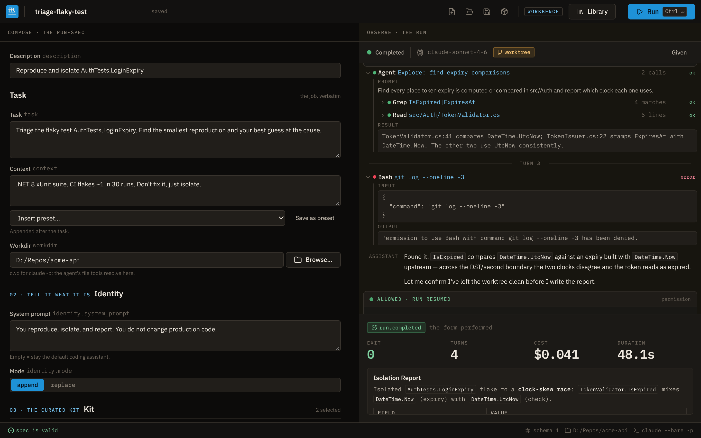

## What Kata is

Kata never owns the agent loop; it *rents* it (via `claude -p`) and controls the edges. A run-spec serializes four decisions plus a leash:

- **The empty room** — `claude --bare` loads nothing by default.
- **Tell it what it is** — an appended (or replacing) system prompt retasks the assistant.
- **A folder of exactly the right skills** — a disposable `--plugin-dir` assembled per run (the "kit").
- **The leash** — cap turns and wall-clock time, optionally contain writes in a git worktree, observe, check the exit code.

The `kata` binary is the single execution path the GUI, the Shokunin orchestrator, and CI all share.

## A look at the Workbench

The Workbench is a desktop app — Layout A: compose the run-spec on the left, observe the run on the right.

| Compose the run-spec | Observe a completed run |
| --- | --- |
| 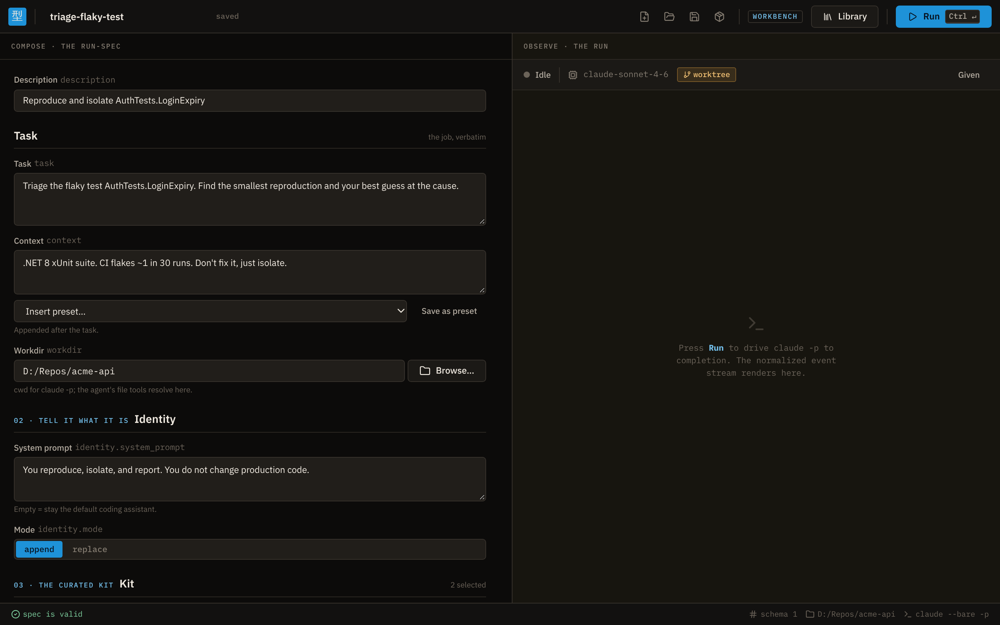 |  |
| **Answer a mid-run question** | **Saved katas & run history** |
| 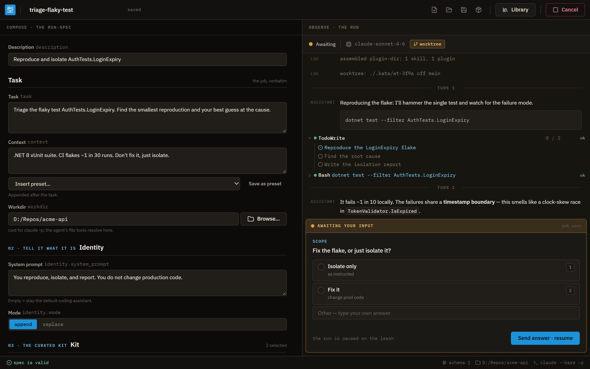 | 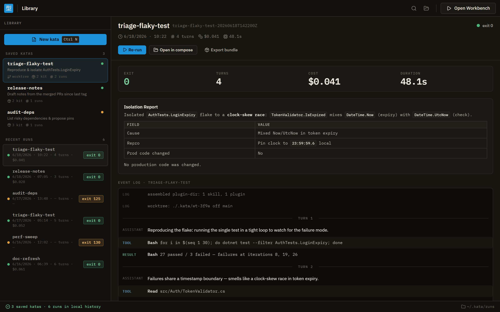 |

Before any run starts, Run opens a preview of what the run will start with: its settings and where each came from, the safety rules, the names of the environment variables it will see, and the hooks, skills, plugins, instructions and tool servers it would load, with a switch on each one that can be left out. After the run, the Observe pane shows what the run was actually given.

## AI-SDLC mode

The same app has a second mode for taking a change from an idea to open pull requests inside a workspace of git repos: one master repo holds the intents, specs, plans, build logs and reviews, and the product repos hold the code they describe. Kata drives the `ai-sdlc` plugin through the same `kata run` path, locks the screen while the agent works, and shows what a stopped run left behind before anything is discarded. Pick the mode on first launch and switch any time from the toolbar.

The workspace home lists your workspaces (add or remove one, switch between them) and each system's changes; the AI-SDLC settings dialog holds the mode's own preferences. One change has one page, and it follows the change through these steps:

- **Start.** New change takes a description and a track. With `ai-sdlc` 0.13.0 or later, "Let the workflow decide" triages the description, says why, and routes it to the light track or the full pipeline; before 0.13.0 only the full pipeline is offered.
- **Intent, spec and plan.** The full pipeline. Each document opens on its own tab, and you accept it (or reject the intent, or send feedback) before the next step. A spec or plan that no longer matches the document above it is marked out of date.
- **Fix.** The light track for a bug or a small enhancement in one repository: one run writes a short intent, spec and plan, which you accept once. It needs `ai-sdlc` 0.13.0 or later.
- **Build.** One agent per repository, several at once, on a build page whose four areas (tasks, activity, changed files, findings) you can arrange; `Ctrl+1` to `Ctrl+4` pick the overview, watch, changes and review arrangements.
- **Changes.** The files each commit on a change branch touched, with a side-by-side diff against the base branch.
- **Review.** One reviewer per repository plus one across them. Findings are grouped by repository and read from the change's `build/review.md`.
- **Done.** Declaring a change done runs your checks, then opens one pull request per touched repository through GitHub's API, the master last.

| The workspace's changes | Triage routes a new change |
| --- | --- |
| 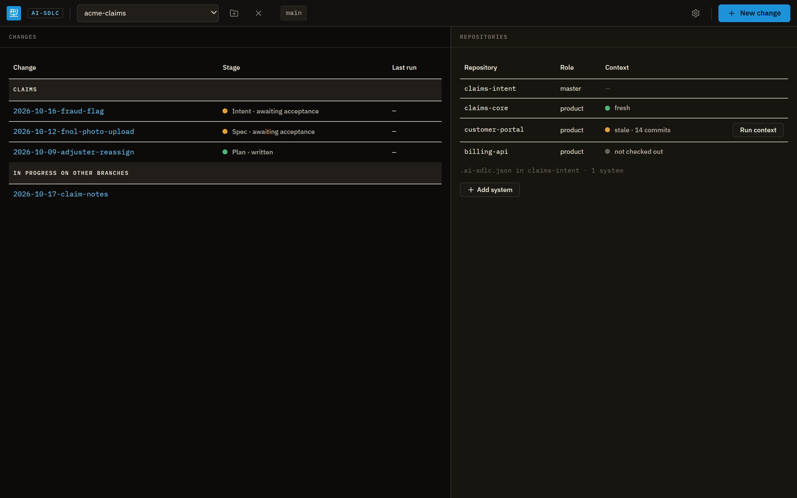 | 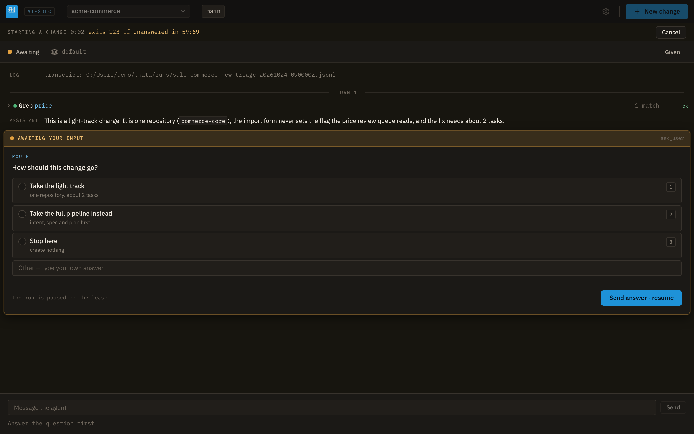 |
| **A light-track fix awaiting acceptance** | **What a run will start with** |
| 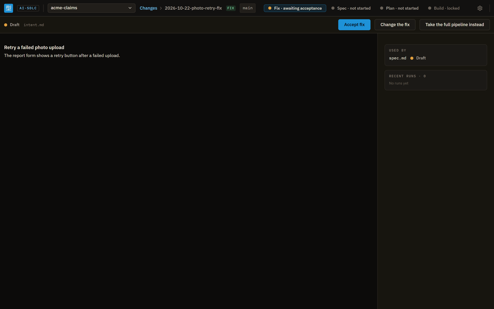 | 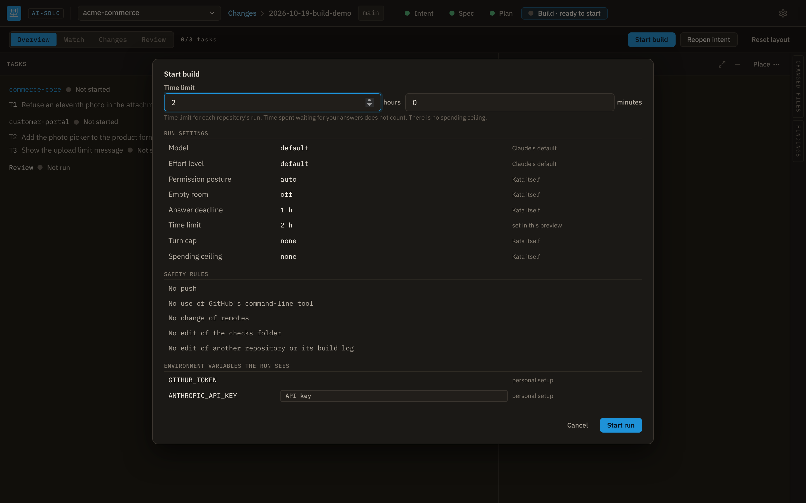 |
| **Watch the build, one agent per repository** | **Review findings by repository, beside the diff** |
| 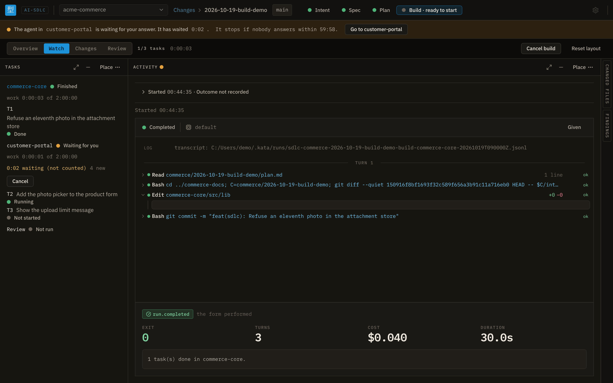 | 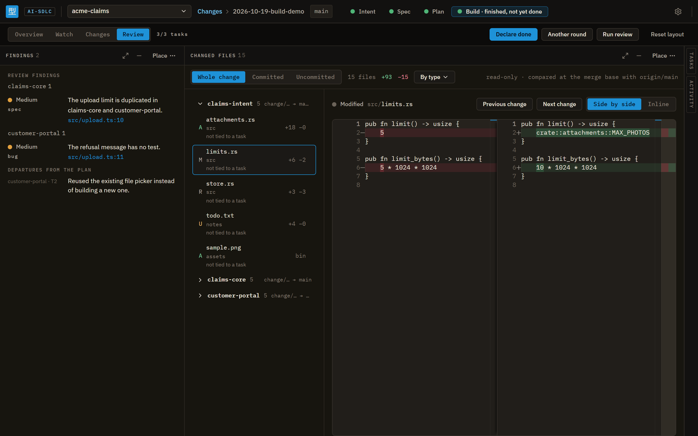 |
| **A run paused on a question** | **Done, with one pull request per repository** |
| 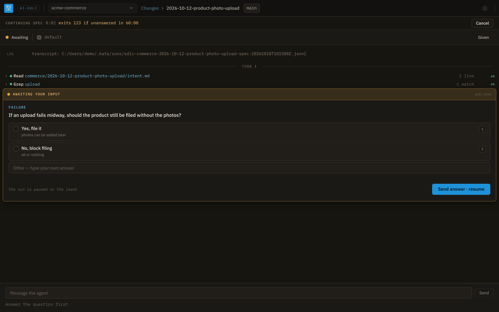 | 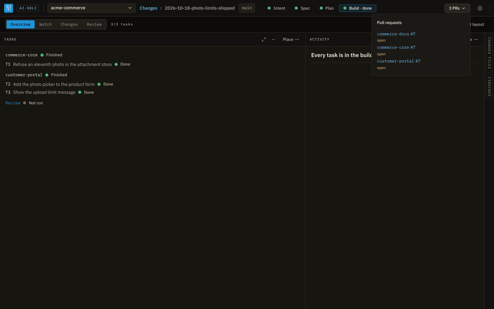 |

### Building a change

Building and declaring a change done have prerequisites beyond an authenticated `claude` on your `PATH`:

- A GitHub sign-in on this machine: Git Credential Manager, or the GitHub CLI's `gh auth login`. Kata finds the sign-in, uses it for the push and the pull request as you, and stores no token. Neither `git` nor `gh` needs to be installed; Kata reads and writes repositories itself.
- The `ai-sdlc` plugin at version 0.9.0 or later (0.13.0 or later for start triage and the light fix track), and Node.js 20 or later on your `PATH`: Kata reads specs, plans, build logs and reviews through the plugin's format program, which runs on Node.

A build runs one agent per repository, inside that repository, with several running at once. Each run has its own time limit. Builds always run under `permissions.mode = "auto"` with deny rules (no `git push`, `gh` or `git remote`, no edits to the checks folder, no edits to another repository's work), whatever permission setting the rest of the app uses, because deny rules do not exist under the default bypass posture.

Checks that judge a change when you declare it done live in `<kata home>/workbench/checks/<system>.toml`, one file per system, outside every workspace so no agent can edit the gate it is checked against. Kata refuses the file when the checks folder and the workspace contain one another. The file is TOML and unknown keys are refused:

```toml
[[checks]]
repo = "api"
name = "unit tests"
argv = ["dotnet", "test", "--nologo"]
timeout_secs = 600

[[checks]]
repo = "product-intent"
argv = ["npx", "markdownlint-cli2", "intent/**/*.md"]
timeout_secs = 120
```

`repo` is required and must be one of the system's repositories or the master repository. `argv` is required, non-empty, and never passes through a shell. `timeout_secs` is required, from 1 to 86,400. `name` is optional and defaults to the joined argv. A missing file means no repository has checks. Any problem fails the whole file with its `file:line:col`, and declaring done runs nothing until it is fixed.

Two costs to know about. Checks are per machine and unversioned: each engineer writes their own file, a new teammate starts with none, and two engineers can declare the same change done against different gates. And the review is only as portable as what was committed: findings are read from `build/review.md` as committed in the master repository, and only when the review wrote none does Kata fall back to the closing words of the review run recorded on this machine.

## Quickstart

### Install

Grab a build from [Releases](https://github.com/satish-krishna/kata/releases) (Windows x64 today):

- **Workbench** — `Kata.Workbench_<version>_x64-setup.exe` (installer) or the `.msi`.
- **CLI** — `kata_<version>_x64.exe`, the standalone engine.

Or build from source (any platform with a Rust toolchain):

```console
$ cargo build --locked --release
$ ./target/release/kata --help
```

A real run needs an authenticated `claude` on your `PATH`.

### Your first kata

Write a run-spec:

Run `kata init` to scaffold a starter run-spec wired to the run-spec JSON Schema — open it in a JSON-Schema-aware TOML editor for autocomplete and inline validation, edit the placeholders, then `kata validate` and `kata run` it.

```toml
# triage.kata.toml
name    = "triage-flaky"
task    = "Find and fix the flaky test in this repo."
workdir = "/repo"
skills  = ["triage-flaky-test"]

[leash]
max_turns    = 12
timeout_secs = 600
```

Run it. Kata drives `claude -p` to completion and streams a normalized, one-object-per-line event protocol on stdout:

```console
$ kata run triage.kata.toml
{"type":"run.started","spec":"triage-flaky","workdir":"/repo","isolation":"none"}
{"type":"assistant.text", ...}
{"type":"tool.use", ...}
{"type":"run.completed","exit_code":0, ...}
```

The CLI has four more verbs: `kata init` (scaffold a starter spec, above), `kata validate <spec>` (pure validation), `kata catalog` (discover installed skills/plugins as JSON), and `kata bundle <spec>` (vendor a portable bundle — see below). `kata run --full-payloads` adds the raw tool input and output to `tool.use` and `tool.result` events, each capped at 256 KB; it is off by default to keep CI logs lean.

Two optional tables shape the child's environment. `[auth]` holds `bare` (the empty room, default `true`) and `token_env`, the name of a host environment variable whose value is forwarded to claude as `ANTHROPIC_API_KEY` under a bare run; the secret itself never enters the spec. `env` sets variables on the claude child (name to literal value) and `env_remove` unsets names, applied last so removal wins; neither touches the host process.

The repository is a Cargo workspace of three crates besides the Tauri backend: `kata-core` (the engine), `kata-cli` (the `kata` binary) and `kata-sdlc` (the AI-SDLC mode's workspace, git and store logic, linked in-process by the Workbench).

## How it works — the edges

Kata's whole job is controlling the four edges around a rented agent loop, then enforcing the leash.

- **The empty room.** Runs start from `claude --bare` (default-on, switchable per run), so nothing leaks in from your ambient `~/.claude` unless the spec asks for it.
- **Retasking.** A system prompt is appended to — or replaces — the default coding assistant, telling the agent what it is for this one job.
- **The kit.** The skills and plugins a spec names are assembled into a disposable `--plugin-dir` for the run, then cleaned up.
- **Permissions.** Every run states outright how claude's permission checks are answered — skipped with `--dangerously-skip-permissions`, handed to Kata's own MCP tool, or handed to claude's own classifier. See [Permissions](#permissions).
- **The leash.** Turn cap, wall-clock timeout, optional git-worktree isolation for writes, and a budget ceiling. The outcome maps to a process exit code so CI and orchestrators can branch on it:

| Exit | Meaning |
| --- | --- |
| `0` | run completed |
| `122` | budget ceiling reached (`leash.max_budget_usd`) |
| `123` | answer deadline exceeded (an unanswered question or permission check) |
| `124` | wall-clock timeout (`leash.timeout_secs`) |
| `125` | turn cap reached (`leash.max_turns`) |
| `130` | cancelled |
| `1` | `kata validate`: spec validation failure; `kata run` also passes claude's own exit code through when no leash trips |
| `2` | spec load/parse error, an invalid spec through `kata run`, or a startup failure |
| `73` | `kata init` refused to overwrite an existing file |

An unset turn cap means unlimited turns, bounded only by the wall-clock timeout. Exit 122 is a post-turn check, so actual spend can overshoot the ceiling by up to one turn.

## Bundling a kata for hand-off

Day-to-day, a run-spec references its skills and plugins by **name** — Kata resolves them from your installed `~/.claude` (and the project's `.claude`) at run time. That's convenient on your own machine, but a bare spec won't run on a box that doesn't already have those skills installed — a CI runner, a teammate's laptop, the orchestrator.

`kata bundle` solves that by *vendoring*: it copies the exact skills/plugins a spec resolves to into a self-contained folder, so the bundle carries everything the run needs.

```console
$ kata bundle triage.kata.toml -o triage-bundle
bundled to triage-bundle
```

The result is a portable folder — the spec, a vendored copy of each resolved skill/plugin under a `.claude/` tree, and a `kata-bundle.toml` marker that records what was vendored and where it came from:

```
triage-bundle/
  kata-bundle.toml          # marker + provenance manifest
  spec.toml                 # the run-spec, copied
  .claude/
    skills/
      triage-flaky-test/
        SKILL.md
```

Hand that folder to any machine and run it by pointing `kata run` at the directory instead of a spec file:

```console
$ kata run triage-bundle
{"type":"run.started","spec":"triage-flaky","workdir":"/repo","isolation":"none"}
{"type":"run.completed","exit_code":0, ...}
```

`kata run` sees the `kata-bundle.toml` marker and runs **hermetically**: it discovers the kit *only* from the bundle's own `.claude`, never the host's `~/.claude` or the target repo's `.claude`. The run depends solely on what the bundle carries, so it behaves identically wherever it lands — which is the whole point of a kata. (Re-bundle with `--force` to overwrite an existing output folder.)

## Permissions

A run's default posture is `--dangerously-skip-permissions`: claude never asks, which is what a headless run wants. That flag is also the first thing a locked-down machine takes away — an admin who sets `permissions.disableBypassPermissionsMode` in managed settings makes claude reject it at startup, and every Kata run on that machine dies before it starts.

`mode = "prompt"` is the route through. Kata writes the spec's `allow`/`deny` rules verbatim into a generated claude settings file, and claude enforces them itself — Kata does not match rules. `--permission-prompt-tool` still points claude at Kata's own MCP tool, but that tool only ever sees a call claude's settings didn't resolve:

```toml
[permissions]
mode      = "prompt"     # "bypass" (default) | "prompt" | "auto"
unmatched = "deny"       # "ask" (default) | "deny" | "allow"
allow     = ["Read", "Grep", "Bash(git *)"]
deny      = ["Bash(rm *)"]
```

This is not a bypass wearing a different hat. Claude checks its settings **before** it would ever call the prompt tool, and before its own built-in auto-approve for read-only commands (`git status`, `git log`, `ls`, `cat`, …) — so a `deny` rule reaches even those, which is exactly what an engine-side matcher never could see. A call the settings resolve, one way or the other, never reaches Kata at all.

`unmatched` decides what happens to a call settings leave unresolved, and it is the choice worth making deliberately: `deny` refuses it (the headless answer — but note `allow` is *not* a complete tool surface on its own; claude has no catch-all deny, so anything not explicitly denied and not caught by `unmatched = "deny"` is still reachable), `ask` pauses the run and puts the call to the operator (which is why it requires `[interactive] enabled = true` — `kata validate` rejects the combination otherwise), and `allow` lets it through too.

Rules use claude's own grammar — `Tool` or `Tool(specifier)`, `*` for any run of characters, a space before the `*` for prefix matching (`Bash(git diff *)` matches any command starting with `git diff`; without the space, `Bash(git diff*)` would also match `git diff-index`) — handed to claude verbatim. `deny` is evaluated before `allow`. Kata's own `ask_user`/`approve_tool` bridge tools are exempt from the rules entirely (`decided_by: "engine"`), so a strict deny policy can't silently switch interactivity off.

`mode = "auto"` hands every call the `allow` and `deny` rules do not resolve to claude's own built-in classifier instead of Kata's `unmatched` policy. The classifier approves routine work and blocks the destructive or externally-reaching call on its own judgment, and its defaults are claude's, since the classifier's tuning is not exposed. `allow` and `deny` are still written to the settings file and enforced by claude first. `unmatched` has no meaning under `auto`, and `validate` rejects `unmatched = "deny"` or `"allow"` under `auto`. The AI-SDLC build always runs under `auto` with generated deny rules.

An `ask` list (`ask = ["Bash(git push *)"]`) is the operator's entry point under `auto`: a matching call is routed to Kata's tool and pauses the run on the operator. Under `prompt` an `ask` rule does not pause by itself, since a call that reaches Kata's tool is settled by `unmatched`, and only `unmatched = "ask"` pauses. A non-empty `ask` list requires `[interactive] enabled = true` under both modes. `allow`, `deny` and `ask` are rejected under `bypass`, since nothing would enforce them.

**Nothing falls back automatically.** A spec that says `bypass` gets `bypass` on every machine, and fails loudly where that is forbidden, rather than quietly running under a different safety posture somewhere else. Changing posture is an edit to the spec.

A `permission.decided` event is emitted only for a check that reaches Kata itself — the `unmatched` policy, the operator, or one of Kata's own bridge tools (`decided_by: "engine"`). A call claude's settings (or its read-only auto-approve) resolved directly is never seen by Kata and produces no event at all, so the event stream is **not** a complete record of every permission check — only of the ones Kata answered:

```console
{"type":"permission.requested","id":"p2","tool":"Bash","input_summary":"rm -rf build/"}
# operator decides on stdin:
decide p2 deny build/ is not yours to delete
{"type":"permission.decided","id":"p2","tool":"Bash","input_summary":"rm -rf build/","allow":false,"decided_by":"operator","message":"build/ is not yours to delete"}
```

## Interactive runs

Any Kata run can pause mid-run and ask the operator a question; the Workbench (or any stdin-connected terminal) answers and the same `claude -p` session resumes with the answer fed back as a tool result.

Every run — whatever `[permissions] mode`, interactive or not — gets a Kata-hosted `ask_user` MCP tool and a retasking note so claude knows to call it at consequential forks, and passes `--disallowedTools AskUserQuestion`. Permission mode governs tool *approval*, not whether the model wants to ask a question: under `bypass` or `auto` claude still reaches for a question tool at a fork, and its built-in one has no UI under `claude -p`, so calling it terminates the session outright. `ask_user` is the channel that survives. claude calls it and blocks; the engine surfaces the question(s) and waits. **There is no automatic answer** — a question always waits on the operator.

```toml
[interactive]
enabled             = true   # default false — lets permission checks pause on you too
answer_timeout_secs = 600    # optional; bounds any operator wait, on any run
```

`enabled` no longer gates questions; it decides whether *permission checks* (`permissions.ask` rules, `unmatched = "ask"`) may also pause on the operator. `answer_timeout_secs` bounds every wait. An unattended run is never stuck on a question: if the engine's answer channel is closed — `kata run` with stdin at EOF, as in most CI — a question ends the run with **123** at once.

**Question kinds** (four, via three `kind` values):

- `confirm` — Yes/No two-button choice.
- `select` with `multi_select: false` — single-choice radio.
- `select` with `multi_select: true` — multiple-choice checkboxes.
- `text` — free-form typed answer.

**The back-channel (extends kata-cli stdin).** Beside `cancel` (and `decide`, which [permission prompting](#permissions) adds), questions add one more shape:

```
answer <id> <json>
```

`<id>` is the correlation id from the `ask.requested` event; `<json>` is the `answers: string[][]` payload — one inner array per question, carrying the chosen label(s) or typed text. `cancel` still works while awaiting (exits 130). A run whose question outlives `answer_timeout_secs`, or that nobody can answer because stdin is closed, exits **123** (nobody answered) — distinct from 124 (work timeout) so CI logs can tell the two apart.

**Worked example:**

```console
$ kata run my-spec.toml
{"type":"run.started","spec":"my-spec", ...}
{"type":"ask.requested","id":"q1","questions":[{"kind":"select","header":"auth","question":"Which auth approach?","options":[{"label":"JWT"},{"label":"session cookie"}],"multi_select":false}]}
# operator answers on stdin:
answer q1 [["JWT"]]
{"type":"ask.answered","id":"q1","answers":[["JWT"]]}
{"type":"run.completed","exit_code":0, ...}
```

## Embedding Kata in another app

Driving Kata from your own software — a GUI, an orchestrator, a CI step — is a first-class use. The `kata` binary is the single execution path the Workbench, the Shokunin orchestrator, and CI all share, and you can build on it two ways: spawn the binary and read its JSON-line events (any language), or depend on the `kata-core` crate and call `run()` in-process (Rust). Both are documented, with the event protocol, the control channel, the exit-code contract, and the full run-spec reference, in **[docs/consuming-kata.md](docs/consuming-kata.md)**.

## The family

Kata sits in a small family of craft-named tools. The shared visual language should let them read as siblings:

- **Shokunin** (職人, "craftsman") — the orchestrator. Runs many forms.
- **Kata** (型, "form") — this product. Defines and performs one exact form.
- **Andon** (行灯 / アンドン) — the line monitor. The factory andon is a stack light (green / amber / red) that signals line status and the cord you pull to stop the line. Kata borrows the andon's stack-light palette for its run-status semantics — that visual rhyme ties the family together.

## Project status & contributing

Kata is under active development — see [ROADMAP.md](ROADMAP.md) for milestone status and [CONTRIBUTING.md](CONTRIBUTING.md) for the workflow. Design specs and plans live in `docs/superpowers/`; architecture notes for working in the codebase are in [CLAUDE.md](CLAUDE.md).

Licensed under [MIT](LICENSE).
