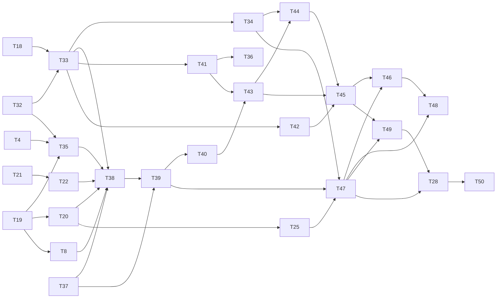

# Plan: Build the plan, review what changed, open pull requests

## Approach

Backend logic lands in `crates/kata-sdlc` as small modules: `pins`, `build` (the plugin's task, dependency and build-log rule, exposed as `sdlc_build_status`), `commits`, `base`, `start` (branches before a build, cleanup after), `diff`, `checks`, `process`, `publish` and `plugin`, plus edits to `changes`, `decide`, `git` and `store`. The Tauri backend changes from one live run to a map of runs keyed by a Workbench run id, wraps each forwarded event as `{ runId, event }`, and refuses a second run in the same working folder and any non-build run during a build. The frontend's `RunStore` and `LockStore` fold and track several runs; a pure `BuildDriver` applies the plugin's "Modes" rule (ready, waiting, stopped, review, stop) to `sdlc_build_status`; the build view shows one row and one observe pane per repository plus the Changes tab on a bundled Monaco diff editor; declare done adds the review gate and the findings. Kata never orders tasks, runs tests, writes build-log rows or reviews code: every run is the ai-sdlc 0.6.0 `build` skill started inside its repository. The kata engine, the run-spec format and the event protocol do not change.

Written against kata `5649745` (branch `feat/ai-sdlc-mode`) and ai-sdlc plugin 0.6.0 (`1e11fe0`). The kata context file is pinned at `7226252` and is 18 product commits stale (spec area of concern 7); where it and the code disagree, the code wins.

This plan replaces the plan written from the previous spec (`e706436`). No task of that plan was built (its build log has no rows). Tasks whose work is unchanged keep their IDs (T4, T8, T9, T18, T19, T20, T21, T22, T25, T28); every task whose work changed with the new spec has a new ID above T30, and T1, T2, T3, T5, T10, T12, T13, T14, T16, T23, T24, T26, T27, T29 and T30 are retired.

### Rules every task follows

- Branch name in every repository: `change/<change folder>`.
- Base branch of a repository (T19): `origin/HEAD`'s target, else `main`, else `master`, each accepted when it exists locally or on `origin`; the base reference is `origin/<base>` when it exists, else local `<base>`.
- Commit headers `<type>(sdlc): <subject>` with the trailer `Generated-By: ai-sdlc` (and `Plan-Task: T<n>`, which the build skill adds). Scope resolution stays in `decide`, made public by T33; nothing copies it.
- Tasks and rows are read only through T32's `build::status`, which follows the plugin's rule; nothing else in Kata parses `plan.md` headings or `build/<repo>.md`.
- Frontend: signals, component-scoped ViewModels, `src/app/ui/` components inject nothing, every template in a sibling `.html` (`shape/no-inline-template`), styles only through CSS custom properties, layout regions as grid in the template, azure accent only on the one primary action, status always dot plus label, Lucide icons through `provideIcons`, dialogs with a title.
- Bindings are regenerated, never hand-edited: `cargo test -p kata-sdlc --features ts export_bindings`.
- Gates green after every task: `cargo fmt --all --check`, `cargo clippy --all-targets -- -D warnings`, `cargo test -p kata-sdlc`; from `app/`: `npm run lint`, `npx stylelint "src/**/*.css"`, `npm test -- --watch=false`, `npm run check:wiring`. UI tasks also run `npm run build`, `npm run check:boot`, `npm run check:interaction`, `npm run check:responsive`. `cargo test --workspace` needs `node app/scripts/stage-sidecar.mjs` first.

### Departures from the spec

- **Forms (operator decision, carried from the previous plan).** The spec says "zod-schema signal forms". `app/CLAUDE.md` says there is no zod. The build dialog uses Angular Signal Forms with Angular's own schema validators (`required`, `min`, `validate`), as `ui/ask-panel.ts` does. No zod dependency is added.
- **Stop reasons.** The spec says the existing `reportStopped` names the reason by exit code. Today it uses the run's result text. T41 adds `stopMessage(exit, error)`; the build view uses it for repository and review runs only, leaving the other stages' toasts unchanged.
- **The house responsive gate.** `check:responsive` stays at 1280 and 1600 for the whole app, as `app/CLAUDE.md` requires. The spec's 375, 768 and 1280 widths are checked for the Changes view and the build view only, in T48's dedicated browser check.
- **mekiki's theme.** mekiki uses Monaco's built-in `vs-dark`. The spec asks for a `kata` theme from Kata's tokens; T25 defines it. That is new code, not a port.
- **The backend's build marker.** The spec says `run_spec` refuses any run outside the build while a build run is live, without saying how the backend knows which runs belong to the build. `run_spec` gains an optional `group` argument (`build:<system>/<change>`), passed by the Workbench next to the run-spec, not inside it, so the run-spec format is unchanged.

## Scenario coverage

| Scenario | Covering test | Task |
|---|---|---|
| R1.1 | `derive_stage_written_plan_awaits_acceptance_r1_1`; `plan-awaiting offers accept, rerun, reopen and no build (R1.1)` | T33 |
| R1.2 | `accept_plan_commits_and_opens_build_r1_2`; `accept plan commits through sdlcDecide (R1.2)` | T34 |
| R1.3 | `derive_stage_superseded_plan_cannot_build_r1_3`; `a superseded plan shows its banner and only Re-run plan (R1.3)` | T33, T34 |
| R1.4 | `derive_stage_broken_pins_are_out_of_date_r1_4` (both example rows); `out-of-date plan and spec banners and actions (R1.4)` | T33, T34 |
| R1.5 | `derive_stage_reopened_intent_or_spec_r1_5` (both example rows); `a reopened intent or spec is named and blocks the build (R1.5)` | T33, T34 |
| R2.1 | `prepare_creates_change_branch_per_plan_repo_r2_1`; `starting a build prepares branches and starts every repository that does not wait (R2.1)` | T35, T45 |
| R2.3 | `build spec has no turn cap and no budget (R2.3)` | T41 |
| R2.4 | `prepare_refuses_repo_outside_system_r2_4`; `prepare_refuses_repo_not_checked_out_r2_4` | T35 |
| R2.5 | `plugin_version_reads_plugin_json_r2_5`; `start refuses a plugin older than 0.6.0 before preparing (R2.5)` | T38, T43 |
| R2.6 | `each repository run carries its own time limit (R2.6)`; `the driver gives every run the time limit the engineer set (R2.6)` | T41, T42 |
| R3.1 | `prepare_state_table_r3_1` (all five rows); `the refusal dialog names the repository and the reason (R3.1)` | T35, T43 |
| R3.2 | `prepare_refuses_dirty_master_r3_2` | T35 |
| R4.1 | `awaiting_does_not_count_against_the_wall_clock_r4_1`; `a repository row shows the waiting clock while its run waits (R4.1)` | T9, T45 |
| R4.2 | `a refused approval reaches only the run that asked (R4.2)` | T40 |
| R4.3 | `build spec denies push, gh and remote edits and strips GitHub tokens (R4.3)` | T41 |
| R5.1 | `build task hands the repository run to the ai-sdlc build skill (R5.1)`; `status_counts_a_committed_row_as_finished_r5_1` | T41, T32 |
| R5.2 | `status_reads_one_row_per_task_from_each_repository_log_r5_2` | T32 |
| R6.1 | `stopMessage maps each exit code (R6.1)`; `a stopped repository shows its reason and Continue, and keeps its commits (R6.1)` | T41, T45 |
| R6.2 | `status_first_unfinished_is_the_first_task_without_a_row_r6_2`; `Continue restarts only the stopped repository (R6.2)` | T32, T42 |
| R6.3 | `leftovers are reported per repository and discard touches only that run's files (R6.3)` | T43 |
| R6.4 | `prepare_asks_before_continuing_on_leftovers_r6_4`; `the change page confirms and retries with leftovers (R6.4)` | T35, T44 |
| R6.5 | `status_a_committed_task_without_a_row_is_unfinished_r6_5` | T32 |
| R6.6 | `unsaved_rows_finds_untracked_and_added_only_logs_r6_6`; `prepare_offers_to_continue_on_an_unsaved_log_row_r6_6` | T32, T35 |
| R6.7 | `a stopped repository does not stop the others (R6.7)` | T42 |
| R7.1 | `whole_change_lists_files_and_line_counts_r7_1`; `changes view lists repositories and opens a file (R7.1)` | T20, T47 |
| R7.2 | `whole_change_marks_uncommitted_files_r7_2`; `the build view's Changes tab marks uncommitted files and keeps everything else locked (R7.2)` | T20, T46 |
| R7.3 | `diff_calls_leave_the_index_byte_identical_r7_3`; `changes view calls only read commands (R7.3)` | T20, T47 |
| R7.4 | `branch_mode_diffs_against_the_merge_base_not_the_base_tip` | T20 |
| R7.5 | `each_kind_of_file_change_is_shown_for_what_it_is_r7_5` (all five rows) | T20 |
| R7.6 | `the_three_parts_select_their_files_r7_6`; `parts toggle switches the listed files (R7.6)` | T20, T47 |
| R7.7 | `local_base_commits_not_on_origin_are_in_the_change_r7_7`; `header names the compared base (R7.7)` | T19, T47 |
| R7.8 | `diff editor folds unchanged regions and steps between changes (R7.8)` | T25 |
| R8.1 | `a round's run carries the instructions inside the picked repository (R8.1)`; `round mode shows the time limit and needs instructions and a repository (R8.1)` | T41, T44 |
| R8.2 | `the review starts by itself and its findings are shown most serious first (R8.2)` | T45 |
| R8.3 | `round mode cannot start without a repository (R8.3)`; `a round's run carries the instructions inside the picked repository (R8.1)` | T44, T41 |
| R8.4 | `a round that adds commits is reviewed again and the old findings are marked replaced (R8.4)` | T45 |
| R9.2 | `done dialog lists departures with the plan's text before confirm (R9.2)` | T49 |
| R9.3 | `status_reads_departures_from_the_rows_and_never_writes_r9_3` | T32 |
| R10.1 | `settle_removes_empty_branch_r10_1`; `touched_repos_skips_repo_without_commits_r10_1` | T35, T8 |
| R11.1 | `declare done runs checks for every touched repository and the master (R11.1)` | T49 |
| R11.2 | `run_repo_stops_at_first_failure_with_tail_r11_2`; `a failed check blocks confirm and shows its last lines (R11.2)` | T22, T49 |
| R11.3 | `a_missing_file_means_no_checks_r11_3`; `no checks counts as passing and says so (R11.3)` | T21, T49 |
| R11.4 | `declare-done only in build-finished (R11.4)`; `declare done is refused while a run is going or edits are uncommitted (R11.4)` | T33, T49 |
| R11.5 | `offenders_lists_commits_without_scope_or_trailer_r11_5`; `an offending commit blocks confirm and offers another round (R11.5)` | T4, T49 |
| R11.6 | `could_not_run_is_not_failed_r11_6` (both example rows); `could not run is amber and says fix the machine (R11.6)` | T22, T49 |
| R11.7 | `build spec denies edits to the checks folder (R11.7)`; `load_refuses_a_folder_inside_the_workspace` | T41, T21 |
| R12.1 | `readiness_table_r12_1` (three rows); `not ready blocks confirm with the reason (R12.1)` | T8, T49 |
| R13.1 | `publish_opens_product_then_master_r13_1`; `pull request list shows a link per repository (R13.1)` | T8, T28 |
| R13.2 | `publish_continues_after_one_failure_r13_2`; `retry is offered when any pull request failed (R13.2)` | T8, T28 |
| R13.3 | `publish_reuses_open_pull_request_r13_3` | T8 |
| R13.4 | `publish_stores_no_credentials_r13_4` | T8 |
| R14.1 | `derive_stage_build_rows_r14_1` (rows 1–3); `change page shows Done when every pull request is open (R14.1)` (row 4) | T33, T28 |
| R14.2 | `status_ignores_an_uncommitted_row_r14_2`; `a repository waiting on an unrecorded task does not start (R14.2)` | T32, T42 |
| R15.1 | `accept_plan_message_uses_scope_and_trailer_r15_1` | T34 |
| R16.1 | `checks_run_in_file_order_and_unnamed_repos_have_none_r16_1` | T21 |
| R16.2 | `checks_file_mistakes_r16_2` (all four rows); `a bad checks file blocks done and says where (R16.2)` | T21, T49 |
| R16.3 | `done dialog lists each repository's checks and the file path (R16.3)` | T49 |
| R17.1 | `switching tabs and repositories makes no transport call (R17.1)` | T46 |
| R17.2 | `events that arrive while on Changes are all shown on return, in order (R17.2)`; the scripted build in `check:build` | T46, T48 |
| R17.3 | `a half-typed answer and the open file survive switching (R17.3)` | T46 |
| R17.4 | `a refresh keeps the open file and shows its latest version (R17.4)` | T47 |
| R17.5 | `the waiting notice names the repository and the countdown and does not switch (R17.5)` (both example rows); the scripted build in `check:build` | T46, T48 |
| R17.6 | `Go to the repository shows its question with focus, and answering clears the notice (R17.6)` | T46 |
| R17.7 | `the notice clears when the waiting run stops, and the stop is reported (R17.7)` | T46 |
| R18.1 | `a repository run starts inside its repository (R18.1)` | T41 |
| R18.5 | `a repository run cannot edit another repository but can write its own log (R18.5)` | T41 |
| R18.6 | `alternating tasks take several runs, all started by the driver (R18.6)` | T42 |
| R19.1 | `independent repositories start together (R19.1)` | T42 |
| R19.2 | `a waiting repository is shown as waiting and starts once its dependency has a row (R19.2)` | T42 |
| R19.3 | `each repository has its own row, status, task and observe pane (R19.3)` | T45 |
| R19.4 | `the waiting repository is flagged in every view while the others keep folding (R19.4)` | T46 |
| R19.5 | `a repository never has two runs at once (R19.5)`; `claim_refuses_a_second_run_in_the_same_folder` | T42, T37 |
| R19.6 | `the build stops with the unfinished tasks by repository when nothing can run (R19.6)` | T42 |
| R20.1 | `done dialog shows the findings most serious first before confirm (R20.1)` | T49 |
| R20.2 | `open findings do not block Open pull requests (R20.2)` | T49 |
| R20.3 | `done needs a finished review of the current heads (R20.3)` (all three rows) | T49 |

Five scenarios describe behavior of the plugin's `build` skill, not Kata: R5.1 and R5.2 (the commits, their trailers and the separate log commit), R6.5 (a committed but unlogged task is recorded, not redone), and R9.3 (a departure is written in its row and the plan is not changed). Kata's share is starting each repository run with that skill (T41) and reading the logs with the skill's own rule (T32), so a task committed but not logged stays unfinished in Kata until the skill records it, and Kata never writes `plan.md` or a build log. Their covering tests assert exactly that share.

## Tasks

### T31: Kata's own design skills point at what exists (`kata`)

- **Depends on:** none
- **Files:** `.claude/skills/kata-design/SKILL.md`; `.claude/skills/house-style/` (root copy).
- **Change:** spec area of concern 17, resolved in the kata repository before anything else is built, because every later task's agent loads these skills. `kata-design/SKILL.md` sends the reader to `readme.md`, `styles.css`, `tokens/`, `components/`, `guidelines/` and `ui_kits/` next to it; point each reference at its real location under `design/design_system/` (check each path exists before writing it). Delete the root `house-style` skill, whose examples show inline `template:` and `styles:` that `shape/no-inline-template` refuses; `app/.claude/skills/house-style/` is the current copy and is what agents working under `app/` load.
- **Tests:** none; this changes agent instructions, not behavior.
- **Done when:** every path `kata-design/SKILL.md` names exists (checked with `ls` per path), `.claude/skills/house-style/` is gone, `grep -rn "template:" .claude/skills` finds no inline-template example, and the commit is the only change.

### T18: Source pins (`kata`)

- **Depends on:** none
- **Files:** create `crates/kata-sdlc/src/pins.rs`; register in `lib.rs`.
- **Change:** `pub fn holds(master: &Path, pin: Option<&str>, upstream_rel: &str) -> bool`, the plugin's rule: `None`, an empty pin, or one starting with `-` is false; otherwise `git -C <master> diff --quiet <pin> HEAD -- <upstream_rel>` exit 0 is true, and exit 1 or any git error (unknown commit, rewritten history) is false. `git::run` already turns a non-zero exit into `Err`. Plus `pub fn spec_pin_holds(master, system, change) -> bool` (spec's `source_intent_commit` against `intent.md`) and `pub fn plan_pin_holds(master, system, change) -> bool` (plan's `source_spec_commit` against `spec.md`), reading the field with `frontmatter::field`.
- **Tests:** in `pins.rs`, failing first because the module does not exist. `pin_holds_when_upstream_is_unchanged`, `pin_fails_after_upstream_changes`, `pin_fails_when_missing_or_unknown` (no field, `deadbeef`, `--output=x`), `pin_ignores_unrelated_commits` (a commit touching another file after the pin still holds). Supports R1.4. Run `cargo test -p kata-sdlc pins`.
- **Done when:** the four tests pass and `--output=x` never reaches git as an option.

### T32: Plan tasks, dependencies and build logs (`kata`)

- **Depends on:** none
- **Files:** create `crates/kata-sdlc/src/build.rs`; register in `lib.rs`. Test fixtures under `crates/kata-sdlc/src/testdata/`: `plan-template.md` copied verbatim from the ai-sdlc plugin's `references/templates/plan.md` (0.6.0), `build-log.md` written to the format in the plugin's `build` skill section 5 (`# Build log: <repo>`, header `| Task | Commits | Departure |`), and one hand-written plan with tasks in `app`, `api` and the master, `Depends on` lines, one task without a `Depends on` line, and a legacy `## Build log` section.
- **Change:** the build skill's reading rule (section 1 step 5 of its `SKILL.md`), by plain line scanning (no regex dependency), and nothing else:
  - `pub struct PlanTask { id, name, repo, depends_on: Vec<String> }`; `pub fn plan_tasks(plan: &str) -> Vec<PlanTask>`: headings `### T<digits>: <name> (`<repo>`)` in document order; the task's first `- **Depends on:**` line gives its dependencies (`none` → empty); a task with no such line depends on every task above it. Any other heading form is ignored.
  - `pub struct BuildRow { task, repo, commits: Vec<String>, departure: Option<String> }`; `fn rows_in(text, repo)`: table rows of a build log, header and separator skipped; commits are the backticked tokens or the comma-separated SHAs; a departure cell `none` (any case) is `None`. The same parser reads a legacy plan's `## Build log` table, whose rows carry a repository column.
  - `pub fn committed_rows(master, system, change) -> Result<Vec<BuildRow>, GitError>`: every file under `intent/<system>/<change>/build/` as committed (`git ls-tree --name-only HEAD -- <dir>/` then `git show HEAD:<path>` per file, never the working tree), plus the committed plan's legacy `## Build log`.
  - `#[serde(tag = "kind")] pub enum RepoState { Ready { task }, Waiting { task, on_task, on_repo }, Done }`; `pub struct TaskStatus { id, name, repo, depends_on, row: Option<BuildRow> }`; `pub struct RepoStatus { repo, first_unfinished: Option<String>, state: RepoState, tasks: u32, finished: u32 }`; `pub struct Departure { task, repo, plan_text, departure }`; `pub struct BuildStatus { tasks: Vec<TaskStatus>, repos: Vec<RepoStatus>, departures: Vec<Departure>, has_tasks: bool }` (all Serialize, TS export, camelCase). `pub fn status(master, system, change) -> Result<BuildStatus, GitError>` reads the committed `plan.md` and rows: a task is finished when any row has its ID; a row whose ID matches no task is ignored; a repository's state is `Ready` when its first unfinished task's dependencies all have rows, `Waiting` naming the first dependency without a row and that task's repository otherwise, `Done` when it has no unfinished task; repositories in first-appearance order. `plan_text` is the task's section text from the plan, for the departures list (R9.2).
  - `pub struct UnsavedRows { repo, tasks: Vec<String> }`; `pub fn unsaved_rows(master, system, change) -> Result<Vec<UnsavedRows>, GitError>`: per build log, `Some` when it is untracked, or when its working text equals the committed text plus added rows and nothing else (CRLF-insensitive). Any other change to a build log is returned as an error naming the file, because the skill would refuse it.
- **Tests:** in `build.rs`, failing first because the module does not exist; fixture repositories from `testutil::repo` and `commit_file`. Run `cargo test -p kata-sdlc build::`.
  - `status_counts_a_committed_row_as_finished_r5_1` covers R5.1's Kata half: a committed `build/app.md` row for T2 makes T2 finished with its commits.
  - `status_reads_one_row_per_task_from_each_repository_log_r5_2` covers R5.2's Kata half: rows in `build/app.md` and `build/api.md` are read together, one per task.
  - `status_first_unfinished_is_the_first_task_without_a_row_r6_2` covers R6.2's Kata half: rows T1 and T2 for `app` → `app` first unfinished T3, `Ready`.
  - `status_a_committed_task_without_a_row_is_unfinished_r6_5` covers R6.5's Kata half: a product commit with `Plan-Task: T3` and no row leaves T3 unfinished.
  - `status_ignores_an_uncommitted_row_r14_2` covers R14.2's Kata half: a T3 row written to the working tree and not committed leaves T3 unfinished and `app2`, whose first task depends on T3, `Waiting { on_task: T3 }`.
  - `status_reads_departures_from_the_rows_and_never_writes_r9_3` covers R9.3's Kata half: a departure cell is returned with the plan's text for its task; `plan.md` and the logs are byte-identical after the call and `git status --porcelain` is unchanged.
  - `unsaved_rows_finds_untracked_and_added_only_logs_r6_6` covers R6.6's Kata half: an untracked `build/app.md` and an added T3 row in `build/api.md` are both found; an edited existing row is an error naming the file.
  - `waiting_names_the_first_dependency_without_a_row`, `a_task_without_depends_on_depends_on_every_task_above`, `depends_on_none_is_empty`, `the_plugin_template_parses_as_an_empty_plan`, `legacy_build_log_rows_count`, `a_row_for_an_unknown_task_is_ignored`, `parses_crlf_plans`, `plan_tasks_ignores_other_heading_styles` (`### Task 1:`).
  - `status_reads_logs_committed_by_two_writers_together` supports spec area of concern 20: two threads commit `build/app.md` and `build/api.md` in the same repository with path-named commits, retrying on `index.lock` as the skill does; `status` then sees both rows.
- **Done when:** all tests pass.

### T33: Plan and build stages read from the repositories (`kata`)

- **Depends on:** T18, T32
- **Files:** `crates/kata-sdlc/src/changes.rs`, `crates/kata-sdlc/src/decide.rs` (publish the scope resolver), `app/src/app/lib/sdlc.ts`, `app/src/app/lib/sdlc.spec.ts`, `app/src/app/lib/sdlc-mock.ts`, `app/src/app/sdlc/change/change-page.view-model.ts` (`docFor`), and every spec the compiler flags for `plan-written`.
- **Change:**
  - `Stage` replaces `PlanWritten` with `PlanAwaiting`, `PlanAcceptedUncommitted`, `PlanOutOfDate`, `BuildReady`, `BuildStopped`, `BuildFinished` (kebab-case serde). `PlanSuperseded` stays.
  - `pub enum OutOfDate { IntentReopened, SpecReopened, SpecPin, PlanPin, NoTasks }` (kebab-case, TS export). `ChangeInfo` gains `build: BuildCounts { tasks, finished, repos }`, `scope: String`, `out_of_date: Option<OutOfDate>`.
  - `derive_stage(intent, spec, plan, facts: &PlanFacts)` with `PlanFacts { spec_pin: bool, plan_pin: bool, has_tasks: bool, tasks: u32, finished: u32 }`. After the existing rows, when the plan exists: superseded → `PlanSuperseded`; intent not `accepted` → `PlanOutOfDate(IntentReopened)`; spec not `accepted` → `PlanOutOfDate(SpecReopened)`; spec pin broken → `PlanOutOfDate(SpecPin)`; plan pin broken → `PlanOutOfDate(PlanPin)`; no tasks → `PlanOutOfDate(NoTasks)`; accepted and uncommitted → `PlanAcceptedUncommitted`; not accepted → `PlanAwaiting`; nothing finished → `BuildReady`; every task finished → `BuildFinished`; otherwise `BuildStopped`. `list` reads `plan.md` once and fills `PlanFacts` from T18 and T32. The causes are checked in that order so the engineer is told the earliest document to settle.
  - `decide::scope` becomes `pub fn change_scope(master, system, change) -> String`.
  - TS: `StageAction` adds `accept-plan`, `start-build`, `continue-build`, `another-round`, `run-review`, `declare-done` (labels `Accept plan`, `Start build`, `Continue build`, `Another round`, `Run review`, `Declare done`). `ACTIONS`: `plan-awaiting: [accept-plan, rerun-plan, reopen-intent]`, `plan-accepted-uncommitted: [commit-acceptance, rerun-plan]`, `plan-superseded: [rerun-plan]`, `build-ready: [start-build, reopen-intent]`, `build-stopped: [continue-build, another-round]`, `build-finished: [declare-done, another-round, run-review]`. `export function actionsForChange(c: ChangeInfo)`: for `plan-out-of-date`, `[reopen-spec]` when the cause is `spec-pin`, nothing when it is `intent-reopened` or `spec-reopened` (the reopened document's own stage actions apply on its tab), else `[rerun-plan]`; otherwise `actionsFor(c.stage)`. Labels: `Plan · awaiting acceptance`, `Plan · accepted, not committed`, `Plan · out of date`, `Build · ready to start`, `Build · in progress (stopped)`, `Build · finished, not yet done`, and `DONE_LABEL` `Done · pull requests open`; `StageLabel.step` adds `build` and `done`. `PRIMARY_ORDER` adds `/^declare-done$/`. `docFor` treats `build` and `done` as `plan`. Mock fixtures move from `plan-written` to `plan-awaiting`.
- **Tests:** failing first because the variants and `PlanFacts` do not exist. Run `cargo test -p kata-sdlc changes` and `cd app && npm test -- --watch=false`.
  - Rust: `derive_stage_written_plan_awaits_acceptance_r1_1` covers R1.1; `derive_stage_superseded_plan_cannot_build_r1_3` covers R1.3; `derive_stage_broken_pins_are_out_of_date_r1_4` covers R1.4 (plan pin broken; spec pin broken; no task headings; an accepted plan with a broken pin is still out of date); `derive_stage_reopened_intent_or_spec_r1_5` covers R1.5 (intent `draft` and spec `draft` under an accepted plan, each naming its cause); `derive_stage_build_rows_r14_1` covers R14.1 rows 1–3; `list_reads_counts_scope_and_pins` (committed intent with `scope: sdlc`, spec with a holding pin, accepted plan with T1 and T2 and a committed `build/app.md` row for T1 → `BuildStopped`, 1 of 2, scope `sdlc`). The existing `derive_stage_table` rows for `PlanWritten` are replaced.
  - TS: `plan-awaiting offers accept, rerun, reopen and no build (R1.1)` covers R1.1; `declare-done only in build-finished (R11.4)` covers R11.4's stage half (every stage but `build-finished` lacks it); `build stage labels (R14.1)` supports R14.1; `out-of-date actions follow the cause` supports R1.4 and R1.5.
- **Done when:** both suites pass and the app builds with the regenerated bindings.

### T34: Accept plan, and the plan tab's banners and build log (`kata`)

- **Depends on:** T33
- **Files:** `crates/kata-sdlc/src/decide.rs`; `app/src/app/sdlc/change/change-page.view-model.ts`, `change-page.html`, their specs; create `app/src/app/ui/build-log-table.ts`, `.html`, spec; `app/src/app/lib/sdlc-mock.ts` (`applyDecision`, `sdlcBuildStatus` fixture).
- **Change:** `Decision::AcceptPlan` (`accept-plan`), file `plan.md`, status `accepted`, verb `accept plan`. View-model: `accept-plan`, and `commit-acceptance` in `plan-accepted-uncommitted`, call `commitDecision('accept-plan', …)`; `FILE['accept-plan'] = 'plan.md'`, `DONE['accept-plan'] = 'Accepted plan'`; actions come from `actionsForChange`. The plan tab shows the spec's banners verbatim: superseded ("The intent was reopened after this plan was written. Rewrite the plan before building."), "The intent was reopened." and "The spec was reopened.", "This plan was not written from the spec accepted now. Rewrite the plan before building.", and "This spec was not written from the intent accepted now. Rewrite the spec, then the plan." Below the plan document, `BuildLogTable` (inputs only) renders "Build log": every task in document order with ID and repository in mono, its `Depends on` tasks, and, once it has a row, its commits and departure; "No tasks built yet." when none has a row. This task builds and tests the table from its inputs only; T44 wires it to `sdlcBuildStatus` on the plan tab, once the transport has that method (T39). Mock: accept-plan moves to `build-ready`.
- **Tests:** failing first because the variant and the table do not exist. Run `cargo test -p kata-sdlc decide` and `npm test -- --watch=false`.
  - `accept_plan_message_uses_scope_and_trailer_r15_1` covers R15.1: `message(AcceptPlan, "sdlc", c)` is `docs(sdlc): accept plan <c>\n\nGenerated-By: ai-sdlc`.
  - `accept_plan_commits_and_opens_build_r1_2` covers R1.2: committed draft plan with a holding pin and one task → `Committed`, the last commit message matches, and `changes::list` reports `BuildReady`.
  - `accept plan commits through sdlcDecide (R1.2)` supports R1.2.
  - `a superseded plan shows its banner and only Re-run plan (R1.3)` covers R1.3 on the page.
  - `out-of-date plan and spec banners and actions (R1.4)` covers R1.4 on the page: no Start build, the banner text, and the one action.
  - `a reopened intent or spec is named and blocks the build (R1.5)` covers R1.5 on the page: both example rows, no Start build or Continue build.
  - `build log table lists tasks with repository, dependencies, commits and departure`.
- **Done when:** tests pass; under `npm start` the mock change at `plan-awaiting` shows Accept plan as the primary action.

### T4: Commit rules on a change branch (`kata`)

- **Depends on:** none
- **Files:** create `crates/kata-sdlc/src/commits.rs`; register in `lib.rs`; `crates/kata-sdlc/src/testutil.rs` (`commit_msg`).
- **Change:** `pub fn follows_rules(message: &str, scope: &str) -> bool`: the header matches the plugin's pattern `<type>(<scope>)!?: <non-space>` with type in `feat|fix|docs|style|refactor|perf|test|build|ci|chore|revert` and exactly this scope, and a later line is `Generated-By: ai-sdlc` (a trailing `\r` ignored). `pub struct Offender { repo, hash, subject }` (TS export). `pub fn offenders(repo_dir, repo, merge_base: &str, scope) -> Result<Vec<Offender>, GitError>` over `<merge_base>..HEAD`, read with one `git log --format=%h%x1f%B%x1e`. `testutil::commit_msg(repo, rel, contents, message)` commits with a multi-line message.
- **Tests:** failing first because the module does not exist. Run `cargo test -p kata-sdlc commits`.
  - `follows_rules_table`: accepts `feat(sdlc): x` + trailer and `fix(sdlc)!: y` with CRLF; refuses another scope, a missing trailer, type `wip`, and `feat(sdlc):x`.
  - `offenders_lists_commits_without_scope_or_trailer_r11_5` covers R11.5: one good commit and one `fix: tweak` → exactly the second, with repo and subject.
- **Done when:** tests pass.

### T19: Base branch, merge base and commits ahead (`kata`)

- **Depends on:** none
- **Files:** create `crates/kata-sdlc/src/base.rs`; register in `lib.rs`; extend `testutil.rs` with mekiki's fixture helpers `write`, `remove`, `rename`, `stage`, `checkout`, and `bare_origin(repo) -> PathBuf` (a bare clone set as `origin`, with `origin/HEAD` set or not per argument).
- **Change:** port of mekiki's `git/base_branch.rs` and `git/ahead.rs` onto `git::run`, without the GitHub lookup and the override. `pub fn base_branch(repo) -> Option<String>`: `refs/remotes/origin/HEAD`'s target, else `main`, else `master`, each accepted when `refs/heads/<b>` or `refs/remotes/origin/<b>` exists. `pub struct BaseInfo { base: String, reference: String, merge_base: String }` (TS export), `pub fn base_info(repo) -> Result<BaseInfo, BaseError>`: reference `origin/<base>` when that ref exists, else `<base>`; merge base `git merge-base HEAD <reference>`. `pub fn commits_ahead(repo) -> Result<u32, BaseError>` (`rev-list --count <merge_base>..HEAD`). `BaseError::Unresolved` ("<repo> has no base branch: no origin/HEAD, main or master"). Never fetches.
- **Tests:** mekiki's, carried: `origin_head_wins_over_everything_else`, `a_local_bare_origin_without_origin_head_falls_through_to_local_main`, `without_a_remote_local_main_is_the_default`, `without_main_local_master_is_the_default`, `with_no_candidate_the_base_is_unresolved`, `counts_commits_on_a_feature_branch_since_the_merge_base`, `the_base_branch_itself_is_zero_ahead`, `commits_on_base_after_branching_are_not_counted`, `an_unresolvable_base_is_base_branch_unresolved`. New: `local_base_commits_not_on_origin_are_in_the_change_r7_7` covers R7.7 (a commit on local `main` never pushed, then the change branch → `commits_ahead` counts it, because the reference is `origin/main`). Supports R7.4 and R10.1. Failing first because the module does not exist. Run `cargo test -p kata-sdlc base`.
- **Done when:** all ten tests pass.

### T35: Branches before a build, cleanup after (`kata`)

- **Depends on:** T32, T4, T19
- **Files:** create `crates/kata-sdlc/src/start.rs`; register in `lib.rs`; `crates/kata-sdlc/src/branch.rs` (`ensure_clean`, `branch_exists` become `pub(crate)`).
- **Change:** the spec's "Starting a build", for every repository any unfinished task names.
  - `pub struct RepoStart { repo, path, base, branch, created: bool }`, `pub struct BuildStart { master: RepoStart, repos: Vec<RepoStart> }`, `#[serde(tag = "kind")] pub enum PrepareOutcome { Ready { start }, NeedsConfirm { leftovers: Vec<RepoFiles> } }` with `RepoFiles { repo, files }` (all TS export).
  - `pub fn prepare(folder, master_repo, system, change, continue_with_leftovers: bool) -> Result<PrepareOutcome, BuildError>`. Order, every check before anything is created or switched anywhere: names valid; the master is clean, except that build logs reported by `build::unsaved_rows` (T32) for this change are leftovers needing confirmation (R6.6); `change/<change>` exists in the master (refuse with "the master repo has no branch change/<change>" otherwise; a change that reached an accepted plan always has it from Part 1); `build::status` (T32); the repositories of unfinished tasks, each passing `is_safe_system`, in `system_repos` (R2.4: "the plan names <repo>, which is not in system <system>") and checked out ("…which is not checked out in this workspace"). A task naming the master repository needs no product branch: the master is already on `change/<change>`. Then classify each product repository:

    | State | Result |
    |---|---|
    | base unresolved (T19) | refuse: "<repo> has no base branch: no origin/HEAD, main or master" |
    | on base, clean, no `change/<change>` | create from local base, check out, `created: true` |
    | on base, clean, `change/<change>` exists with no offenders since the merge base (T4) | check it out |
    | `change/<change>` with offenders (checked out or not) | refuse: "<repo> already has a branch change/<change> holding work from outside this change" |
    | on base, dirty | refuse: "<repo> has uncommitted files: <files>" |
    | on `change/<change>`, dirty | `NeedsConfirm` unless `continue_with_leftovers` |
    | on `change/<change>`, clean | continue |
    | any other branch | refuse: "<repo> is on branch <branch>; switch it to <base> first" |

    Every leftover found (the master's unsaved rows, product files) is returned together in one `NeedsConfirm`. Only after every repository is classified: check out `change/<change>` in the master if needed, then each product's create or checkout.
  - `pub fn settle(start: &BuildStart) -> Result<Vec<String>, BuildError>`: a product repository whose `change/<change>` has `commits_ahead == 0` (T19) and a clean tree goes back to its base and the branch is deleted; returns those repositories. A branch with commits is never deleted.
  - `pub fn heads(folder, repos: &[String], change) -> Result<BTreeMap<String, String>, BuildError>`: `git rev-parse change/<change>` per repository, for the review link's `heads` (T38, T49).
- **Tests:** a `fixture()` builds a workspace with master `m` (marker for system `s` with repos `app`, `api`; branch `change/<c>` holding an accepted plan with tasks in `app`, `api` and `m`) and product repos from `testutil::repo`. Failing first because the module does not exist. Run `cargo test -p kata-sdlc start`.
  - `prepare_creates_change_branch_per_plan_repo_r2_1` covers R2.1's backend half: `app` and `api` each get `change/<c>` from their base; the master needs no new branch.
  - `prepare_refuses_repo_outside_system_r2_4`, `prepare_refuses_repo_not_checked_out_r2_4` cover R2.4.
  - `prepare_state_table_r3_1` covers R3.1, all five example rows, and after each refusal asserts every repository's branch and `git status --porcelain` are exactly as before (no partial start).
  - `prepare_refuses_dirty_master_r3_2` covers R3.2.
  - `prepare_asks_before_continuing_on_leftovers_r6_4` covers R6.4's backend half: `false` → `NeedsConfirm` naming `app` and `src/new.rs`; `true` → `Ready` and the file is still there.
  - `prepare_offers_to_continue_on_an_unsaved_log_row_r6_6` covers R6.6's backend half: an untracked `build/app.md` in the master → `NeedsConfirm` naming the master and that file; an edited existing row → refused as dirty.
  - `prepare_skips_repos_whose_tasks_are_all_finished`, `prepare_refuses_unsafe_repo_names` (`../m`), `heads_reads_each_change_branch`.
  - `settle_removes_empty_branch_r10_1` covers R10.1's branch half.
- **Done when:** tests pass and bindings are regenerated.

### T20: What changed, per repository (`kata`)

- **Depends on:** T19
- **Files:** `crates/kata-sdlc/src/git.rs` (`run_bytes`, `run_env`); create `crates/kata-sdlc/src/diff.rs`; register in `lib.rs`.
- **Change:** the spec's "One git engine" section, implemented as written.
  - `git::run_bytes(dir, args) -> Result<Vec<u8>, GitError>` returns stdout untouched (`run` strips the trailing newline, which would show a phantom last-line change). `git::run_env(dir, args, env: &[(&str, &OsStr)])` for `GIT_INDEX_FILE`.
  - `#[serde(rename_all = "camelCase")] pub enum Part { Whole, Committed, Uncommitted }`; `pub enum ChangeStatus { Added, Modified, Deleted, Renamed, Untracked }`; `pub struct ChangedFile { path, old_path: Option<String>, status, binary, added: u32, removed: u32, uncommitted: bool }`; `pub struct FilePair { original, modified, language_hint, binary }`; `pub struct FileTypeStats { extension, files, added, removed }` (all TS export, camelCase).
  - `pub fn changed_files(repo, part) -> Result<Vec<ChangedFile>, DiffError>`: left side is the merge base (T19) for Whole and Committed and `HEAD` for Uncommitted; right side is the working tree for Whole and Uncommitted and `HEAD` for Committed. Working-tree parts diff through a throwaway index: copy the file at `git rev-parse --git-path index` to a temp file outside every repository, `git add -N` the untracked non-ignored files (`ls-files --others --exclude-standard -z`) with `GIT_INDEX_FILE` set, then `git diff -M --numstat -z` and `--name-status -z` against the left side; delete the temp index afterwards. A file is binary when numstat reports `-`. `uncommitted` is set on every file that appears in the Uncommitted part. Sorted by path.
  - `pub fn file_pair(repo, part, path) -> Result<FilePair, DiffError>`: refuses a path not in `changed_files(repo, part)` (`DiffError::FileNotChanged`); original from `run_bytes(show <left>:<old path>)` or empty; modified from `show HEAD:<path>` (Committed) or the file on disk (working-tree parts) or empty when deleted; non-UTF-8 decoded lossily; binary returns no content. `language_for(path)` ported from mekiki's `FilePair::language_for`.
  - `pub fn loc_by_file_type(files) -> Vec<FileTypeStats>` ported from mekiki's `group`, binaries excluded.
  - Read-only: no `add` without `GIT_INDEX_FILE`, no `checkout`, `stash`, `reset` or `update-index`. Every `status`/`diff` call passes `--no-optional-locks` so the real index's stat cache is never refreshed, which also keeps the diff from contending with a build run's commits.
- **Tests:** mekiki's, carried, adapted to parts: `a_clean_repository_has_no_working_tree_changes`, `working_tree_reports_each_change_status`, `untracked_files_in_new_folders_are_listed_individually`, `a_staged_rename_reports_the_old_path`, `an_unstaged_move_is_detected_as_a_rename` (proves the throwaway index), `binary_files_are_flagged_without_line_counts`, `file_pair_returns_both_sides_with_an_empty_missing_side`, `file_pair_of_an_unchanged_file_is_an_error`, `branch_mode_diffs_against_the_merge_base_not_the_base_tip` (covers R7.4, for Committed and Whole), `branch_mode_ignores_uncommitted_changes`, `loc_by_file_type_groups_patch_line_stats`, `groups_by_lowercase_extension_and_excludes_binaries`, `language_hint_follows_the_extension`. New: `whole_change_lists_files_and_line_counts_r7_1` (covers R7.1), `whole_change_marks_uncommitted_files_r7_2` (covers R7.2), `diff_calls_leave_the_index_byte_identical_r7_3` (covers R7.3: `.git/index` bytes, `HEAD`, branch and `status --porcelain=v1 -uall` identical before and after every call), `each_kind_of_file_change_is_shown_for_what_it_is_r7_5` (covers R7.5: added with whole content; deleted with old content; moved and slightly edited → renamed with `old_path`; new uncommitted → untracked with whole content; a PNG → binary with no counts), `the_three_parts_select_their_files_r7_6` (covers R7.6), `non_utf8_text_is_listed_and_opened_as_text`, `file_pair_keeps_trailing_newlines`, `paths_with_spaces_and_non_ascii_round_trip`. Failing first because the module does not exist. Run `cargo test -p kata-sdlc diff`.
- **Done when:** all tests pass on Windows and Linux CI.

### T21: The checks file (`kata`)

- **Depends on:** none
- **Files:** `crates/kata-sdlc/Cargo.toml` (`toml.workspace = true`); create `crates/kata-sdlc/src/checks.rs`; register in `lib.rs`.
- **Change:** the spec's "Where checks are configured". `pub fn checks_dir() -> Option<PathBuf>` is `store::workbench_dir()/checks`. TOML `[[checks]]` entries `{ repo, name?, argv, timeout_secs }`, `deny_unknown_fields` on every table, BOM stripped, CRLF accepted. `repo` must be one of the system's repositories or the master; `argv` non-empty with a non-blank program; `timeout_secs` 1 to 86,400 and required; `name` defaults to the joined argv. Errors carry `file:line:col` from the toml span (port of mekiki's `parse_message`). `pub struct CheckSpec { repo, name, argv, timeout_secs }`, `pub struct ChecksPlan { path: String, exists: bool, checks: Vec<CheckSpec> }` (TS export). `pub fn load(system, workspace_folder, allowed_repos) -> Result<ChecksPlan, ChecksError>`: refuses before reading when the checks folder and the workspace contain one another, comparing canonical paths with mekiki's `canonical_lenient`; a missing file is `exists: false` with no checks; an unreadable file (I/O error, invalid UTF-8) is `Unreadable`. `pub fn for_repo(plan, repo) -> Vec<CheckSpec>` in file order. Error texts name the file path.
- **Tests:** mekiki's `session.rs` and `sessions_folder.rs` validation tests that apply, carried: `a_shell_check_defaults_its_name_to_the_joined_argv`, `unknown_top_level_key_is_a_parse_error_with_line_and_column`, `unknown_key_in_a_check_is_a_parse_error_with_a_line`, `timeout_above_24_hours_is_invalid_and_24_hours_is_accepted`, `unknown_repo_is_invalid`, `empty_argv_is_invalid`, `zero_timeout_is_invalid`, `a_bom_and_crlf_file_loads`, `load_refuses_a_folder_inside_the_workspace` (covers R11.7's location half), `load_refuses_a_workspace_inside_the_folder`. New: `checks_run_in_file_order_and_unnamed_repos_have_none_r16_1` (covers R16.1), `checks_file_mistakes_r16_2` (covers R16.2: missing `timeout_secs`, a repo outside the system, the folder inside the workspace via `KATA_HOME`, invalid UTF-8; each error names what and where), `a_missing_file_means_no_checks_r11_3` (covers R11.3's backend half). `KATA_HOME` tests are `#[serial]`. Failing first because the module does not exist. Run `cargo test -p kata-sdlc checks`.
- **Done when:** tests pass.

### T22: Running checks (`kata`)

- **Depends on:** T21
- **Files:** `crates/kata-sdlc/Cargo.toml` (`process-wrap = { version = "9.1", features = ["std", "job-object", "process-group"] }`); create `crates/kata-sdlc/src/process.rs`; extend `checks.rs`.
- **Change:** port of mekiki's `checks/process.rs`: program resolved on `PATH` (with `PATHEXT` on Windows, default `.COM;.EXE;.BAT;.CMD`) or relative to the repository root; runs in the repository root with stdin null, inside a Windows job object or a Unix process group; stdout and stderr captured, ANSI stripped, last 50 lines and at most 64 KiB; on timeout the whole tree is killed. `#[serde(tag = "kind")] pub enum CheckOutcome { Passed, Failed { exit: Option<i32> }, CouldNotRun { reason: String } }`, `pub struct CheckResult { name, argv, outcome, tail }`, `pub struct RepoChecks { repo, results: Vec<CheckResult>, none: bool }` (TS export). `pub fn run_repo(plan: &ChecksPlan, repo, repo_dir) -> RepoChecks`: in file order, stopping at the first `Failed` or `CouldNotRun`; no checks gives `none: true`. A spawn failure is `CouldNotRun { reason: "<program> was not found on this machine" }`; a timeout is `CouldNotRun { reason: "ran past its time limit of <n>s" }`; a kill without an exit code is `Failed { exit: None }`.
- **Tests:** mekiki's `process.rs` tests, carried: `strip_ansi_removes_csi_sequences`, `strip_ansi_removes_an_osc_ended_by_bel`, `strip_ansi_removes_an_osc_ended_by_st_and_keeps_the_text`, `captures_the_exit_code_and_output`, `keeps_only_the_last_50_lines`, `huge_output_stays_under_64_kib`, `one_enormous_line_keeps_only_its_last_64_kib`, `stderr_is_captured_too`, `non_utf8_output_decodes_lossily`, `ansi_sequences_are_stripped`, `stdin_is_null_so_a_prompt_does_not_hang`, `a_missing_binary_is_spawn_failed`, `an_empty_argv_is_spawn_failed`, `a_timeout_kills_and_reports_timed_out`, `runs_in_the_given_directory`, and the Windows-only `windows_resolution` set. `shell.rs`'s `exit_zero_passes`, `non_zero_fails_with_the_tail_as_detail`, `runs_in_the_repository_root`. New: `run_repo_stops_at_first_failure_with_tail_r11_2` (covers R11.2's backend half: `git not-a-command` then `git --version` → one `Failed` result, the second never ran, the tail contains git's error), `could_not_run_is_not_failed_r11_6` (covers R11.6's backend half: a 1-second timeout on a sleeping child, and a missing program, are both `CouldNotRun` with a reason and tail). Failing first because the module does not exist. Run `cargo test -p kata-sdlc process checks`.
- **Done when:** tests pass on Windows and Linux CI, and a timed-out check leaves no child process behind (asserted in `a_timeout_kills_and_reports_timed_out`).

### T8: Readiness and pull requests (`kata`)

- **Depends on:** T19
- **Files:** create `crates/kata-sdlc/src/publish.rs`; register in `lib.rs`.
- **Change:**
  - `pub trait Gh { fn run(&self, dir: &Path, args: &[&str]) -> Result<String, String>; }` and `pub struct GhCli` spawning `gh` with `GH_PROMPT_DISABLED=1`; a missing binary is `Err("gh is not installed")`.
  - `pub fn origin_host(url) -> Option<String>`, ported from mekiki's `remote_url.rs` (https, scp-style and `ssh://` forms; local paths have no host).
  - `pub struct PublishRepo { repo, path, base }` (TS export). `pub fn touched_repos(folder, master_repo, system, change) -> Result<Vec<PublishRepo>, BuildError>`: product repositories with `change/<change>` and `commits_ahead > 0` (T19), then the master last.
  - `pub fn signed_in(gh, repos) -> Result<String, NotReady>` (`gh auth status --hostname <host>` per distinct origin host; returns the account line for the banner) and `pub fn origins(gh, repos) -> Result<(), NotReady>` (`origin` exists, then `gh repo view <origin url> --json url`). `NotReady` texts: `GhMissing` "Install the GitHub CLI (gh), run gh auth login, then declare done again."; `NotSignedIn(host)` "Not signed in to <host>. Run gh auth login, then declare done again."; `NoRemote(repo)` "<repo> has no GitHub remote"; `Unreachable` "GitHub could not be reached. Try again later." (errors containing `could not connect`, `error connecting`, `timeout` or `no such host`).
  - `#[serde(tag = "kind")] pub enum PrOutcome { Opened { url }, Reused { url }, Failed { error } }`, `pub struct PrResult { repo, outcome }`, `pub fn publish(gh, master, system, change, repos) -> Vec<PrResult>`: in order, master last. Per repository: `gh pr list --head change/<change> --state open --json url --jq ".[0].url"`; a non-empty answer is `Reused`. Otherwise `git push -u origin change/<change>` (never forced, never another ref) and `gh pr create --base <base> --head change/<change> --title <intent title> --body-file <temp>`. Product body names the change folder in the master repository; master body lists `- <repo>: <url>` for every product pull request opened or reused. A failure is recorded and the loop continues; the temp file is removed either way.
  - `pub struct PrState { repo, url: Option<String> }`, `pub fn open_pull_requests(gh, repos, change) -> Result<Vec<PrState>, String>`.
- **Tests:** a `FakeGh` that records calls and answers from a table; each repo gets a bare `origin` (T19's helper). Failing first because the module does not exist. Run `cargo test -p kata-sdlc publish`.
  - `readiness_table_r12_1` covers R12.1's backend half: not signed in → text contains `gh auth login`; no origin → "app has no GitHub remote"; `error connecting to api.github.com` → unreachable.
  - `origin_host_forms` (mekiki's `remote_url.rs` host tests).
  - `touched_repos_skips_repo_without_commits_r10_1` covers R10.1's pull-request half: `app` ahead, `api` not → `[app, m]`.
  - `publish_opens_product_then_master_r13_1` covers R13.1's backend half: create order app, api, m; `app`'s origin has `change/c`; the master body lists both URLs.
  - `publish_continues_after_one_failure_r13_2` covers R13.2's backend half.
  - `publish_reuses_open_pull_request_r13_3` covers R13.3: no push and no create for `app`; outcome `Reused`.
  - `publish_stores_no_credentials_r13_4` covers R13.4 (`#[serial]`): `KATA_HOME` stays empty; `git config --get-regexp "credential|token|password"` is empty in each repo; origin URLs unchanged; no recorded `gh` call carries a token.
  - `open_pull_requests_reports_each_repo` supports R14.1.
- **Done when:** tests pass without network access.

### T9: Waiting on the operator does not use the time limit (`kata`)

- **Depends on:** none
- **Files:** `crates/kata-core/tests/run_it.rs` (test only, no engine change).
- **Change:** none to the engine.
- **Tests:** `awaiting_does_not_count_against_the_wall_clock_r4_1` covers R4.1's engine half: next to `interactive_run_pauses_and_resumes_on_answer`, same setup with `spec.leash.timeout_secs = Some(1)`; on `AskRequested` a thread sleeps 3 seconds and then answers; the run exits 0. Run `cargo test -p kata-core --test run_it awaiting_does_not_count`. This test may pass on first run, because the spec's premise is that the engine already pauses its work clock; it pins that premise. If it fails, stop the build: fixing it is an engine change the intent forbids, and it goes to the maintainer as a separate decision.
- **Done when:** the test passes and is `#[serial]`.

### T37: The Workbench backend holds several runs (`kata`)

- **Depends on:** none
- **Files:** `app/src-tauri/src/lib.rs`; create `app/src-tauri/src/runs.rs` (the run table, pure and testable).
- **Change:** spec "Several runs at once in the Workbench", backend half, and spec area of concern 5.
  - `runs.rs`: `pub struct LiveRun { id: u64, workdir: PathBuf, group: Option<String>, child: Option<CommandChild> }` behind a trait-free generic so tests use a fake child; `pub struct RunTable { runs: BTreeMap<u64, LiveRun> }` with `claim(&self, workdir: &Path, group: Option<&str>) -> Result<(), String>`: refuses "Another run is already working in <workdir>." when a live run has the same canonical working folder; refuses "A build is running. Everything else waits until it ends." when any live run has a `build:` group and the new run has none or a different one; refuses "Another task is already running." when a live run has no group (Part 1's one-at-a-time rule). `insert`, `remove(id)` (only that id, so a stale reader never clears a newer run), `get_mut(id)`, `is_live(id)`.
  - `run_spec(app, control, spec, group: Option<String>) -> Result<String, String>` claims, spawns as today, returns the run id as a string. The reader wraps each forwarded event as `{ "runId": <id>, "event": <kata event> }` on `kata://event` (the synthetic `run.error` too); the kata event itself is passed through unchanged. `cancel_run(id)`, `submit_answer(run_id, id, answers)`, `submit_decision(run_id, id, allow, message)` and `sdlc_wait_run_exit(run_id, timeout_ms)` take the run id and touch only that child. `wait_idle` waits for one id.
- **Tests:** in `runs.rs`, failing first because the module does not exist. Run `node app/scripts/stage-sidecar.mjs && cargo test -p kata-app runs`.
  - `claim_refuses_a_second_run_in_the_same_folder` covers R19.5's backend half (`D:\ws\app` and `D:/ws/app/` are the same folder).
  - `claim_allows_two_build_runs_in_different_folders` supports R19.1.
  - `claim_refuses_a_non_build_run_during_a_build`, `claim_refuses_anything_while_a_part_one_run_is_live`, `remove_ignores_a_stale_id`, `wrap_puts_the_run_id_around_the_event_unchanged`.
  - The existing `wait_idle_returns_true_once_the_reader_clears_the_run` is adapted to one id.
- **Done when:** `cargo test --workspace`, clippy and fmt pass.

### T38: Tauri commands for the build, the diff, checks and publishing (`kata`)

- **Depends on:** T33, T35, T20, T22, T8, T37
- **Files:** `app/src-tauri/src/lib.rs`; create `crates/kata-sdlc/src/plugin.rs`; `crates/kata-sdlc/src/store.rs` (`RunLink.heads`).
- **Change:**
  - `plugin.rs`: `pub fn version(plugin_dir: &Path) -> Option<String>` reads `.claude-plugin/plugin.json`'s `version`; `pub fn at_least(version: &str, min: &str) -> bool` compares dotted numbers (a pre-release or unparsable version is false). The minimum is `0.6.0` (spec R2.5).
  - `RunLink` gains `heads: Option<BTreeMap<String, String>>` with `#[serde(default)]`, so existing `runs.json` files still load.
  - Thin `#[tauri::command(async)]` wrappers, errors as `String`, all in `generate_handler!`: `sdlc_build_status(master, system, change) -> BuildStatus`, `sdlc_unsaved_rows`, `sdlc_build_prepare`, `sdlc_build_settle`, `sdlc_build_heads(folder, repos, change)`, `sdlc_plugin_version(path) -> Option<String>`, `sdlc_change_repos(folder, master_repo, system, change) -> Vec<ChangeRepo>` (master first, then every system repo with `change/<change>` and any change in the Whole part; `ChangeRepo { repo, path, branch, base: BaseInfo }`), `sdlc_diff_files(repo_path, part) -> { files, loc }`, `sdlc_diff_pair(repo_path, part, path)`, `sdlc_diff_base(repo_path)`, `sdlc_touched_repos`, `sdlc_commit_offenders(folder, master_repo, system, change)` (over touched repos, scope from `change_scope`), `sdlc_checks_dir() -> String`, `sdlc_checks_load(folder, master_repo, system) -> ChecksPlan`, `sdlc_run_checks(folder, master_repo, system, repo: PublishRepo) -> RepoChecks`, `sdlc_gh_signed_in(repos) -> String`, `sdlc_gh_origins(repos)`, `sdlc_publish(folder, master_repo, system, change, repos) -> Vec<PrResult>`, `sdlc_pull_requests(repos, change) -> Vec<PrState>`.
- **Tests:** in `plugin.rs` and `store.rs`, failing first because they do not exist. Run `cargo test -p kata-sdlc plugin store` and `cargo test --workspace`.
  - `plugin_version_reads_plugin_json_r2_5` covers R2.5's backend half: `0.6.0` and `0.10.1` pass, `0.5.0`, `0.6.0-rc1`, a missing file and a missing field do not.
  - `run_links_without_heads_still_load`, `run_link_heads_round_trip`.
- **Done when:** `cargo test --workspace`, clippy and fmt pass, and the bindings are regenerated.

### T39: Transport and browser fixtures (`kata`)

- **Depends on:** T37, T38
- **Files:** `app/src/app/core/transport/kata-transport.ts`, `tauri-transport.ts`, `mock-transport.ts` and both specs; `app/src/app/lib/sdlc-mock.ts`; `app/src/app/lib/mock.ts`; `app/package.json` (`check:boot` and `check:interaction` gain `--route sdlc/claims/2026-10-19-build-demo`).
- **Change:**
  - Run-id-aware run methods: `runSpec(spec, group?: string) -> Promise<string>` (the run id), `cancelRun(runId)`, `submitAnswer(runId, id, answers)`, `submitDecision(runId, id, allow, message)`, `sdlcWaitRunExit(runId, timeoutMs)`, and `onRunEvent(cb: (runId: string, ev: KataEvent) => void)`. `RunStore`, the only caller, is updated in this task to keep the id it got from `runSpec` and pass it back, still holding one run; T40 makes it hold several.
  - One method per T38 command, camelCase, same parameters: `sdlcBuildStatus`, `sdlcUnsavedRows`, `sdlcBuildPrepare`, `sdlcBuildSettle`, `sdlcBuildHeads`, `sdlcPluginVersion`, `sdlcChangeRepos`, `sdlcDiffFiles`, `sdlcDiffPair`, `sdlcDiffBase`, `sdlcTouchedRepos`, `sdlcCommitOffenders`, `sdlcChecksDir`, `sdlcChecksLoad`, `sdlcRunChecks`, `sdlcGhSignedIn`, `sdlcGhOrigins`, `sdlcPublish`, `sdlcPullRequests`.
  - `MockTransport` plays several scripted runs at once, each tagged with its own id. `SdlcMock` gains change `2026-10-19-build-demo` in `claims` with a plan of T1 in `claims-core`, T2 in `customer-portal` and T3 in `customer-portal` depending on T1; a scripted build in which `claims-core` and the first `customer-portal` stretch run together, `customer-portal` asks one question, each run commits its row into the mock's status, and a review run closes with two findings; canned diff files (one added, one modified, one renamed, one untracked, one binary) with real file pairs; a checks plan (`claims-core` passes, `customer-portal` has none); one departure on T2; and `sdlcPublish` returning opened URLs. The catalog's `ai-sdlc` entry gains `provides: ["skill:build", …]` and `sdlcPluginVersion` answers `0.6.0`.
- **Tests:** failing first because the methods and signatures do not exist. One `tauri-transport.spec.ts` row per new or changed method (command name and payload, as the `sdlcDecide` row does), including `runSpec` passing `group` and `onRunEvent` unwrapping `{ runId, event }`; `mock-transport.spec.ts`: two scripted runs deliver interleaved events each tagged with its own id, and `sdlcChanges` lists the build-demo change at `build-ready`. Run `npm test -- --watch=false`. Supports every UI scenario.
- **Done when:** tests pass and `npm run check:boot` renders the new route.

### T40: Run and lock stores for several runs (`kata`)

- **Depends on:** T39
- **Files:** `app/src/app/core/run/run.store.ts`, spec; `app/src/app/core/lock/lock.store.ts`, spec; `app/src/app/core/sdlc/sdlc-runner.ts` and every component that reads `RunStore` or `LockStore` (compile-driven).
- **Change:** spec "Several runs at once in the Workbench", frontend half.
  - `RunStore` keeps one folded `RunSnapshot` per run id in a signal map, folding every event it receives whatever is on screen, through one listener registered once. `startRun(spec, group?) -> Promise<string | null>` returns the id; `cancelRun(id)`, `submitAnswer(id, …)`, `submitDecision(id, …)` act on that run only. `snapshot(id)` returns a computed view; the existing `state()`, `events()`, `summary()`, `asks()`, `permissions()` read the solo run (the most recent run started without a build group), so the Workbench screen and Part 1 stages are unchanged. Generation guards move per run.
  - `LockStore` gains a third view kind, `{ kind: 'build'; title; runs: string[]; finished: boolean }`: `beginBuild(title)` takes the lock once for the whole build (refusing with "Another task is already running." as today), `addRun(id)`, `endBuild()` holds the view until closed. `ask(runId)`, `permission(runId)` and `deadlineSecs(runId)` take a run id (the run view's existing callers pass the solo id); `waiting()` lists `{ runId, kind: 'answer' | 'approval' }` for every run of the build with an open question or approval. Each run's pending-since clock is kept per id.
- **Tests:** failing first because the per-id API does not exist. Run `npm test -- --watch=false`.
  - `a refused approval reaches only the run that asked (R4.2)` covers R4.2's Kata half: two live runs; `submitDecision(runB, id, false, null)` calls the transport with run B's id only, and run A's snapshot is unchanged.
  - `events from two runs fold into their own snapshots`, `waiting lists every run with an open pause and clears on answer or end` (supports R19.4 and R17.7), `deadlineSecs counts per run`, `a build holds the lock across its runs`, `the solo run API still drives a Part 1 stage` (regression for Part 1), `the workbench screen still runs one kata`.
- **Done when:** tests, lint and `check:wiring` pass, and every existing `run.store.spec.ts`, `lock.store.spec.ts` and `sdlc-runner.spec.ts` case still passes.

### T41: The repository and review run-specs (`kata`)

- **Depends on:** T33
- **Files:** `app/src/app/lib/sdlc.ts`, `app/src/app/lib/sdlc.spec.ts`.
- **Change:** spec "The run-spec of one run".
  - `SdlcKind` adds `build`. `export type BuildRun = { target: { repo: string } | 'review'; timeoutSecs: number; instructions: string | null; workspaceFolder: string; masterRepo: string; systemRepos: string[]; checksDir: string; continueOnLeftovers: boolean }`. `DEFAULT_BUILD_SECS = 7200`.
  - `export function canBuild(catalog, version: string | null)`: the `ai-sdlc` plugin entry's `provides` includes `skill:build` and `version` is at least `0.6.0`.
  - `specFor('build', action, ctx, settings, catalog, run)` (throws when `run` is missing): name `sdlc-<system>-<change>-build-<repo>` or `…-review`; plugins `ai-sdlc` only; `workdir` `<workspace>/<repo>` (the master repository's path when the task or the round names it, and for the review); `auth = { bare: false, token_env: null }`; `leash.timeout_secs = timeoutSecs`, `max_turns` and `max_budget_usd` unset; `interactive = { enabled: true, answer_timeout_secs: 3600 }`; `env_remove = ["GH_TOKEN", "GITHUB_TOKEN", "GH_ENTERPRISE_TOKEN"]`; `permissions = { mode: "auto", allow, deny, ask: [] }` whatever `settings.permission_mode` says.
  - Rules, in claude's absolute-path form (`//` followed by the path with forward slashes, computed by one helper `rulePath`): `BUILD_DENY = ["Bash(git push:*)", "Bash(gh:*)", "Bash(git remote:*)"]`; `Edit` and `Write` denies on `<checksDir>/**`. A repository run adds `Edit` and `Write` denies on every other product repository of the system (`<workspace>/<other>/**`) and allows `Read(<workspace>/**)` and `Edit`/`Write` on `<master>/intent/<system>/<change>/build/<repo>.md` only. The review run denies `Edit` and `Write` on `<workspace>/**`, the master included, and allows `Read(<workspace>/**)`.
  - Task: `Use the ai-sdlc build skill for system <system> on change folder <change> with --repo <repo>.` or `… with --review.`, the same way the other stages name their skill; plus, when `continueOnLeftovers`, ` The engineer has already confirmed continuing on top of the uncommitted edits the previous run left; do not ask again.`; plus, for non-blank instructions on a repository run, `\n\nInstructions from the engineer for this run:\n<trimmed>`. Kata adds nothing about task order, test-first work, commits, the log or the review.
  - `export function stopMessage(exit: number | null, error: string | null)`: 124 `Stopped: reached the time limit`, 130 `Stopped: cancelled`, 123 `Stopped: nobody answered`, anything else `Stopped: the agent failed`, with ` · <error>` when an error exists. `runCounts` and `StepCounts` add `build` (links with stage `build:<repo>`) and `review`.
- **Tests:** failing first because the `build` kind does not exist. Run `npm test -- --watch=false`.
  - `each repository run carries its own time limit (R2.6)` covers R2.6's spec half: runs for `app` and `api` built with 4 hours each have `leash.timeout_secs` 14400, independently.
  - `build spec has no turn cap and no budget (R2.3)` covers R2.3.
  - `build spec is interactive with an answer deadline (R4.1)` supports R4.1.
  - `build spec runs under auto even when settings say bypass` supports R4.3 (and `validateLocal(spec)` is empty).
  - `build spec denies push, gh and remote edits and strips GitHub tokens (R4.3)` covers R4.3.
  - `build spec denies edits to the checks folder (R11.7)` covers R11.7 (Windows and POSIX paths both produce `//`-prefixed forward-slash rules).
  - `a repository run starts inside its repository (R18.1)` covers R18.1's Kata half: `workdir` is `<workspace>/app` for `app` and `<workspace>/api` for `api`, and `auth.bare` is false so the repository's own skills and hooks load.
  - `a repository run cannot edit another repository but can write its own log (R18.5)` covers R18.5's Kata half: the `app` run denies `Edit`/`Write` on `api/**`, allows them on `build/app.md` only, and does not deny the master.
  - `the review run changes nothing` supports R8.2: `Edit`/`Write` denied on the whole workspace.
  - `build task hands the repository run to the ai-sdlc build skill (R5.1)` covers R5.1's Kata half and supports R5.2, R6.2, R6.5 and R9.3: the task names the build skill, the system, the change and `--repo app`, and contains no instruction about ordering, commits or the log.
  - `a round's run carries the instructions inside the picked repository (R8.1)` covers R8.1's and R8.3's spec half: `workdir` is the picked repository and the task ends with the trimmed instructions; a review run never carries instructions.
  - `stopMessage maps each exit code (R6.1)` covers R6.1's message half.
  - `canBuild needs the build skill and 0.6.0 or later` supports R2.5.
- **Done when:** tests and lint pass.

### T36: Proofs of the claude behaviors the build relies on (`kata`)

- **Depends on:** T41
- **Files:** `crates/kata-core/tests/run_it.rs` (opt-in tests, beside the existing `KATA_SMOKE_REAL` smoke test); `crates/kata-core/tests/fixtures/build-proof/` (a two-repository workspace with `app/.claude/skills/proof-skill/SKILL.md` nested under `app/web/.claude/skills/`).
- **Change:** none to the engine. Answers spec areas of concern 12 and 18 on the claude version this machine runs. The rule strings are the ones T41 generates, copied into the test with a comment naming `sdlc.ts`, so a change there must change here.
- **Tests:** each runs only when `KATA_SMOKE_REAL` is set, else skips. Run `KATA_SMOKE_REAL=1 cargo test -p kata-core --test run_it build_proof -- --nocapture`.
  - `build_proof_subagent_inherits_deny_rules` supports R4.3, R11.7 and R18.5: a real run in `app` under `permissions.mode = "auto"` with T41's rules (a temp checks folder) tells claude to dispatch one subagent that runs `git remote -v`, `gh --version`, writes a file inside the checks folder and writes a file inside `api`. Asserts from the event stream that each call ends in a denial and neither file exists.
  - `build_proof_absolute_allow_rules_reach_outside_the_workdir` supports R18.5: the same run reads a file in `api` and writes `build/app.md` in the master by absolute path, including on a Windows drive path when run on Windows; both succeed, and a write to `build/api.md` is denied.
  - `build_proof_nested_skills_load_when_working_there` supports R18.1: a run started at `app`'s root and told to edit a file under `app/web/` reports `proof-skill` among its loaded skills (from the `init` or skill events).
- **Done when:** the three tests pass once on the maintainer's machine, and the result and the claude version are recorded in this task's build-log row. Any failure stops the build for the maintainer (areas of concern 12 and 18 are then unresolved), because T41's rules would then not mean what they say.

### T42: The build driver (`kata`)

- **Depends on:** T33
- **Files:** create `app/src/app/sdlc/build/build-driver.ts`, spec.
- **Change:** spec "The driver", as a plain class with no Angular dependencies, so its rule is tested on its own. `new BuildDriver({ status: () => Promise<BuildStatus>, start: (target: { repo } | 'review', opts) => Promise<RunEnd>, heads: () => Promise<Record<string, string>> })` where `RunEnd = { exit: number | null; error: string | null }`. State: `going: Set<string>` (repositories with a run), `stopped: Map<string, { task; reason }>`, `round: { repo; instructions } | null`, `phase: 'building' | 'reviewing' | 'stopped' | 'finished' | 'cancelled'`, exposed as signals for the view. `begin(timeoutSecs, round?)`, `continueRepo(repo)`, `continueAll()`, `cancel(repo)`, `cancelAll()`.
  1. **Look.** Read the status. A repository is ready when it is not going, its state is `Ready`, and it is not in `stopped` for that same task. A picked round repository is ready even when `Done`. A `Waiting` repository is shown as waiting, never stopped.
  2. **Start.** Start every ready repository at once with the same `timeoutSecs`; never two runs for one repository.
  3. **After any run ends.** Read the status again. When the task the repository was on now has a row, or the repository is now `Waiting` (blocked), it is not stopped; otherwise it goes into `stopped` with `stopMessage(exit, error)`. Then look again.
  4. **Review.** When every task has a row and nothing is going, start the review once, with the heads read just before it starts. After a round whose repository's head moved, review again.
  5. **Stop.** When nothing is going, nothing is ready and a task has no row, `phase` becomes `stopped` with the unfinished tasks by repository and each waiting repository's dependency.
- **Tests:** failing first because the class does not exist. A scripted status and a fake `start` that resolves when the test says so, committing rows into the scripted status. Run `npm test -- --watch=false`.
  - `independent repositories start together (R19.1)` covers R19.1.
  - `a waiting repository is shown as waiting and starts once its dependency has a row (R19.2)` covers R19.2: `app` waits for T1 in `api`, is never `stopped`, and starts after `api`'s run ends with T1's row.
  - `a repository waiting on an unrecorded task does not start (R14.2)` covers R14.2's driver half: `api`'s run ends claiming T1 with no row → `api` stopped, `app` still waiting.
  - `alternating tasks take several runs, all started by the driver (R18.6)` covers R18.6: T1 `app`, T2 `api` needing T1, T3 `app` needing T2 → starts `app`, `api`, `app`, with no call from the test between them.
  - `a repository never has two runs at once (R19.5)` covers R19.5: T1 and T2 in `app` with no dependency → one `start` for `app`; a second look while it is going starts nothing.
  - `a stopped repository does not stop the others (R6.7)` covers R6.7: `app` ends with exit 124 and no row → `api` keeps going, `docs` keeps waiting, phase stays `building`.
  - `Continue restarts only the stopped repository (R6.2)` covers R6.2's driver half.
  - `the build stops with the unfinished tasks by repository when nothing can run (R19.6)` covers R19.6.
  - `the driver gives every run the time limit the engineer set (R2.6)` covers R2.6's driver half.
  - `the review starts once every task has a row and nothing is going` supports R8.2; `a round with new commits starts a new review` supports R8.4; `a round on a finished repository starts it` supports R8.1; `cancel all starts nothing new`.
- **Done when:** tests and lint pass.

### T43: Starting, running and ending a build in `SdlcRunner` (`kata`)

- **Depends on:** T40, T41
- **Files:** `app/src/app/core/sdlc/sdlc-runner.ts`, `sdlc-runner.spec.ts`; `app/src/app/ui/leftover-dialog.ts`, `.html`, spec; create `app/src/app/ui/build-refusal-dialog.ts`, `.html`, spec.
- **Change:** the machinery the build view's ViewModel calls; Part 1's `run()` is unchanged.
  - `RepoLeftovers = { repo, path, snapshot, data }`; `SdlcRunner.leftovers` becomes a list, master first; `discard(repo, paths)`; Part 1 runs produce a one-element list. `LeftoverDialog` takes the list and renders one section per repository with its own selection, titled "Uncommitted edits left by the build" for builds, buttons **Discard selected** and **Keep all**.
  - `async prepareBuild(req) -> PrepareResult` where `PrepareResult` is `ready (start) | needs-confirm (leftovers) | refused (reason)`: refuses with "Update the ai-sdlc plugin to 0.6.0 or later, then start the build again." when `!canBuild(catalog, await sdlcPluginVersion(entry.path))` before any other backend call (R2.5); then `sdlcBuildPrepare`; an error is `refused` with the backend's text.
  - `async runInRepo(target, spec, link) -> RunEnd`: snapshot that repository (`sdlcSnapshot` of its path), `runs.startRun(spec, 'build:<system>/<change>')`, `lock.addRun(id)`, link the transcript with stage `build:<repo>` or `review` (a review link also records `heads` from `sdlcBuildHeads`), wait for the run to end and its engine to exit, then compute that repository's leftovers against its own snapshot and keep them. Returns the exit and error.
  - `async finishBuild(start)`: show the leftover dialog when any repository has leftovers, wait for it to close, then `sdlcBuildSettle(start)`; a settle error toasts and does not throw.
  - `BuildRefusalDialog` (`hlm-alert-dialog`): title "The build did not start", the reason in a crimson banner, "Nothing was created or switched in any repository.", Close only.
- **Tests:** failing first because the methods do not exist. Run `npm test -- --watch=false`.
  - `start refuses a plugin older than 0.6.0 before preparing (R2.5)` covers R2.5's UI half: version `0.5.0` → refused with the update text; `sdlcBuildPrepare` and `runSpec` never called.
  - `the refusal dialog names the repository and the reason (R3.1)` covers R3.1's UI half: "claims-core has uncommitted files: a.txt" and the nothing-created line.
  - `leftovers are reported per repository and discard touches only that run's files (R6.3)` covers R6.3: two repository runs each leave a file; the dialog lists both repositories; `discard('claims-core', ['src/x.rs'])` calls `sdlcDiscard` with that repository's path and its own snapshot; settle runs only after the dialog closes.
  - `a review run's link records the heads`, `runInRepo snapshots before the run and links build:<repo>`, `part 1 runs still report master leftovers as one entry`.
- **Done when:** tests, lint and `check:wiring` pass.

### T44: Build dialog and build actions (`kata`)

- **Depends on:** T34, T43
- **Files:** create `app/src/app/ui/build-dialog.ts`, `.html`, spec; `app/src/app/sdlc/change/change-page.view-model.ts`, `change-page.html`, `change-page.ts`, specs.
- **Change:** `BuildDialog` (`app-build-dialog`), inputs `open`, `mode: 'start' | 'continue' | 'round'`, `repos: string[]` (the master repository first, then every repository the plan names); outputs `start: { timeoutSecs, instructions, repo }`, `cancel`. A Signal Form (`@angular/forms/signals`) with Hours (default 2) and Minutes (default 0), reset on each open, validators `required` and `min(0)`, and a `validate` that the total is above zero; in `round` mode a required **Instructions** textarea and a required **Repository** `hlm-select` with the hint "The agent works on the instructions inside this repository, after any of its unfinished tasks." The note "Time limit for each repository's run. Time spent waiting for your answers does not count. There is no spending ceiling." Title and primary button `Start build`, `Continue build`, `Start round`. View-model: `start-build`, `continue-build` and `another-round` open it; submit calls `runner.prepareBuild` with `continueOnLeftovers: false`; `needs-confirm` opens the existing `app-confirm-dialog` titled "Continue on top of leftovers?" listing each repository and file; confirming prepares again with `continueOnLeftovers: true` and the same inputs; `refused` opens `BuildRefusalDialog`; `ready` hands the start, the time limit and the round (if any) to the build view (T45). `checksDir` comes from `sdlcChecksDir`, read once on load. The page's `load()` also reads `sdlcBuildStatus` once the plan exists and passes it to T34's `BuildLogTable` under the plan document.
- **Tests:** failing first because the dialog does not exist. Run `npm test -- --watch=false`.
  - `round mode shows the time limit and needs instructions and a repository (R8.1)` covers R8.1's UI half: Start round disabled until both are set; emits trimmed text, the repository and the edited time limit (4 h 0 min → 14400).
  - `round mode cannot start without a repository (R8.3)` covers R8.3's UI half.
  - `the change page confirms and retries with leftovers (R6.4)` covers R6.4's UI half: first prepare → confirm listing `claims-core: src/new.rs`; confirm → second prepare with `continueOnLeftovers: true` and the same time limit.
  - `zero time limit disables the primary button`; a `change-page.spec.ts` case clicking the rendered Start build and asserting the dialog opens; `the plan tab renders the build log from sdlcBuildStatus`.
- **Done when:** tests, lint, stylelint, `check:wiring`, `check:boot`, `check:interaction` pass.

### T45: The build view (`kata`)

- **Depends on:** T42, T43, T44
- **Files:** create `app/src/app/sdlc/build/build-view.ts`, `.html`, `.css`, `build-view.view-model.ts`, specs; create `app/src/app/ui/repo-status-list.ts`, `.html`, spec and `app/src/app/ui/findings-list.ts`, `.html`, spec; `app/src/app/sdlc/change/change-page.view-model.ts`, `change-page.html`, specs; `app/src/app/lib/sdlc.ts` (`reviewFindings(detail)`).
- **Change:** the spec's "The build view" and "End of a build", Activity side. `BuildViewModel` (component-scoped) owns a `BuildDriver` (T42) wired to `sdlcBuildStatus`, `SdlcRunner.runInRepo` and `sdlcBuildHeads`; `lock.beginBuild('Build')` before the first run and `lock.endBuild()` after the last. `BuildView` (`app-build-view`), headed "Build", is a grid region `grid grid-cols-1 md:grid-cols-[16rem_1fr]`: the left column is `RepoStatusList` (inputs only): one row per repository the plan names, then a "review" row, each with its name in mono and an andon dot with a label: **Working** · T<n> (jade), **Waiting for you** (amber), **Waiting for T<n> in `<repo>`** (muted), **Stopped** with the reason (crimson), **Finished** · X/X (jade), **Not started** (muted), plus "work H:MM:SS of H:MM:SS" and, while its run waits on the engineer, "M:SS waiting (not counted)". Above the list "X/Y tasks" and **Cancel build**. The main column shows the selected repository's runs in one `app-observe-pane` per run, oldest first, with a hairline divider row naming each run's start time in mono, then **Cancel** or, when stopped, **Continue `<repo>`**. When the driver finishes: "Every task is in the build log." and `FindingsList` with the review run's findings, most serious first, read by `reviewFindings` from the review run's `run.completed` result through `loadRun` (spec area of concern 11). When a newer review replaces an older one, the older findings are shown collapsed under "Replaced by the review at <time>". When the driver stops: "The build stopped. Nothing more can run." with the unfinished tasks by repository and each waiting repository's dependency, then `SdlcRunner.finishBuild`. **Close** releases the lock. The change page shows the build view in place of the session view while the lock's view is `build`.
- **Tests:** failing first because the view does not exist. ViewModel and component tests with the mock transport's scripted build. Run `npm test -- --watch=false`.
  - `starting a build prepares branches and starts every repository that does not wait (R2.1)` covers R2.1's UI half: after prepare, runs start in `claims-core` and `customer-portal` with their own workdirs; nothing else is started.
  - `each repository has its own row, status, task and observe pane (R19.3)` covers R19.3.
  - `a repository row shows the waiting clock while its run waits (R4.1)` covers R4.1's UI half.
  - `a stopped repository shows its reason and Continue, and keeps its commits (R6.1)` covers R6.1's UI half, for each of the four exit codes; `sdlcDiscard` is never called.
  - `the review starts by itself and its findings are shown most serious first (R8.2)` covers R8.2: after the last row, a review run starts with no click, and its two findings are listed in order.
  - `a round that adds commits is reviewed again and the old findings are marked replaced (R8.4)` covers R8.4.
  - `the build stops and lists what is left` supports R19.6; `Cancel build cancels every run and starts none` supports R6.1.
- **Done when:** tests, lint, stylelint, `check:wiring`, `check:boot`, `check:interaction` pass.

### T25: The diff editor (`kata`)

- **Depends on:** T20
- **Files:** `app/package.json` (`monaco-editor` pinned `0.57.0`); `app/angular.json` (styles entry `{ input: "node_modules/monaco-editor/min/vs/editor/editor.main.css", bundleName: "monaco", inject: false }`, `webWorkerTsConfig: "tsconfig.worker.json"`); create `app/tsconfig.worker.json`; `app/src-tauri/tauri.conf.json` (CSP gains `font-src 'self' data:` and `worker-src 'self'`; `script-src` and `style-src` unchanged); create under `app/src/app/ui/diff-editor/`: `monaco.loader.ts`, `editor.worker.ts`, `kata-theme.ts`, `change-navigation.ts` (+ spec), `diff-editor.ts`, `.html`, `.css`, spec.
- **Change:** port of mekiki's `diff-editor`: `loadMonaco()` memoized, `MonacoEnvironment.getWorker` returning `new Worker(new URL('./editor.worker', import.meta.url), { type: 'module' })`, the stylesheet link, and the lazy `import('monaco-editor/editor/editor.api')`. The stylesheet link's `href` is resolved at runtime from the built `monaco` bundle name so a hashed production name still loads; T48's production check proves it. `kata-theme.ts` defines theme `kata` from `getComputedStyle(document.documentElement)` values of Kata's color tokens when the editor loads. `DiffEditor` (`app-diff-editor`): inputs `pair: FilePair | null`, `sideBySide: boolean`; options `readOnly`, `originalEditable: false`, `hideUnchangedRegions: { enabled: true }`, `renderSideBySide`, minimap off, `scrollBeyondLastLine: false`, `automaticLayout: true`, `mouseWheelZoom: false`, IBM Plex Mono; re-layout on window resize; no keybinding for Ctrl +, − or 0; each file creates a fresh model pair and disposes the old one after the swap; `updateModified(text)` swaps only the modified model's value, keeping scroll and expanded regions (for T47's refresh); everything disposed with the component; each effect reads its signal before touching the editor. Methods `nextChange()`, `previousChange()` use `getLineChanges()` with `nextChangeLine` and `previousChangeLine`. A binary pair shows "Binary file. No line diff." Change-page, build-view and Changes-view unit tests stub `loadMonaco` (`vi.spyOn` on an exported `monaco` holder, restored after each test), as `5649745` does for Mermaid.
- **Tests:** failing first because the files do not exist. Run `npm test -- --watch=false`.
  - mekiki's `change-navigation.spec.ts`, carried: `next moves to the first change below the cursor and wraps to the top`, `previous moves to the last change above the cursor and wraps to the bottom`, `a deletion at the top of the file anchors on line 1`, `there is nowhere to go without changes`.
  - `diff editor folds unchanged regions and steps between changes (R7.8)` covers R7.8: with a stubbed Monaco, the created options have `hideUnchangedRegions.enabled` true; `nextChange()` reveals the next change line; toggling `sideBySide` calls `updateOptions({ renderSideBySide })`.
  - `swapping files disposes the previous models`, `updateModified keeps the view state`, `a binary pair shows no editor`.
- **Done when:** tests pass and `npm run build` succeeds within the existing initial-bundle budget (Monaco loads lazily, outside the initial bundle).

### T47: The Changes view (`kata`)

- **Depends on:** T25, T34, T39
- **Files:** create `app/src/app/sdlc/changes/changes-view.ts`, `.html`, `.css`, `changes-view.view-model.ts`, specs; create `app/src/app/ui/repo-file-list.ts`, `.html`, spec and `app/src/app/ui/diff-bar.ts`, `.html`, spec; `app/src/app/ui/stage-stepper.ts`, `.html`, spec; `app/src/app/sdlc/change/change-page.html`, `change-page.view-model.ts`.
- **Change:** the spec's "The Changes view" and the keeping-place half of "Watching and reviewing during a build". `ChangesViewModel` (component-scoped): `repos`, `part = signal<Part>('whole')`, `files` per repo, `selected`, `pair`, `sideBySide`, `gone: boolean`, `refresh()`, `select(repo, path)`; calls only `sdlcChangeRepos`, `sdlcDiffFiles`, `sdlcDiffPair`, `sdlcDiffBase`. A refresh keeps the selected repository, part and file when the file is still listed and passes only the new modified text to the editor (`updateModified`); when the file left the list it keeps the last content with "This file is no longer part of the change." until another is picked. An input `turns: number` (the count of `turn` events across the build's runs) triggers a refresh when it grows. `ChangesView` (`app-changes-view`, inputs `folder`, `masterRepo`, `system`, `change`, `turns`, `banner: string | null`): a grid region `grid grid-cols-1 md:grid-cols-[18rem_1fr]`; left column `RepoFileList` (repositories with changes, master first, expandable, file count; rows with status letter A, M, D, R, U each with an accessible name, mono path, amber dot for uncommitted, `+N −N` or `bin`); main column with the repository name, branch chips `change/<folder>` into `<base>`, "base from origin/HEAD · compared at the merge base with <reference>", a `toggle-group` "Whole change · Committed · Uncommitted · N", the lines-by-type chips, the pull request row placeholder (filled by T28), and "Read-only. Nothing here changes a file, commit or branch."; then `DiffBar` (status, path, `old → new`, uncommitted tag, **Previous change**, **Next change**, a `toggle-group` **Side by side · Inline**) and `app-diff-editor`. Both columns scroll. Below 768 CSS pixels the list stacks above the diff and the editor is forced inline. `StageStepper` gains the fourth tile **Build**: "Build · locked until the plan is accepted" and disabled before acceptance; otherwise the build stage and "no runs yet" or "X/Y tasks · N repositories"; enabled once any repository has the change's branch. Outside a build the page's tabs root renders `app-changes-view` in the `build` panel, refreshed on demand.
- **Tests:** failing first because the components do not exist. Run `npm test -- --watch=false`.
  - `changes view lists repositories and opens a file (R7.1)` covers R7.1's UI half: master and `claims-core` listed with counts; selecting a file passes its pair to the editor.
  - `changes view calls only read commands (R7.3)` covers R7.3's UI half: after load, part switches, select and refresh, only the four read methods were called.
  - `parts toggle switches the listed files (R7.6)` covers R7.6's UI half.
  - `header names the compared base (R7.7)` covers R7.7's UI half.
  - `a refresh keeps the open file and shows its latest version (R17.4)` covers R17.4: a new file appears in the list, the selected file stays selected, and the editor gets `updateModified` with the new text, not a new pair.
  - `a file that left the change keeps its last content with a note`, `build tile is locked until the plan is accepted`.
- **Done when:** tests, lint, stylelint, `check:wiring`, `check:boot`, `check:interaction`, `check:responsive` pass.

### T46: Watching and reviewing during a build (`kata`)

- **Depends on:** T45, T47
- **Files:** `app/src/app/sdlc/build/build-view.ts`, `.html`, `.css`, `build-view.view-model.ts`, specs; create `app/src/app/ui/waiting-notice.ts`, `.html`, spec.
- **Change:** the spec's "Watching and reviewing during a build", Activity and Changes together. The build view's main column gets the installed `tabs` primitive with **Activity** and **Changes**; both panels stay rendered for the whole build and the inactive one is hidden, never removed with `@if`; inside Activity, every repository's observe panes stay mounted and only the selected repository's are shown. The Changes panel renders `app-changes-view` with `turns` from every run of the build and the banner "The build is running. Uncommitted edits are the agents' work in progress and are marked with a dot." Selecting a tab or a repository changes only signals in the ViewModel and calls nothing on the transport. Each repository row shows "N new" for events since that repository's Activity was last shown, and the Activity tab label shows the total while Changes is open; each clears on return, and the observe pane keeps its scroll with a "N new below" marker at the first unseen event. From `LockStore.waiting()`: the rows it names show the amber dot and "Waiting for you"; on the Changes tab, `WaitingNotice` (inputs only) is pinned above the file list and the editor and cannot be dismissed: an amber dot, "The agent in `api` is waiting for your answer." or "… for your approval." per waiting run, "It stops if nobody answers within M:SS." from that run's `deadlineSecs`, and **Go to `api`**; the Activity tab label shows an amber dot and "Waiting for you"; on another repository's Activity, a one-line pinned banner "The agent in `api` is waiting for you." with **Go to `api`**; and one announcement through an `aria-live="assertive"` region. None of these switches the tab, the repository or focus. **Go to `<repo>`** selects that repository and Activity and scrolls the open card into view with focus on its first control. A flag clears as soon as its run is not waiting. The notice shows no agent-written text. The Monaco editor in a hidden panel is laid out again when its panel is shown (`automaticLayout`).
- **Tests:** failing first because the tabs and notice do not exist. Run `npm test -- --watch=false`.
  - `switching tabs and repositories makes no transport call (R17.1)` covers R17.1: ten switches; no transport method called; every run's elapsed clock still advancing.
  - `events that arrive while on Changes are all shown on return, in order (R17.2)` covers R17.2: events for two runs arrive while Changes is shown; on return each pane holds every event in order after the ones seen before, with the "N new below" marker.
  - `a half-typed answer and the open file survive switching (R17.3)` covers R17.3.
  - `the build view's Changes tab marks uncommitted files and keeps everything else locked (R7.2)` covers R7.2's UI half: uncommitted rows carry the dot; the page toolbar actions stay disabled.
  - `the waiting notice names the repository and the countdown and does not switch (R17.5)` covers R17.5, both example rows (an ask and a permission).
  - `Go to the repository shows its question with focus, and answering clears the notice (R17.6)` covers R17.6.
  - `the notice clears when the waiting run stops, and the stop is reported (R17.7)` covers R17.7: exit 123 → notice gone, row "Stopped: nobody answered".
  - `the waiting repository is flagged in every view while the others keep folding (R19.4)` covers R19.4: flagged on Changes, on another repository's Activity and on its own; the other run's events keep arriving; two waiting runs show two lines.
- **Done when:** tests, lint, stylelint, `check:wiring`, `check:interaction` pass.

### T48: Browser checks for the build and Changes views (`kata`)

- **Depends on:** T46, T47
- **Files:** create `app/scripts/check-changes-view.mjs` and `app/scripts/check-build-view.mjs`; `app/package.json` (`check:changes`, `check:build`); `.github/workflows/ci.yml` (run both after the `check:boot` step).
- **Change:** Playwright scripts on the existing `app/harness/playwright/serve-and-visit.mjs`, serving the **production** build (`npm run build` output) with the CSP header from `tauri.conf.json` set on every response.
  - `check:changes` opens `/sdlc/claims/2026-10-19-build-demo`, the Build tile and a modified file. (1) CSP, from mekiki's `git-diff.smoke.spec.ts`: any `pageerror` or console error fails, and the Monaco diff editor rendered with its stylesheet applied (proves the hashed bundle name loads). (2) Zoom alignment: with a file open, emulate Workbench zoom through CDP `Emulation.setDeviceMetricsOverride` (1280 wide at scale 1, then 640 wide at scale 2, then back) and assert after each step that the original and modified panes' first visible lines share the same top and the editor fills its container. (3) Zoom keys inside the editor: focus the modified editor, press Control+=, Control+- and Control+0, and assert from a window-level listener that each keydown reached the document with `defaultPrevented` true. (4) Widths: at 375, 768 and 1280 pixels the view has no horizontal page scroll; below 768 the list is above the diff and the editor is inline.
  - `check:build` (spec area of concern 16) starts the mock's scripted build of two repositories, switches to Changes, lets the scripted `customer-portal` run ask its question, checks that the notice names `customer-portal` while the Changes tab is still selected and `claims-core`'s events kept arriving, presses **Go to `customer-portal`**, answers, and checks the notice is gone and the run carries on to its row. Also at 375, 768 and 1280 pixels the build view has no horizontal page scroll and the repository list stacks above the main column below 768.
- **Tests:** the scripts themselves; they fail first because the route and views do not exist until T39, T46 and T47, and the CSP check fails until T25's CSP additions. Run `cd app && npm run build && npm run check:changes && npm run check:build`. Supports R7.1, R7.2, R7.8, R17.2 and R17.5 in the real browser.
- **Done when:** both scripts pass locally and in CI.

### T49: Declare done (`kata`)

- **Depends on:** T45, T47
- **Files:** create `app/src/app/lib/sdlc-done.ts`, spec; create `app/src/app/ui/done-dialog.ts`, `.html`, spec and `app/src/app/ui/check-results.ts`, `.html`, spec; `app/src/app/sdlc/change/change-page.view-model.ts`, `change-page.html`, specs.
- **Change:** the spec's "Declare done". `DoneReport = { account: string | null; notReady: string | null; repos: { repo, base, checks: CheckSpec[], result: RepoChecks | null }[]; offenders: Offender[]; departures: Departure[]; review: { at: number; findings: Finding[] } | { missing: 'none' | 'unfinished' | 'stale' }; checksPath: string; checksError: string | null }`. `canConfirm(r)`: no `notReady`, no `checksError`, no offenders, a current review, every repo has a result, and no `Failed` or `CouldNotRun`; open findings never block. `reviewState(links, records, heads)`: the latest `review` link for this change; `none` when there is none; `unfinished` when its run's exit is not 0; `stale` when its `heads` differ from `sdlcBuildHeads` now. `checkLabel(result)` → `passed` (jade), `failed` (crimson), `could not run` (amber), `no checks` (muted). View-model `declareDone()`: offered only at `build-finished` with no build running; refuses with "Commit or discard the uncommitted edits in <repo> before declaring done." when any repository's Uncommitted part has files; otherwise `lock.runSteps('Declaring done', …)` with steps "Signed in to GitHub" (`sdlcTouchedRepos`, `sdlcGhSignedIn`), "Origins are GitHub repositories" (`sdlcGhOrigins`), "Commit rules" (`sdlcCommitOffenders`), "Review covers the current work" (`sdlcRunLinks`, `listRuns`, `sdlcBuildHeads`, then `loadRun` for the findings via T45's `reviewFindings`), then "Checks · <repo>" per touched repository and the master (`sdlcChecksLoad` once, then `sdlcRunChecks`; a load error is recorded and no check runs), footnote "Everything else is locked while this runs." A refusal at one step is recorded and later steps record nothing; nothing throws. Then `DoneDialog` (`app-done-dialog`, input `report`, outputs `confirm`, `anotherRound`, `runReview`, `cancel`): readiness banner (jade "Signed in to github.com as <account> · every origin is a GitHub repository", or crimson with the problem); an `hlmTable` of Repository, Branch (`change/<folder> → <base>`), Checks (each check's name and argv in mono, then its status); `CheckResults` blocks "<repo> · <check> · last 50 lines" for failed ("<check> · exit N", "The check ran and failed. Ask for another round to fix it.") and could-not-run ("The check could not run to completion. Fix the environment, not the code.") results; "Commits that break the commit rules" by repo, short hash and subject; "Departures from the plan" from `BuildStatus.departures`, each with the plan's text for the task and the row's departure; "Review findings" with `FindingsList` most serious first and "Reviewed at <time>", or "The change has not been reviewed.", "The review did not finish." or "The work changed since it was reviewed." with **Run review**; "Checks from <path>"; buttons **Another round** (whenever something blocks, and whenever there are findings), **Cancel**, **Open pull requests** (primary, enabled only when `canConfirm`). **Run review** starts the build view with a review run only.
- **Tests:** failing first because the module and dialog do not exist. Run `npm test -- --watch=false`.
  - `declare done runs checks for every touched repository and the master (R11.1)` covers R11.1.
  - `a failed check blocks confirm and shows its last lines (R11.2)` covers R11.2.
  - `no checks counts as passing and says so (R11.3)` covers R11.3's UI half.
  - `declare done is refused while a run is going or edits are uncommitted (R11.4)` covers R11.4's UI half: toast; `runSteps` never called.
  - `an offending commit blocks confirm and offers another round (R11.5)` covers R11.5's UI half.
  - `could not run is amber and says fix the machine (R11.6)` covers R11.6's UI half: not merged with failed; confirm disabled.
  - `not ready blocks confirm with the reason (R12.1)` covers R12.1's UI half, for each of the three texts.
  - `done dialog lists departures with the plan's text before confirm (R9.2)` covers R9.2.
  - `a bad checks file blocks done and says where (R16.2)` covers R16.2's UI half: no `sdlcRunChecks` call; the error with its `file:line:col`.
  - `done dialog lists each repository's checks and the file path (R16.3)` covers R16.3.
  - `done dialog shows the findings most serious first before confirm (R20.1)` covers R20.1.
  - `open findings do not block Open pull requests (R20.2)` covers R20.2: two findings, everything else passing → confirm enabled, and confirming publishes.
  - `done needs a finished review of the current heads (R20.3)` covers R20.3, all three rows: confirm disabled, the reason text, and **Run review** offered.
- **Done when:** tests, lint, stylelint, `check:wiring`, `check:interaction` pass.

### T28: Pull requests and Done (`kata`)

- **Depends on:** T49, T47
- **Files:** create `app/src/app/ui/pr-list-dialog.ts`, `.html`, spec and `app/src/app/ui/pr-card.ts`, `.html`, spec; `app/src/app/sdlc/change/change-page.view-model.ts`, `change-page.html`, specs; `app/src/app/sdlc/changes/changes-view.html`.
- **Change:** on confirm, `sdlcPublish` inside `lock.runSteps('Opening pull requests', …)`; the results open `PrListDialog` (input `results`, outputs `retry`, `close`): per row the repository and "opened" (jade, with the link), "already open, reused", or "failed" (crimson, with `gh`'s error); **Retry** (primary) when any failed, which calls `sdlcPublish` again, otherwise **Close**. `load()` at `build-finished` calls `sdlcTouchedRepos` then `sdlcPullRequests`; when every repository has a URL the page label is `DONE_LABEL` and there are no actions; when GitHub cannot be reached the label stays and a muted note reads "could not check pull requests". `PrCard` ("Pull requests") sits above the page body on every tab once done. In the Changes view each repository shows "#N open", the title and **View on GitHub**, or "No pull request yet. Pull requests open when you declare the change done."
- **Tests:** failing first because the dialog does not exist. Run `npm test -- --watch=false`.
  - `pull request list shows a link per repository (R13.1)` covers R13.1's UI half: three rows with hrefs, the master last.
  - `retry is offered when any pull request failed (R13.2)` covers R13.2's UI half.
  - `change page shows Done when every pull request is open (R14.1)` covers R14.1 row 4: label "Done · pull requests open", no actions, the card shown.
  - `unreachable GitHub keeps the finished label with a note`.
- **Done when:** the full gate passes: tests, lint, stylelint, `check:wiring`, `check:boot`, `check:interaction`, `check:responsive`, `check:changes`, `check:build`, `npm run build`, and `cargo test --workspace`.

### T50: Document the build prerequisites (`kata`)

- **Depends on:** T28
- **Files:** `README.md` (AI-SDLC mode section), `app/CLAUDE.md` (the build and Changes views' narrow-width exception, the Monaco test stub, and that `RunStore` must keep folding hidden runs), `CLAUDE.md` (the new `kata-sdlc` modules and `app/src-tauri/src/runs.rs`).
- **Change:** document the prerequisites next to "an authenticated `claude` on PATH": the GitHub CLI installed and signed in (`gh auth login`, `gh auth setup-git` for pushes) and the ai-sdlc plugin 0.6.0 or later; that a build runs one agent per repository, inside that repository, several at once, each with its own time limit; the checks file location `<kata home>/workbench/checks/<system>.toml` with the spec's example and its rules; that checks are per machine and unversioned (spec area of concern 3); that builds always run under `auto` with deny rules whatever the permission setting (area of concern 1); that the review's findings are read from the review run's transcript on this machine (area of concern 11).
- **Tests:** none; documentation only.
- **Done when:** the three files describe each point, use US English and one line per paragraph, and `npm run lint` passes.

## Order and dependencies

- Document order is a valid build order. T31, T18, T32, T4, T19, T21, T9 and T37 depend on nothing else in this plan.
- T31 comes first on purpose: every later task's agent works inside `kata` and loads its skills, so the broken `kata-design` references and the stale root `house-style` would cost a retry on every UI task (spec area of concern 17).
- T33 changes the Rust `Stage` and the TypeScript stage tables together, so the app builds after every task.
- T37 to T40 change the run plumbing in order: backend table, transport signatures, then the stores. The app must build after each; T39 updates the stores' calls to the new transport signatures with the solo run's id, and T40 then makes the stores per run.
- T9 and T36 pin premises the design rests on (the engine pauses its clock; deny and allow rules mean what T41 writes, for subagents too, and nested skills load). Either failing stops the build for a maintainer decision rather than a workaround.
- Everything is in the `kata` repository, so there is one repository run at a time and no cross-repository ordering. The master repository gets only the build-log rows.
- Before building this plan with the ai-sdlc `build` skill: `kata` must be on `change/2026-10-19-ai-sdlc-part-2` created from `feat/ai-sdlc-mode` (Part 1 is not on `main`; the skill refuses to run on the default branch). For the intent's "first proof" to pass afterwards, Part 1 and Part 2 must be merged so the next change can start from `main`, and the master repository `ai-sdlc` needs a GitHub remote (R12.1 correctly refuses without one).
- Refresh the kata context before building (spec area of concern 7); the plan was written against the code, but the build's subagents read the context file too.

## Risks

- **Riskiest step:** T40, turning `RunStore` and `LockStore` from one run into several. Every Part 1 stage and the Workbench screen run through them, and a subtle fold or lock bug would break shipped behavior far from the build. Protection: the solo-run API stays as it is and is what Part 1 calls; every existing store and runner spec must pass unchanged; `the solo run API still drives a Part 1 stage` and `the workbench screen still runs one kata` pin it; `check:interaction` exercises every route.
- **Second riskiest:** T41's absolute-path rules. Claude's rule form on Windows (`//D:/...`) is the least certain fact in this plan; a wrong form silently denies nothing (an agent edits another repository or the checks) or allows nothing (the run cannot write its log and every repository stops after its first task). Protection: T36 runs a real claude against exactly these rules, for the run and its subagents, before any UI is built on them; the location guard (T21) and the classifier under `auto` remain behind it.
- **Third:** T35 `prepare`, which creates and switches branches in repositories the engineer owns. Protection: every repository is classified before anything is created or switched, and `prepare_state_table_r3_1` asserts every repository is exactly as before after each refusal.
- **Fourth:** T8 `publish`, the only code that pushes. Protection: `gh` behind a trait so tests never touch GitHub; tests push to local bare remotes; the push is pinned to `change/<change>` with no `--force`.
- **What could break:**
  - Part 1's plan stage: `plan-written` is replaced and a superseded plan now offers Re-run plan. T33's updated stage tables and T34's page tests cover every old row.
  - Part 1's one-run-at-a-time rule: T37's `claim_refuses_anything_while_a_part_one_run_is_live` keeps it in the backend, and `LockStore.runAgent` still refuses in the frontend.
  - A stale reader clearing a newer run's handle, the bug the current `id` guard prevents: `remove_ignores_a_stale_id` pins it per id.
  - Part 1's leftover dialog: its input becomes a list. T43's `part 1 runs still report master leftovers as one entry` pins it.
  - Older `runs.json` files: `RunLink.heads` is optional; `run_links_without_heads_still_load` pins it.
  - Workbench zoom: Monaco could swallow Ctrl +, − or 0 or misalign after a zoom step. T48 checks both in a real browser.
  - Unit tests timing out on Monaco's cold import, as Mermaid did. T25 stubs the loader in every unit spec that renders the editor.
  - The stepper's tiles are the document tabs; a fourth tile changes the keyboard order. `check:interaction` and the stepper spec cover it.
  - The production bundle: a hashed `monaco` stylesheet name. T48 runs against the production build.
  - A later change that unmounts hidden panes or pauses folding: `check:build` (T48) fails, and T50 writes the rule into `app/CLAUDE.md` (spec area of concern 16).

## Rejected alternatives

- **One build run from the workspace folder, as the previous plan did:** the plugin's 0.6.0 build skill refuses a repository run whose session is not inside that repository, and a run from the workspace never loads the repository's `CLAUDE.md`, skills and gate hooks (spec R18).
- **The driver in Rust:** the driver needs live run state (which runs are going, how each ended) that lives in the frontend stores; a Rust driver would need a second event path from the backend. A pure TypeScript class reading `sdlc_build_status` keeps the plugin's rule in one testable place and the backend thin.
- **A second `RunStore` instance per repository:** `RunStore` is a root store and the Workbench screen and Part 1 depend on it; one store keyed by run id keeps one event listener and one fold, which is what R17.2 rests on.
- **Polling for run state instead of wrapping events with a run id:** loses event order across runs and adds latency to the waiting flags.
- **The `diff` package for the Changes view:** the spec chose Monaco for folding, stepping and side-by-side; `diff` stays for the tool cards.
- **libgit2 (`git2`) for diffs, as mekiki does:** a second git engine beside `git::run`; the spec ports mekiki's behavior onto the CLI.
- **Checks in `.ai-sdlc.json`:** inside the agents' workspace, so an agent could edit its own gate; the spec moves them to Kata's data folder.
- **Calling the GitHub REST API from Rust with a token:** Kata must store no credentials; `gh` and git's credential helper use the engineer's sign-in.
- **Bypass with deny rules:** the engine rejects deny rules under bypass, so builds always run under `auto`.
- **Storing the review's findings in Kata's data folder:** a second store of change state the constraint forbids; the transcript is the record until the plugin writes `build/review.md` (spec area of concern 11).

## Build log

| Task | Repository | Commits | Departure |
|---|---|---|---|
