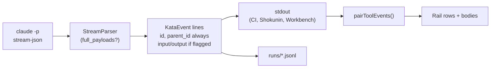

# Tool cards — design

**Date:** 2026-10-12
**Branch:** `feat/tool-cards`
**Follows:** `f4f4f38` — *feat!: every run can ask the operator a question (v3.0.0) (#42)*

## Problem

The Workbench Observe pane renders every tool call as a one-line log row: `tool.use` shows a 200-character `input_summary`, and `tool.result` shows a 200-character `summary`. An operator watching an agent edit code cannot see the edit, cannot see why a command failed, and cannot see what a subagent did. The VSCode Claude Code extension solves this with collapsible per-call cards: an Edit expands into a diff, a failed command expands into its output, a subagent expands into its own calls. The Workbench should work the same way.

This is not a reskin. The event protocol does not carry what a card needs:

1. **No payloads.** `tool.use` and `tool.result` carry only truncated summaries. A diff needs `old_string` and `new_string`; an output block needs the output.
2. **No pairing key.** The parser records claude's `tool_use_id` internally (`StreamParser::tool_names`) and drops it from the emitted events. Pairing a result to its call by tool name breaks as soon as claude issues parallel calls of the same tool, which it does routinely. This is a correctness bug for every consumer today, not only for the Workbench.
3. **No nesting key.** Messages from inside a subagent carry `parent_tool_use_id` in claude's stream-json. The parser ignores it, so a subagent's calls appear in the main stream as if the parent agent made them.

## What the probe established

One real run against `claude` 2.1.296 (`claude -p … --output-format stream-json --verbose`) that delegated a single file read to a subagent:

| Observation | Consequence |
| :--- | :--- |
| The subagent's `assistant` (tool_use) and `user` (tool_result) messages carry `parent_tool_use_id` equal to the parent call's `tool_use.id`. Top-level messages carry `null`. | Nesting is possible from data already in the stream. |
| The subagent tool is named `Agent`, not `Task`. | The renderer matches both names; older claude builds emit `Task`. |
| A `Read` result's `content` is a plain string; the `Agent` result's `content` is an array of `{type: "text"}` blocks. | The parser flattens both shapes into one `output` string. |
| The `Agent` result opens with a harness notice (`[Subagent hand-back] …`). | Rendered verbatim. Stripping it would mean matching text claude may reword at any time. |
| The `Edit` tool input carries `old_string`, `new_string`, and `file_path`, with no line position. | Diffs render without line numbers. |

## Design

### A. Protocol: four optional fields

All additions are optional fields on existing events. Per `CONTRACTS.md` this is additive (minor), and `protocolVersion` stays at **1**.

| Event | Field | Type | Emitted |
| :--- | :--- | :--- | :--- |
| `tool.use` | `id` | `string` | Always |
| `tool.use` | `parent_id` | `string` | When the call was made inside a subagent |
| `tool.use` | `input` | JSON object | Only under `--full-payloads` |
| `tool.use` | `truncated` | `bool` | Only under `--full-payloads`, and only when the input was omitted for size |
| `tool.result` | `id` | `string` | Always |
| `tool.result` | `parent_id` | `string` | When the result belongs to a subagent's call |
| `tool.result` | `output` | `string` | Only under `--full-payloads` |
| `tool.result` | `truncated` | `bool` | Only under `--full-payloads`, and only when `true` |
| `assistant.text` | `parent_id` | `string` | When the text was written inside a subagent |

Every new field carries `#[serde(default)]` (and `skip_serializing_if` for `Option`/`false`). Transcripts in `<kata-home>/runs/*.jsonl` written before this change lack all of them and must keep loading, or old runs disappear from the Workbench history.

`id` is emitted on every run because it fixes pairing for every consumer at a cost of a few dozen bytes per event. `input` and `output` sit behind a flag because a single `Read` of a large file puts tens of kilobytes on one stdout line, and CI logs and Shokunin should not pay for that unless they ask.

**Output flattening.** A `tool_result.content` that is a string is used as-is. One that is an array has the `text` of each `{type: "text"}` block joined with `\n`; non-text blocks (images) contribute a `[<type>]` placeholder.

**Truncation.** `input` (serialized) and `output` are each capped at 256 KB. Truncation reuses `event::truncate`, which already cuts on a character boundary. When `output` is cut, `truncated: true` is set. When the serialized `input` exceeds the cap, `input` is omitted entirely rather than emitted as invalid JSON, and `truncated: true` is set on that `tool.use`.

Bridge tools (`ask_user`, `approve_tool`) stay suppressed exactly as today.

### B. The flag

`kata run --full-payloads <spec>`. It is a CLI flag, not a run-spec field: it changes what a run reports, not what a run does, so it does not belong in a reproducible spec.

`kata_core::run::run` gains a `RunOptions { full_payloads: bool }` parameter (a struct rather than a seventh positional argument, so the next observation option has somewhere to go). `run` passes it to `StreamParser`, which gains a constructor taking the option; `StreamParser::default()` keeps today's behavior so every existing test is unaffected.

The Workbench sidecar (`run_spec` in `app/src-tauri/src/lib.rs`) always passes `--full-payloads`. Consequence: Workbench run transcripts on disk include payloads; CLI runs without the flag stay lean.

### C. Workbench: the rail

Layout is the **rail** (approved against mockups `card-style.html` and `rail-v4.html` in `.superpowers/brainstorm/`): one mono line per call, with an expandable body hanging off a hairline rail.

**Row:** `chevron · status dot · tool name · target · meta · status label`, 12px `--font-mono`. The status label sits beside the dot on every row (`ok`, `error`, `running…`), per the andon rule in `app/CLAUDE.md` that a status color is never shown without a label. There is no `exit N` label: `tool.result` carries only `ok`, and parsing an exit code out of Bash output text is the same fragility as parsing line numbers. The `exit 101` in the mockups is therefore not built. The row is the toggle; nothing else on it is interactive.

**Body:** indented under the dot, with a 1px `--border-default` left border. Content panels (diffs, output, JSON) use `--surface-inset`. Collapsed bodies are not rendered at all (`{#if}`), which keeps the DOM small on long runs.

**Running state:** a `tool.use` with no matching `tool.result` yet shows a `--text-faint` dot and a `running…` label.

**Renderers:**

| Tool | Target · meta | Body | Default |
| :--- | :--- | :--- | :--- |
| `Edit` | `file_path` · `+n −m` | Line diff of `old_string` → `new_string`, no line numbers | Open |
| `MultiEdit` | `file_path` · summed `+n −m` | One diff per edit, stacked | Open |
| `Write` | `file_path` · `+n` | Every line of `content` as added | Open |
| `Read` | `file_path` · line count | Output, scrollable past about 20 lines | Collapsed |
| `Grep` | `pattern` · match count | Output | Collapsed |
| `Glob` | `pattern` · match count | Output | Collapsed |
| `TodoWrite` | (none) · `done / total` | Checklist: completed struck through in `--text-faint`, in-progress in `--accent-text`, pending in `--text-muted` | Open |
| `Agent` / `Task` | `subagent_type: description` · nested call count | `prompt`, then the subagent's own rows nested one level, then the result | Collapsed |
| Anything else | `input_summary` | Pretty-printed `input`, then `output` | Collapsed |

Any failed call (`ok: false`) starts open regardless of tool. Open/closed state is per-session and not persisted.

**Nesting depth.** Exactly one level. A subagent's subagent renders its rows flat inside the first subagent's body rather than indenting again.

**Truncated payloads.** A body whose payload was truncated ends with a `--text-faint` line `… truncated at 256 KB`. A diff is only computed when both sides arrived whole; if the `tool.use` was truncated, the Edit body falls back to the generic renderer instead of rendering a misleading diff.

**Fallback.** A `tool.use`/`tool.result` without `id` (an old transcript) renders through today's `EventRow`, unchanged. A tool event with `id` but no payloads (a CLI run without `--full-payloads`, replayed in history) renders as a rail row whose body shows the summaries.

**Code layout.**

- `app/src/lib/toolcards.ts` — pure `pairToolEvents(events) → StreamItem[]`: pairs by `id`, attaches children by `parent_id`, marks running calls, passes id-less events through. An event whose `parent_id` names a call that never arrived is shown at the top level, never dropped.
- `app/src/lib/components/ToolCard.svelte` — the row and the body shell.
- `app/src/lib/components/toolcards/{DiffBody,TodoBody,OutputBody,JsonBody}.svelte` — one per renderer family.
- `ObservePane.svelte` renders `pairToolEvents(events)` instead of raw events. Ask and permission records are positioned by `at`, a count of raw events, so every top-level item records the raw index of the event that opened it, and a record with `at = n` is spliced after the last top-level item whose index is below `n`. A pause that happens mid-call (between a `tool.use` and its result) therefore lands right after that call's row, which is where it happened.
- Diffing uses the `diff` npm package (`diffLines`). Hand-rolling a diff is not worth the bugs.
- Styles go in `app/src/styles/components/components.css` as `.k-toolcard*` classes, tokens only.

### D. Tests

Engine (`cargo test -p kata-core -p kata-cli`):

- Three parallel `Read` calls pair to the right results by `id`.
- Without the flag, `input`, `output`, and `truncated` are absent; `id` is present.
- With the flag, `input` and `output` are present; an output over 256 KB is cut on a character boundary with `truncated: true`; an oversized input is omitted with `truncated: true`.
- String and block-array `tool_result.content` flatten to the same `output`.
- `parent_id` is set on a subagent's `tool.use`, `tool.result`, and `assistant.text`, and absent at the top level.
- A transcript line written before this change (no `id`) deserializes.
- `fake-claude` gains a `subagent` mode replaying the probe's shape; an integration test runs it with and without `--full-payloads`.
- `kata-cli` integration test for the flag.

Frontend (`npm test`):

- `pairToolEvents`: pairing, running state, one-level nesting, flattening of deeper nesting, orphaned `parent_id`, id-less pass-through.
- One render test per renderer, the `Agent`/`Task` alias, open-by-default policy including failures, the truncated-diff fallback, and the summary-only body for events without payloads.

### E. Regeneration and verification

1. `KATA_BLESS_SCHEMA=1 cargo test -p kata-core --features schema schema_artifact_is_fresh`
2. `cd app && npm run gen:events`
3. Walk `CONTRACTS.md` by hand: every change is a new optional field or a new flag.
4. `cargo fmt --all --check`, `cargo clippy --all-targets -- -D warnings`, `cargo build --locked`, `npm run check`, `npm test`.
5. Look at a real run in `npm run tauri:dev` that edits a file, fails a command, and uses a subagent.

Ships as one PR.

## Out of scope

- **Line numbers on diffs.** The Edit input carries no position. Parsing them from claude's result text is fragile.
- **Thinking blocks.** The parser does not emit them today; adding them is a separate protocol change.
- **Syntax highlighting** in diffs and output.
- **Persisting** which cards are open.
- **Bespoke renderers** for `Bash`, `WebFetch`, `WebSearch`, and MCP tools. They use the generic card.
- **A capped always-on mode.** Considered and rejected in favor of the opt-in flag.
