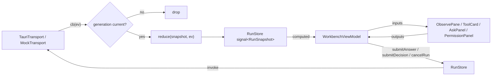

# Workbench Angular port — design

Status: approved in brainstorming, 2026-10-15. Branch: `feat/angular-workbench`.

## Intent

Port the Kata Workbench frontend (`app/`) from SvelteKit + Svelte 5 to Angular so the owner can maintain it in a framework they work in daily. The UX must not change. `D:\Repos\angular-jig` is the template and is copied verbatim for scaffolding, tooling, gates, hooks, skills, and patterns, with the deviations listed below.

### Decisions

| Topic | Decision |
|---|---|
| Template fidelity | angular-jig verbatim. Its code already satisfies the house rules (no `.subscribe()` in `src/`, OnPush via the Angular 22 default). The violations recorded in `house-rules-angular` belong to `D:\Repos\jig`, not angular-jig. |
| Styling stack | angular-jig's Tailwind 4 + spartan helm, skinned with Kata's sumi-ink tokens. |
| Cutover | Side-by-side in `app/web-ng/`, then one swap commit. |
| Jig vs Kata design rules | Kata wins: desktop-only responsive checks, dark theme only, no theme toggle. |
| Forms | Signal Forms over the generated `RunSpec`. No zod: the validation source of truth stays Rust `validate` via `validate_spec` (and `validateLocal` in browser mode). |
| RxJS | None on the event path. The seam is callback + unlisten, so nothing can be subscribed above it. |

### Assumptions

1. `app/src-tauri` and every Tauri command stay unchanged. This is a frontend swap.
2. Feature parity includes browser mode: fixtures, the scripted run timeline, and `?demo=run`.
3. Generated types stay generated (18 ts-rs bindings, `kata-events.ts` via json2ts) with unchanged generators and CI drift checks.
4. The Hero Ops domain, angular-jig's `harness/*-spec.md` write-ups, and `.superpowers/sdd/` logs are not copied. Gates, rules, hooks, and skills are.

### Success criteria

- Every captured view matches a Svelte baseline taken before the port (pixel diff, see Verification).
- All existing test behaviors (22 files, about 179 cases) are ported and pass.
- angular-jig's gates pass; the CI web job is green on Angular commands.
- Svelte is removed in a single swap commit.

## Architecture

```
app/
  src-tauri/            unchanged
  web-ng/               Angular 22 workspace from angular-jig; becomes app/ at the swap
    src/app/
      core/transport/   KataTransport (abstract) + TauriTransport + MockTransport + provideKataTransport()
      core/run/         RunStore (root, signals) + pure reduce(snapshot, ev)
      core/toast/       ToastStore
      core/launch/      LaunchStore (one-shot Library -> Compose handoff)
      lib/              framework-free TS ported near-verbatim: events, toolcards, spec, kit, katas, scroll, fixtures, mock timeline
      workbench/        route '' : component + WorkbenchViewModel
      library/          route 'library' : component + LibraryViewModel
      ui/               presentational components; inputs/outputs only, inject nothing
    libs/ui/            spartan helm, vendored as in angular-jig
    parity/             baseline PNGs + parity check
```

Svelte to Angular component map:

| Svelte | Angular |
|---|---|
| `routes/+page.svelte` | `workbench/` component + `WorkbenchViewModel` |
| `routes/library/+page.svelte` | `library/` component + `LibraryViewModel` |
| `routes/+layout.svelte` | `app.ts` shell (router outlet + toaster) |
| `lib/components/*.svelte` | `ui/<kebab-name>/` presentational components |
| `lib/components/toolcards/*` | `ui/tool-card/bodies/*` |
| `lib/run.svelte.ts` | `core/run/run.store.ts` + `core/run/reduce.ts` |
| `lib/toast.svelte.ts`, `lib/launch.ts` | `core/toast/`, `core/launch/` |
| `lib/api.ts` + `lib/mock.ts` bridge half | `core/transport/` |
| `lib/components/spec-fixture.svelte.ts` | dropped (TestBed inputs replace it) |

Library replacements:

| Svelte dependency | Angular replacement |
|---|---|
| `@lucide/svelte` | `@ng-icons/lucide` via `provideIcons` + `NgIcon` (angular-jig pattern) |
| `svelte-exmarkdown` + `remark-gfm` | unified: `remark-parse` + `remark-gfm` + `remark-rehype` + `rehype-sanitize` + `rehype-stringify`, bound via `[innerHTML]`. Same parser, so the same output. |
| `diff` | unchanged |
| `@tauri-apps/api`, `@tauri-apps/plugin-dialog` | unchanged, used only inside `TauriTransport` |
| `$app/navigation` `goto` | `Router.navigate` |

### Theming

Kata's token files (`colors.css`, `typography.css`, `spacing.css`) stay as the primitive layer. spartan's semantic tokens (`--background`, `--foreground`, `--card`, `--primary`, `--border`, `--ring`, `--muted`, ...) are defined on `:root` from those primitives. There is one dark palette and no `.dark` class toggle. `--primary` maps to `--accent` (Hanada azure). Andon status colors stay as their own tokens and never alias the accent. IBM Plex stays self-hosted (`@font-face` from the existing woff2 files) because the Tauri CSP has no `font-src`. The literals in `workbench.css` (the Hiragino seal font, 10px and 11px sizes) become tokens with unchanged values.

## Data flow



### Transport seam

`KataTransport` is an abstract class used as the DI token. It has one `Promise`-returning method per Tauri command (`catalog`, `listRuns`, `loadRun`, `loadSpec`, `saveSpec`, `validateSpec`, `runSpec`, `cancelRun`, `submitAnswer`, `submitDecision`, `listKatas`, `loadKata`, `saveKata`, `listPresets`, `savePreset`, `exportBundle`, `pickDirectory`, `pickOpenSpec`, `pickSaveSpec`), plus `onRunEvent(cb): Promise<() => void>`.

- `TauriTransport` wraps `invoke`, `listen('kata://event')`, and the dialog plugin.
- `MockTransport` holds the fixtures, `validateLocal`, and the scripted head/mid/tail timeline with today's semantics (submitAnswer emits `ask.answered` then plays mid; submitDecision emits `permission.decided` from `PENDING_PERMISSION` then plays tail; cancel clears timers; backend-only calls reject with the existing `NO_BACKEND` message).
- `provideKataTransport()` picks one implementation once at bootstrap using `inTauri()` (`'__TAURI_INTERNALS__' in window`). No code above the seam calls `inTauri()` except `WorkbenchViewModel`, which needs it for `?demo=run` and seed-vs-default spec, matching today.

### Run store

`RunStore` is `providedIn: 'root'` and holds one `signal<RunSnapshot>` where `RunSnapshot = { state, events, summary, asks, permissions }`, with a `computed` per field. Public methods keep today's names and guards: `startRun(spec)`, `cancelRun()`, `submitAnswer(id, answers)`, `submitDecision(id, allow, message)`.

- `reduce(snapshot, ev)` is a pure function that ports `handle()` case for case and returns new arrays and objects rather than mutating. In-place mutation would not notify signal consumers.
- Generation guard: each `startRun` increments a counter. The `onRunEvent` callback captures its generation and drops events whose generation is no longer current. This closes the window where an event already queued in the webview lands after Cancel or a fast Re-run. No visible behavior changes.
- Terminal events (via `terminalStateFor`) set the final state and call the unlisten function, as today. Cancel appends the same warn log row and sets `warning`.

### ViewModels

- `WorkbenchViewModel` (component-scoped) owns the spec signal, dirty tracking via `specEquals`, open/save/export/validate orchestration, the discard-changes confirm, the preset prompt, Ctrl/Cmd+Enter to run, the Library launch handoff via `LaunchStore.take()`, and `?demo=run` (read once at init, browser mode only).
- `LibraryViewModel` (component-scoped) owns history, run detail, katas, task editing, and the launch handoff via `LaunchStore.set()` + `Router.navigate(['/'])`.
- `ui/` components inject nothing. State enters through inputs and leaves through outputs.

### Error handling

Unchanged from today: rejected transport calls surface through `ToastStore.error`; a `runSpec` rejection appends an error log row and sets state to `error`; `run.error` events become error rows; browser-mode backend-only calls reject with `NO_BACKEND`.

## Verification

### Parity gate

1. Before any Angular code is written, extend `app/scripts/screenshots.mjs` to capture: compose (empty, seeded, validation banner, kit search), observe (running, ask pending, permission pending, tool cards collapsed and expanded, diff/todo/json bodies, summary), library (list, detail), both dialogs, and focus and hover on primary controls. Run it against Svelte and commit the PNGs to `app/web-ng/parity/baseline/`.
2. `npm run check:parity` serves the Angular build, captures the same views with Playwright, and pixel-diffs each against its baseline. Threshold: at most 0.1% differing pixels per view.
3. A failing view is fixed in tokens or CSS, never by re-blessing. Re-blessing a baseline for a deliberate change requires the owner's sign-off. The swap does not happen until every view passes.

### Tests

- Runner: angular-jig's `@angular/build:unit-test` (Vitest).
- The 12 framework-free lib test files port near-verbatim.
- The run-store tests are rewritten against `reduce` and `RunStore` with a fake `KataTransport`, and add a generation-guard test (a stale event after Cancel or Re-run is dropped).
- The 10 component tests move to TestBed with the same assertions.
- New ViewModel specs (angular-jig style, no DOM) cover both routes, which have no tests today.

### Gates

angular-jig's gates run unchanged: ESLint seal and shape rules (`noInlineConfig: true`), the Stylelint token gate, `check:boot`, `check:interaction`, `check:contrast`, `check:wiring`, and the `.claude` hooks. `check:responsive` runs at 1280 and 1600 only.

## Bindings and build wiring

- During side-by-side, `web-ng` reads bindings through a tsconfig path alias `@bindings/*` → `../src/bindings/*`.
- At the swap the Angular workspace root becomes `app/`, so the bindings sit at `app/src/bindings/`, the path ts-rs and json2ts already write to. No generator or Rust change.
- Side-by-side launch: `app/src-tauri/tauri.ng.conf.json`, merged with `tauri dev --config`, points `devUrl`, `frontendDist`, `beforeDevCommand`, and `beforeBuildCommand` at `web-ng`. `npm run tauri:dev` keeps launching Svelte until the swap.
- Dev server stays on port 1420 (`ng serve --port 1420`, strict).

## CI

- During side-by-side, the existing `web` job is unchanged and a new `web-ng` job runs: `npm ci`, the `gen:events` drift check, `lint`, stylelint, `ng build`, `ng test`, `check:parity`.
- At the swap, `web-ng` replaces `web`.

## Swap commit

1. Delete Svelte sources, `svelte.config.js`, `vite.config.js`, `vitest.config.ts`, and the Svelte dependencies.
2. Move `web-ng/*` into `app/`.
3. `tauri.conf.json`: `frontendDist` → `../dist/kata-workbench/browser`, `beforeDevCommand` → the Angular dev script on 1420, `beforeBuildCommand` → the Angular build. Delete `tauri.ng.conf.json`.
4. Update the Workbench sections of root `CLAUDE.md`, `app/CLAUDE.md` (stack, icons, Tailwind/helm styling rules, gates), and the Workbench-pane chain in `docs/adding-a-feature.md`.
5. Bump the version to 3.2.0. The run-spec and event contracts are unchanged.
6. After merge, update the `house-rules-angular` concept, which says Svelte in kata is out of scope.

## Out of scope

- New features or UX changes of any kind.
- Removing the dead `saveSpec` / `pickSaveSpec`; they are ported as they are.
- A light theme, a theme toggle, or a mobile layout.
- zod schemas for `RunSpec`.
- Redesigning the `workbench.css` literals; they become tokens with the same values.
