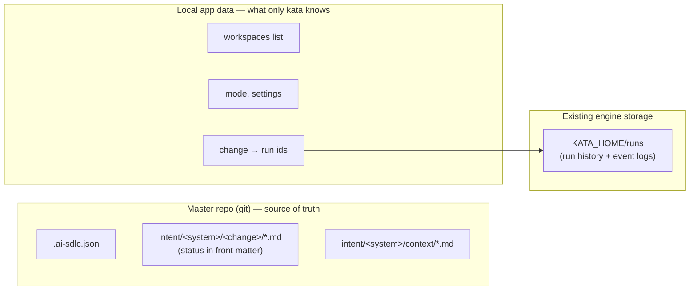
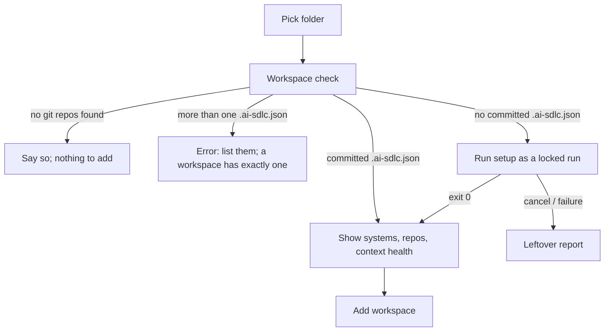

# AI-SDLC mode for the Workbench, Part 1 (intent → spec → plan) — design

Status: draft for owner review · 2026-10-18 · Part 2 (implement, diff explorer, pull requests) is designed separately

## Intent

The Workbench today does one thing: compose one run-spec, launch it, watch it. This design adds a second mode, **AI-SDLC**, in which a product owner and an engineer take a *change* through the front half of the AI-native SDLC (`intent → spec → plan`) inside a *workspace* of git repositories, across as many sittings as it takes, with the Workbench keeping track of where every change stands.

The process itself already exists as the `ai-sdlc` Claude Code plugin (`D:\Repos\experiments\ai-sdlc\plugin`): five skills (`setup`, `context`, `intent`, `spec`, `plan`) that write Markdown artifacts into a *master repository*. What the plugin lacks is a host that a non-engineer can drive: a place to see every change and its stage, to answer the interview questions, and to accept a document without knowing git. The Workbench becomes that host.

Why now: Shokunin is changing into something else and is out of scope. Kata's Workbench is where this lands instead.

## Goals

- At launch the user picks a mode: **Workbench** (today's app, untouched) or **AI-SDLC**.
- In AI-SDLC mode a user can add a workspace (a folder of sibling git repos), set it up for ai-sdlc when it is new, and refresh repository context.
- The user sees every change in the workspace with its current stage, and can pick any of them up where it stopped.
- Each stage (`intent`, `spec`, `plan`) runs as an ordinary kata run that loads the ai-sdlc plugin; interview questions arrive through the existing `ask_user` pause.
- A human decision (accepting or rejecting a document) is one button, and the Workbench commits it.
- Long work (kata's own checks and agent runs) locks the screen behind a progress panel with honest progress and a Cancel button.

## Non-goals

- No change to the `kata` engine, the CLI, the run-spec contract, or the event protocol. "Kata in itself doesn't change a bit." If an implementation step seems to need an engine change, stop and raise it; do not make it.
- No cloning. Repositories are discovered in place, never fetched.
- No pushing and no pull requests in Part 1. The only branches Part 1 creates are change branches in the master repo (see "Branch per change").
- Nothing in the product repos is written, branched, or committed in Part 1.
- No database. State lives in files on the local machine.
- No change to the ai-sdlc plugin. Kata works with it as written.
- The back half of the SDLC is **Part 2**, designed separately and built after this: an `implement` stage in which kata executes `plan.md` across the product repos, change branches in the product repos, a diff explorer borrowed from mekiki, and pull requests for every repo the change touched. Part 1 must not build any of it, but must not block it either: Part 2 reuses Part 1's workspace, change, branch, and locked-work machinery.
- No user roles or permissions. Every control is visible to whoever is at the keyboard.
- No concurrency between kata instances. One Workbench window works one workspace at a time; two windows on the same workspace can race commits, and nothing guards against that.

## Anti-goals (would be a failure even if it works)

- **Two sources of truth for a change's stage.** If the Workbench records "this change is at spec" anywhere of its own, it will drift from the repo the first time someone edits a file outside kata. Stage is always derived from the master repo.
- **Invented progress.** A percentage bar on an agent run is fiction. Kata cannot know how far through a `claude -p` run it is.
- **A locked screen that hides a question.** If a run asks something while the screen is locked and the question cannot be answered, the run times out (exit 123) on a question nobody could reach.
- **Discarding a person's own uncommitted work.** Cleanup after a cancelled run may only ever touch files that run produced.
- **Breaking Workbench mode.** Today's compose/observe screens, the Library, and all existing gates must keep working unchanged.

## Concepts

These are ai-sdlc's terms, adopted unchanged so the two never disagree. The source of each definition is `plugin/references/workspace.md` in the ai-sdlc repo.

| Term | Meaning |
|---|---|
| Workspace | A folder whose **immediate** child folders that contain `.git` are its repositories. Nothing deeper is searched; nothing is cloned. mekiki and ai-sdlc both already use this definition. |
| Master repository | The one repository whose root contains `.ai-sdlc.json`. Exactly one per workspace; zero means "not set up", more than one is an error ai-sdlc refuses to work with. |
| System | A named product under `.ai-sdlc.json` `systems`, with a list of repos. Its artifacts live in `<master>/intent/<system>/`. A workspace can hold several systems. |
| Change | A folder `<master>/intent/<system>/YYYY-MM-DD-<slug>/` holding `intent.md`, then `spec.md`, then `plan.md`. |
| Stage | Which of those three documents is being worked on, derived from which files exist and their front-matter `status`. |
| Context | `<master>/intent/<system>/context/<repo>.md`, one per repo, with a `source_commit`. Stale when the repo has product commits after it (workspace.md §7 gives the exact `git rev-list` command). |

## Who owns what

- **The repo owns** everything ai-sdlc knows: which systems exist, which changes exist, every stage and status, every context file and its freshness. The Workbench reads these every time it shows them, from the working tree plus `git status`, and caches nothing.
- **Local app data owns** what only kata knows: the list of workspaces (name, folder, last opened), the remembered mode, settings, and which kata runs touched which change.
- **Run history** is the engine's existing store (`KATA_HOME/runs`), the same one the Library reads. The Workbench only keeps the run ids per change.

## The commit rule

**Runs commit what the agent wrote. The Workbench commits what a human decided.**

- Each ai-sdlc skill commits its own files as its last step (workspace.md §8). Kata leaves that alone and does not deny, intercept, or redo those commits.
- The Workbench commits only for a human decision made with a button: **Accept** or **Reject** on `intent.md`, and **Accept** on `spec.md`. These are the moments where ai-sdlc tells a PO to "change the status and commit", which a non-git PO cannot do.
- **Reopen** is not a Workbench commit. Reopening an accepted intent is done by the `intent` skill itself (it resets the statuses and commits `reopen intent`), so the Reopen button launches an `intent` run on that change.

Reversed decision, recorded so nobody revives it: early in the design the rule was "kata-cli sessions never commit; the Workbench commits everything." That would have meant fighting the plugin from the outside (a retasking note plus a `deny` rule on `git commit`, plus a `HEAD` check), three layers standing in for a plugin change the owner did not want. The owner chose not to deny anything, and the rule above replaced it.

### Workbench commit details

- Commit to the master repo, current branch (the change's branch), never push, same as the plugin.
- Messages use the Conventional Commits format. The owner is moving ai-sdlc's own messages to the same format, and the Workbench's must match it. Until that lands, the Workbench uses type `docs` and the system as scope: `docs(<system>): accept intent <change>`, `docs(<system>): reject intent <change>`, `docs(<system>): accept spec <change>`. Keep the message builder in one place so it can be aligned with whatever ai-sdlc settles on.
- Commit only the one file, with `git commit -- <file>`, leaving anything else the user has staged untouched.
- If the file has uncommitted edits beyond the status line, show that before committing ("`intent.md` has other uncommitted edits; accepting commits them too") and require confirmation. What gets accepted is what is on disk.
- If git refuses (hooks, no identity, detached HEAD), show git's error verbatim and leave the file with its new status uncommitted. Never retry with flags that bypass hooks.

## Branch per change

The master repo's base branch (normally `main`) holds every change that has been merged. **A new change starts on a new branch** in the master repo, and every run and Workbench commit for that change lands there. Merging back to the base branch is Part 2's pull request; until Part 2 exists, the user merges by hand.

- **Naming.** `change/<change-folder>`, for example `change/2026-10-12-fnol-photo-upload`. The convention is what lets the Workbench find in-progress changes without reading other branches' files.
- **Base branch.** Recorded per workspace in local app data when the workspace is added: `main` if it exists, else `master`, else the branch checked out at that moment. Editable in the workspace's settings.
- **Creating it.** The `intent` skill commits to whatever branch is checked out, but chooses the change folder name partway through its interview. So on **New change**, the Workbench (with a clean master working tree) creates `change/pending-<utc>` from the base branch, checks it out, and starts the `intent` run. When the run has created the change folder, the Workbench renames the branch to `change/<folder>`. If the run ends without creating a folder, the Workbench switches back to the base branch and deletes the pending branch, which has no commits of its own.
- **Listing.** The workspace home lists the changes on the **currently checked-out** branch of the master repo, exactly as before. Below them it shows a second group, **In progress on other branches**, built only from `git branch --list "change/*"` names that are not the current branch. Those rows show the change folder name and no stage, since their files are not read.
- **Opening one.** Opening a change from the other-branches group checks out its branch. If the master working tree is dirty, the Workbench refuses and says which files are in the way; it never stashes or discards to make the switch.
- **Setup and context run on the base branch.** They describe the system, not a change, so their commits belong on the base branch. If the master repo is on a change branch when the user runs them, the Workbench offers to switch to the base branch first (same clean-tree rule).
- **The toolbar shows the master repo's current branch** in mono beside the workspace name, so nobody is surprised about where a commit is about to land.

## Plugin discovery

The run-spec references plugins **by name**, resolved through the catalog (user `~/.claude`, the project `.claude` under the workdir, installed marketplace plugins, the embedded builtin). There is no path field, and adding one would change the run-spec contract, which this design rules out.

So the ai-sdlc plugin is "pointed at" by being **installed where the catalog finds it** (user scope or an installed marketplace plugin) under the name `ai-sdlc`. Not embedded in kata: ai-sdlc has never been run for real and will change often, and embedding would tie each change to a kata release. Embedding is revisited once it settles.

On entering AI-SDLC mode, the Workbench calls the existing `catalog` for the workspace folder and checks for a plugin named `ai-sdlc`. If it is missing, the mode shows a blocking empty state saying the plugin was not found and where kata looked, with no workspace actions available until it is installed.

The `plan` skill hands off to `superpowers:writing-plans` when available. The plan run-spec includes the `superpowers` plugin in its kit when the catalog finds it, and otherwise passes `--standalone`, so the skill's own fallback is explicit.

## Screens

The layout is "drill-down" (option B from the mockups): two screens joined by a breadcrumb, plus overlays. The visual language is the existing sumi-ink system. Read `app/CLAUDE.md`, `design/README.md`, and the house-style skill before building; the brainstorm mockups (`.superpowers/brainstorm/…/content/*.html`, gitignored) are throwaway references for layout only.

### Launch: mode choice

A dialog on first launch with two cards: **Workbench** ("Compose a run") and **AI-SDLC** ("Work a change"). A "Remember this" checkbox is on by default; once remembered, kata opens straight into that mode. The toolbar carries a mode badge that switches modes at any time, disabled while a run or locked operation is in progress.

### Toolbar (AI-SDLC mode)

Seal, `ai-sdlc` mode badge, a **workspace switcher** (dropdown on the workspace name), the breadcrumb, and the primary action for the current screen. The switcher lists known workspaces with their folder path and number of changes, flags a workspace whose folder no longer exists ("folder missing"), and ends with **Add workspace…** and **Remove from list…** (removing only forgets it; nothing on disk is touched). The last-used workspace opens on launch. There is no separate workspaces screen.

### Add workspace

A dialog: pick a folder, then kata runs its own **workspace check** (below) and branches on the result.

- "Set up" means `.ai-sdlc.json` is **committed** in the master repo. An uncommitted marker (from a cancelled setup) does not count. This mirrors ai-sdlc's own rule that an acceptance only counts once it is in history.
- When already set up, the dialog lists each repo with its role (master), context state (fresh, stale with commit count, missing), and repos listed in `.ai-sdlc.json` but not checked out ("not checked out", reported and skipped, never cloned). Then **Add workspace**.
- A workspace is added to the local list only after the check succeeds (and setup, if it ran, exited 0).

### Screen 1: Workspace home

Two tables side by side:

- **Changes**, grouped by system: change folder name (mono), stage and status, last run time. Clicking a row opens the change page. Primary toolbar action: **New change**.
- **Repositories**: each repo, its context state, and a **Run context** button on missing or stale rows. Also the master repo marker. Plus an **Add system** action, which reruns `setup` (setup is idempotent and supports adding a system).

States the screen must handle: workspace folder missing, master repo gone, more than one master, plugin missing.

### Screen 2: Change page

Breadcrumb `acme-claims / 2026-10-12-fnol-photo-upload`. A three-step **stage stepper** (Intent, Spec, Plan), each showing its status (as an andon tag with its label, never color alone) and the number of runs so far. Below it, the current stage's document, rendered read-only from the working tree, with its front matter shown as a mono line. Actions in the toolbar depend on state (table below).

The run itself does not get a drawer: while a stage runs, the screen is locked (next section), and the document refreshes when the lock lifts.

### Stage derivation and actions

Status values are read from front matter and shown raw; only the literal `accepted` (and `rejected`, `superseded`) carry meaning. Any other value (`draft`, `ready for product owner review`, …) means "not accepted yet".

| What's in the change folder | Shown as | Actions |
|---|---|---|
| `intent.md` exists but was never committed | Intent · in progress (not committed) | Continue intent |
| `intent.md` committed, not accepted | Intent · awaiting acceptance | Continue intent, Accept intent, Reject intent |
| `intent.md` or `spec.md` says `accepted` on disk but that edit is not committed (hand-edited outside kata) | Intent/Spec · accepted, not committed | Commit acceptance (a human decision, so the Workbench commits it with the usual `accept` message), Continue |
| `intent.md` rejected | Closed · rejected | none |
| intent accepted, no `spec.md` | Spec · ready to start | Start spec, Reopen intent |
| `spec.md` not accepted | Spec · awaiting acceptance | Continue spec, Accept spec, Reopen intent |
| spec accepted, no `plan.md` | Plan · ready to start | Start plan, Reopen spec, Reopen intent |
| `plan.md` present, not superseded | Plan · written | Re-run plan, Reopen spec, Reopen intent |
| `plan.md` superseded | Plan · superseded | Re-run plan (it replaces the superseded plan), Reopen spec |

The skills enforce their own gates (for example, `spec` refuses an uncommitted acceptance). The Workbench hides actions the gate would refuse, but the skill stays the authority: if a run stops on a gate, its message is shown as-is.

### New change

From the workspace home: choose the system (only asked when there is more than one), and type the idea in a sentence or two. That launches an `intent` run. The skill itself proposes the title and the `YYYY-MM-DD-<slug>` folder name and confirms it through `ask_user`, so the Workbench does not ask for a slug.

## Locked work and progress

Any long operation (kata's workspace check, a setup/context run, a stage run) puts a scrim over the app and shows one centered panel. Two kinds of progress, never mixed:

- **Kata's own checks** have known, finite steps and show a real step list, each going pending → running → done: scan the folder for repos, find the master repo, read `.ai-sdlc.json`, check context staleness per repo, list changes. A step counter (`3 / 5`) is honest here.
- **Agent runs** show live activity from the event stream the Workbench already receives: elapsed time, turn number, model, and the last tool call ("Read billing-api/README.md"). Never a percentage or an ETA.

The lock covers everything **except** Cancel and the question card. When a run raises `ask.requested`, the question card appears inside the panel and is fully answerable; the panel footer shows how long until the answer deadline. Permission prompts, if the run's permission mode produces them, appear the same way.

Every locked operation ends with a notification (the existing toaster) that says what happened: success with a one-line result, or failure or cancellation with what was and was not committed. The lock never lifts silently.

## Cancel, failure, and leftover files

Before each run, the Workbench records the master repo's `HEAD` and the output of `git status --porcelain`. After any run that does not exit 0 (cancelled, failed, or any leash exit code), it compares:

- **New commits** since the recorded `HEAD`: listed by message. This happens when a chained run commits partway (setup commits, then its `context` step is cancelled).
- **Files that appeared or changed during the run**: listed, each with a checkbox, and a **Discard selected** action. Nothing is pre-checked for an `intent.md` or `spec.md` draft, because those skills write as they go so an interrupted session can resume; discarding loses the PO's interview.
- **Files that were already dirty before the run**: listed as "changed before this run, left alone", without a checkbox. Kata cannot tell its changes from the person's.

Discard means: delete files that did not exist before the run, and restore files that were clean before the run to their committed version. It never touches anything outside that list.

Scope of the snapshot:

- **The master repo is snapshotted in full.** Every ai-sdlc skill writes only under the master repo (workspace.md §5), so that is where leftovers can be.
- **A file already dirty before the run** has its content hashed in the snapshot. If the hash changed during the run, it is reported as "changed before and during this run" so the user knows the run touched it, still without a discard checkbox. This matters for an `intent.md` or `spec.md` a PO hand-edited before resuming.
- **Product repos are not snapshotted**, because the skills only read them. After each run the Workbench runs `git status --porcelain` in each product repo and, if any changed, shows a warning naming the repo ("the run changed files in `claims-core`; ai-sdlc should not write there"). It offers no discard there: it cannot tell the run's edits from the person's, and the warning points at a plugin bug to report.

### What "committed" means

Every rule in this design that depends on a file being committed (a set-up workspace, a committed acceptance, a never-committed intent) uses the same test the plugin's acceptance gate uses (workspace.md §9): the file is tracked (`git ls-files --error-unmatch -- <file>` succeeds) **and** `git status --porcelain -- <file>` prints nothing. Staged-but-uncommitted counts as uncommitted.

## Running a stage

Each action becomes an ordinary run-spec handed to the existing `run_spec` path (sidecar, events, cancel, answers). The shape, per action:

| Field | Value |
|---|---|
| `workdir` | the workspace folder (ai-sdlc treats a non-repo cwd as the workspace) |
| `plugins` | `ai-sdlc`; plus `superpowers` for `plan` when the catalog has it |
| `task` | invokes the skill with the system and the change folder or idea (exact wording left to the builder; it must name the skill unambiguously) |
| `permissions.mode` | the AI-SDLC permission setting, default `bypass` |
| `interactive` | per the permission setting; `ask_user` works either way |
| `leash` | engine defaults |
| `interactive.answer_timeout_secs` | 3600 |
| `name` | `sdlc-<system>-<change>-<stage>` (for a new change before the folder exists: `sdlc-<system>-new-intent`) |

The change-to-run link is written to local app data, keyed by workspace, system, and change folder, so the stepper can show run counts and the Library's history can be opened from a change. No engine change is needed to get the run id:

- The engine names each transcript `KATA_HOME/runs/<slug(spec.name)>-<utc>.jsonl`, and the history id is that file stem (`crates/kata-core/src/run.rs`, `open_transcript`).
- Early in every run it emits a `log` event at level `info` with the message `transcript: <absolute path>`. The Workbench reads the id from that event and records it.
- As a fallback for a run whose transcript could not be written (the engine then emits `transcript unavailable: …` instead), the Workbench gives every AI-SDLC run-spec a deterministic `name` of the form `sdlc-<system>-<change>-<stage>`, so `list_runs` can still be filtered by the record's `kata` field. The link is then best-effort, which is acceptable for a run that has no transcript to open anyway.

Buttons are the confirmation. When a button stands for a decision a skill would otherwise confirm through `ask_user` (Reopen intent: "edit an accepted intent?"; Reopen spec: "edit an accepted spec?"; Continue spec: "regenerate the spec?"; Re-run plan: "replace the existing plan?"), the task wording states that the user already confirmed, so the user is not asked twice. Every other question the skill asks still comes through `ask_user`.

Reopen spec sets only the spec back to draft and marks any plan superseded; the intent stays accepted. Every action that revisits an existing document (Continue intent, Reopen intent, Continue spec, Reopen spec, Re-run plan) first opens a feedback box, "What should change?", which is optional. Its text is appended to the task as an `Operator feedback:` block, and the skill regenerates the whole document with it (ai-sdlc 0.4.0, workspace reference section "Operator feedback"). Start spec and Start plan run at once, since a first draft has nothing to correct.

`interactive.answer_timeout_secs` is 3600 (one hour) for every AI-SDLC run. An interview pause can be long, but a forgotten session should still end with exit 123 rather than hold a `claude` process forever. The lock panel's countdown is computed from the time `ask.requested` arrived plus that value; the event itself carries no deadline.

## Local app data

Stored under the existing `KATA_HOME` (default `~/.kata`), in a new `workbench/` folder, because that is where kata already keeps its local libraries (runs, katas, presets) and the Workbench today keeps nothing of its own. Contents: the workspaces list, settings (remembered mode, AI-SDLC permission mode), and the change-to-run index. Plain JSON files; no database.

## Constraints

- House rules for the frontend: `app/CLAUDE.md` (tokens only, no hex; sumi-ink; single azure accent; andon colors for status, always with a label), the `house-style` skill, spartan primitives, Angular signals and OnPush, presentational components plus a component-scoped ViewModel.
- Every new backend call goes through `KataTransport`, with both `TauriTransport` and `MockTransport` implementations, and fixtures in `lib/mock.ts` so `npm start` works without a backend. Follow `docs/adding-a-feature.md` shape D for each new pane or control.
- The browser gates must cover the new routes: `check:boot`, `check:interaction` (the mode dialog, switcher, add-workspace dialog, lock panel, leftover dialog), `check:parity` (new baselines), `check:responsive`.
- Git operations in the backend shell out to `git`, as `kata-core` already does in `worktree.rs`.
- All docs and comments in US English.

## Calls made in this design (not explicitly agreed by the owner)

- "Remember this" is on by default; mode choice is shown on first launch, not every launch.
- Stage runs lock the screen like setup does, rather than using a run drawer.
- Local app data lives under `KATA_HOME/workbench/`, not Tauri's `app_local_data_dir`, to follow where kata already stores its local data.
- "Pointing at" the plugin means installing it where the catalog looks, because the run-spec has no plugin-path field and the engine must not change.
- A workspace counts as set up only when `.ai-sdlc.json` is committed.
- The Workbench snapshots `git status` before each run so discard only offers files the run produced; intent and spec drafts are never pre-selected for discard.
- New change asks for system and idea, not a slug; the skill proposes the folder name.
- No roles: all controls visible to everyone.
- Permission posture for AI-SDLC runs is a single setting, default `bypass`, with no automatic fallback.
- The run id comes from the engine's existing `transcript: <path>` log event, with a deterministic spec `name` as the fallback, so no engine change is needed.
- `answer_timeout_secs` is one hour for every AI-SDLC run.
- A button press counts as the confirmation for the decision it names; the skill is not allowed to ask it again.
- The snapshot covers the master repo in full (with content hashes for files already dirty); product repos get a post-run warning only.
- "Committed" means tracked and clean in `git status --porcelain`, the same test as the plugin's acceptance gate.
- One Workbench instance per workspace. Two kata windows on the same workspace can race commits; that is out of scope and the doc says so rather than adding a lock file.
- No version check on the installed `ai-sdlc` plugin beyond its name. Revisit when the plugin is embedded.
- Workbench commit messages use `docs(<system>): …` until ai-sdlc's own Conventional Commits format lands.
- Change branches are named `change/<change-folder>`, created as `change/pending-<utc>` and renamed once the intent run creates the folder; deleted if the run creates no folder.
- The base branch is detected (`main`, else `master`, else current) and stored per workspace, editable.
- In-progress changes on other branches are listed from branch names only; opening one checks out its branch and requires a clean master working tree.
- Setup and context always run on the base branch.

## Left to the builder

- Route paths and component boundaries.
- Exact task wording that invokes each skill.
- JSON file layout under `KATA_HOME/workbench/`.
- The Rust module structure for workspace scanning, front-matter parsing, and git calls in `app/src-tauri`.
- Whether the Library gains a filter for AI-SDLC runs.

## Risks

- **ai-sdlc is untested.** Kata is its first serious host; expect plugin bugs to surface through the Workbench. Report them against the plugin; do not work around them in kata.
- **Interview length vs. the lock.** A full `intent` interview through `ask_user` can run long with the screen locked. If that proves miserable in use, the lock design is the first thing to revisit, not the commit rule.
- **Status vocabulary drift.** The spec template's initial status is `ready for product owner review`, not `draft`. The Workbench must key only on `accepted`, `rejected`, and `superseded`, and show any other value raw.
