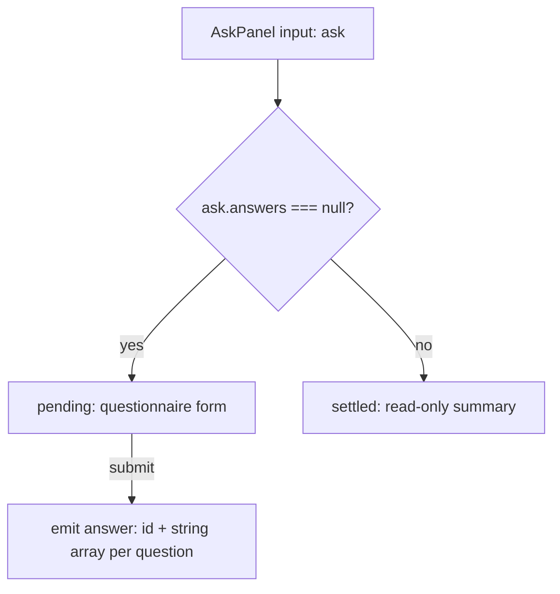

# AskPanel on the spartan questionnaire

Status: approved for planning (the operator opted out of the brainstorm and asked for spec → plan → implementation). Branch: `feat/spartan-1.8`.

## Intent

When a run pauses on `ask_user`, the operator answers in the Workbench's `AskPanel` (`app/src/app/ui/ask-panel.ts`). Today that panel is hand-built: about 200 of its 262 lines are home-made radio, checkbox and "Other" state kept in per-index signal maps. spartan 1.8.0 ships a questionnaire primitive built for exactly this job: questions with choices, multi-select, an inline free-text answer, required/optional with Skip, progress, keyboard shortcuts, and `fieldset`/`legend` semantics, all on Signal Forms.

The operator chose to follow Claude Code's own picker: one question at a time, step through with Next, submit at the end, and show a plain summary once answered. This port replaces the hand-built pending form with the questionnaire and replaces the hand-built "answered" view with a small read-only summary.

## What the spike established

A throwaway spec (`app/src/app/ui/questionnaire-spike.spec.ts`, commit `5fb122a`) proved, against the installed 1.8.0 brain:

- Text typed into `input[hlmQuestionnaireInput]` placed inside `hlmQuestionnaireChoices` reaches the bound form value, trimmed. Single-select: it replaces the picked choice. Multi-select: it joins the picked choices as one list (`['Redis', 'Kafka', 'NATS']`).
- Whitespace-only free text counts as no answer.
- Only the active item renders; every other item carries `hidden` and `inert`. A `disabled` item is never active, so a disabled questionnaire renders nothing.
- Writing a multi-select value back into the form blanks the free-text input. A settled answer therefore cannot be shown by the questionnaire.
- brain stamps its own `id` on every answer input, overriding any `id` in the template. Tests must locate inputs by `aria-label` or name, never by `id`.
- The vendored Helm buttons default to shadcn's `default`/`outline` variants, which the Kata button lacks; they were remapped to `primary` (Next, Submit) and `secondary` (Previous, Skip).

The spike spec is deleted as part of this work.

## Goals

- A pending ask renders as a stepped questionnaire: one question visible, Previous / Skip / Next, and a final submit that emits the same `{ id, answers: string[][] }` the panel emits today.
- A settled ask renders as a read-only summary of every question and its answer.
- `AskPanel` keeps its selector (`app-ask-panel`), its `ask` input and its `answer` output, so `ObservePane` and the run store do not change.
- The answer shape is unchanged (see "Answer mapping"); the only difference in content is that typed text is trimmed.
- The panel keeps the Kata look: the amber `.k-ask` banner while pending, jade when answered, inset option rows with the azure selected state, mono uppercase eyebrows, 13px UI base.

## Non-goals

- No engine, event, binding or schema change. `ask.requested` / `ask.answered` stay as they are.
- No change to `PermissionPanel`, `ToolCard`, or the trace component.
- No new question kinds.

## Anti-goals (a failure even if it works)

- Restyling a Helm primitive at the call site, or hiding a primitive from the sealing gate. Appearance goes in the vendored copy under `app/libs/ui/questionnaire/` or through `variant`/`size`.
- A hex value or raw length anywhere outside the vendored Helm copy.
- An answer that silently differs from what the operator saw selected.
- Any automatic answer or default selection: the operator must act on every required question.

## Constraints

- House rules in `app/CLAUDE.md`: signals, `input()`/`output()`, Signal Forms with submission through `submission.action` (no `ngSubmit`, no `FormsModule`), presentational components under `src/app/ui/` inject nothing, `check:wiring` must find every public member referenced.
- Sealed vocabulary: the questionnaire family is already in the gate and counter vocabularies (`5fb122a`). Every part must be composed exactly as the spartan docs show it.
- Accessibility: AXE-clean, WCAG AA. The questionnaire supplies `fieldset`/`legend`, progress semantics and `aria-keyshortcuts`; do not override them.

## Design

### Shape

`AskPanel` keeps the `.k-ask` card and banner in both states. The body switches between the questionnaire (pending) and the summary (settled). The two-branch split mirrors today's template, so the `ObservePane` `trackKey` (which changes only at settle) still remounts exactly once.

### Question to item mapping

Each question `i` becomes one `fieldset[hlmQuestionnaireItem]` bound with `[formField]` to model key `q<i>`; whether it is required comes from the schema (below).

| `kind` | Item content | Notes |
|---|---|---|
| `select` | one `label[hlmQuestionnaireChoice]` per option (`value` = label, `hlmQuestionnaireChoiceDescription` for the description), then one `input[hlmQuestionnaireInput]` with `aria-label="Other answer"` and placeholder `Other — type your own answer` | `multiple` when `multi_select`. The trailing free-text input is the "Other" from #43. |
| `confirm` | one choice per option, defaulting to `Yes` / `No` when `options` is absent | No free-text input. |
| `text` | a single `input[hlmQuestionnaireInput]` with `aria-label` = the question and the question's `placeholder` | Single line. See "Decisions made by the author". |

Inside each item: the `header` as the mono uppercase eyebrow and the `question` text inside `legend[hlmQuestionnaireTitle]`; for a multi-select, a `hlmQuestionnaireDescription` reading `choose any`; then `hlmQuestionnaireChoices`; then `p[hlmQuestionnaireError]`.

The form is a Signal Form over a model with one key per question: a `string` for single-select, confirm and text, a `string[]` for multi-select. Keyboard shortcuts are on, `shortcuts="numbers"`.

**Required lives in the Signal Forms schema.** `[formField]` overwrites the fieldset's `name`, `required` and `disabled` with the field's own state (Angular writes `name` as `<appId>.form<N>.<key>`), and brain keeps its own values only when they are static host attributes, which a `@for` over runtime questions cannot produce. Angular's `FormRoot` calls `submission.action` whenever the Signal Forms validators pass, regardless of brain's `preventDefault`. So the schema declares `required()` on every key whose question is not `optional`; that is what both blocks submission and reaches the item. Do not pass the `items` input: its names would not match the names `[formField]` writes, and without it brain assigns shortcuts in DOM order, which is what we want. (Author's call, from the builder check.)

**Picking a listed choice clears the free text.** In single-select, brain drops typed text from the value when a choice is clicked but leaves it visible in the input, so the operator would see text that will not be sent. The panel clears that question's free-text input when a listed choice becomes checked, matching today's behavior and its existing test. (Author's call, from the anti-goal.)

**Next and Submit refuse on click, not by being disabled.** brain never disables them; it refuses, shows the `hlmQuestionnaireError` text and focuses the invalid item. That is kept; the old disabled-until-ready Send button goes. (Author's call.)

### Navigation

- `div[hlmQuestionnaireProgress]` shows above the items when the ask has more than one question.
- `div[hlmQuestionnaireActions]` holds Previous, Skip, Next and Submit. The questionnaire shows and hides them per step. With a single question, only Submit (and Skip, if optional) is meaningful; the builder hides the progress for a single question and relies on the questionnaire's own visibility for the buttons.
- Submit's label is `Send answer · resume`, so tests, parity and the operator's muscle memory carry over.
- **The last step sends on Enter or Skip (operator's decision).** brain's fast path is kept: on the last step, Enter in a filled answer and Skip on an optional question both submit the whole ask and resume the run, as Claude Code does. Tests assert both, so the behavior is deliberate.
- **A new ask takes focus (operator's decision).** brain focuses the first item when the ask activates. The run is paused waiting on the operator, so jumping to the ask wins over the Observe pane's "never pull the reader down" rule, which still governs every other arrival. The resulting scroll is accepted.
- The banner text, the `ask_user` tool label and the footer hint `the run is paused on the leash` stay.

### Answer mapping

On submit, build `answers: string[][]` with one entry per question, in order:

| Question | Model value | Answer entry |
|---|---|---|
| `text` | `string` | `[value]`, including `['']` for a skipped optional text question (today's behavior) |
| single-select or confirm | `string` | `[value]`, or `[]` when skipped |
| multi-select | `string[]` | the list, de-duplicated with order kept (typing a label that is already ticked sends it once, as #43 requires) |

### Settled summary

When `ask.answers` is set, the body shows each question as its eyebrow, its question text, and its answer:

- `text`: the typed text in `.k-ask__answer`, or `(no answer)` in the empty style.
- `select` / `confirm`: each answer on its own line. An answer that is not one of the listed labels is shown under an `Other` label so the operator can tell a typed answer from a listed one.
- A skipped question shows `(skipped)`.

No form, no inputs, no buttons. The banner turns jade (`answered · run resumed`), as today.

### Skin

The Helm copies under `app/libs/ui/questionnaire/` carry shadcn class strings. spartan's semantic tokens are already defined from Kata's in `app/src/styles.css` (`--primary` → `--accent`, `--input` → `--border-default`, `--muted` → `--surface-inset`, …), so those classes already resolve to Kata colors, and `dark:` classes are inert (spartan's `dark` variant needs a `.dark` ancestor, which the app never sets). The builder edits the vendored copies so the choice row matches the current `.k-ask__opt`: inset surface, hairline `--border-default`, `--border-strong` on hover, `--accent` border and `--accent-subtle` tint when checked, and a filled azure mark. The free-text input matches `.k-input` / `.k-textarea`. Lengths and colors come from Kata tokens via Tailwind's arbitrary-value syntax, as the existing `libs/ui/button` copy does.

`.k-ask__*` classes that only the old hand-built form used are removed from `components.css`; classes the banner, footer and summary still use stay.

### Parity

`app/parity/capture.mjs` drives the ask in four views (`observe-ask`, `observe-permission`, `observe-complete`, `observe-toolcards-open`) by clicking `.k-ask__opt` and `.k-ask__foot button.k-btn--primary`. Those helpers are updated to drive the questionnaire (pick the first choice of each step, Next, then `Send answer · resume`). The `observe-ask` baseline changes on purpose, and the other three change wherever the settled summary is in view. The new baselines are captured on Windows, shown to the operator, and committed only with their approval. Every non-ask view must still match within the existing 0.1% threshold.

## Testing

- `ask-panel.spec.ts` is rewritten against the new DOM, keeping every behavior it covers today: Other on every select and never on confirm; an empty Other never sends; single-select free text replaces the choice; picking a listed choice after typing drops the text; multi-select free text joins the ticks; a ticked label typed again is sent once; confirm defaults to Yes/No; text sends typed text; the settled view shows the banner, hides the form, and marks a typed answer as Other.
- New cases: stepping (only one question visible; Next moves on; Submit appears on the last); a required question blocks Next and Submit until answered; an optional question can be skipped and maps as in "Answer mapping"; a number key picks a choice.
- The three "Other autofocus" tests are removed: the free-text input is always visible now, so there is no box opening to focus. The questionnaire's own focus handling replaces them.
- The full Workbench gate list runs green: lint, stylelint, unit tests, build, `check:wiring`, `check:boot`, `check:interaction`, `check:responsive`, and `check:parity` against the newly approved baselines. `test:harness` stays green.

## Decisions made by the author (check these)

- **Text answers become single-line.** The questionnaire's answer input is `input` only, not `textarea`. Claude Code's free-text answer is a single line too. Pasted newlines are flattened by the browser. If multi-line text answers matter, this needs a different approach and the port should stop.
- **Number shortcuts** (`1`, `2`, `3`, …) rather than letters, matching Claude Code's picker.
- **Skipped text stays `['']`**, skipped select becomes `[]`, both matching today's `answerFor`.
- **Typed answers are trimmed.** brain trims every input value, so a `text` answer loses leading and trailing whitespace. Today it is sent as typed.
- **An optional question is passed with Skip, not Next.** brain treats an unanswered, unskipped item as invalid even when optional. The "skipped" rows in "Answer mapping" are the only path for an unanswered optional question.
- **Free-text placeholder** `Other — type your own answer`, folding today's separate Other row label and hint into one field.

## Left to the builder

- Whether the summary is its own small presentational component or a branch inside `AskPanel`.
- The exact Signal Forms construction for a model whose keys are only known at runtime, provided submission goes through `submission.action`.
- The exact Tailwind class strings in the vendored skin, provided they use Kata tokens and the result matches the current `.k-ask__opt` look.
