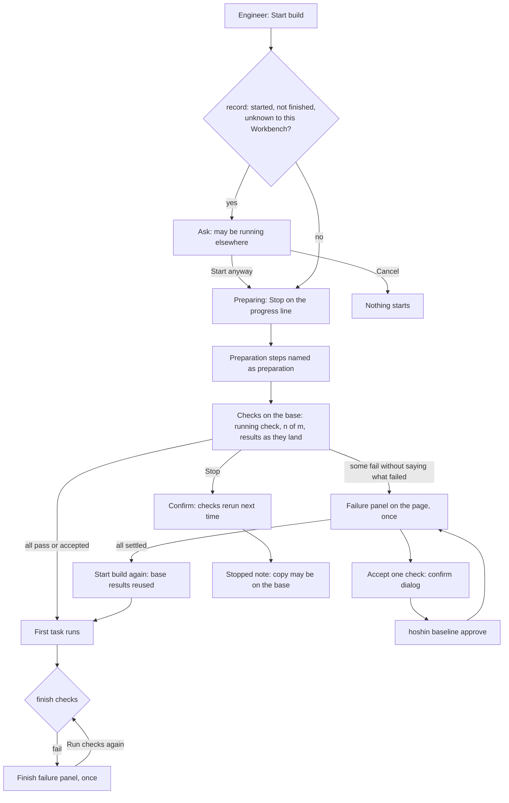

# Spec: Show and settle the build's checks in the Workbench

Policies: security (security-review), brand (kata-design), UX (house-style) and architecture (kata-architecture) were checked against this design. Compliance was not checked: `policies.md` lists no skill for it. The security-review skill reviews a diff; this change has no code yet, so its criteria were applied to the design below, with no finding. The context file `context/kata.md` is current (0 commits behind).

## Requirements

```gherkin
Feature: Show and settle the build's checks in the Workbench
  An engineer whose base has a known failing check goes from starting the build to the first task running without opening a terminal, and always sees which check is running and where the change stands now.

  Background:
    Given a change whose plan is accepted, in a system whose team has checks that run when a repository's build finishes
    And the engineer has the change's Build tab open in the Workbench

  @R1 @from:outcome-1
  Rule: While the build is being prepared, the way to stop it takes no more room than the progress itself

    @R1.1
    Scenario: Stop sits on the progress line
      When the engineer starts the build
      Then the page shows that the build is being prepared, with the step it is on
      And the way to stop the preparation sits on that same line, not on a row of its own

  @R2 @from:outcome-2 @from:D1
  Rule: While the checks run on the base, the page names the check running now, how many are done, and each result as it lands

    @R2.1
    Scenario: The running check is named, with a count and each finished result
      Given the workflow reports each check on the base as it starts and ends
      When the checks run on the base
      Then the page names the check running at that moment and how long it has run
      And it says how many of how many checks are done
      And each finished check shows whether it passed or failed, and how long it took, as soon as it ends
      And the checks not yet run are listed as waiting

    @R2.2
    Scenario: A short preparation step is named as preparation, not as a check
      Given the team has a step that runs when a build starts, such as installing packages
      When that step runs before the checks on the base
      Then the page names it as a preparation step, apart from the list of checks
      And it is never counted as one of the checks

    @R2.3
    Scenario: The workflow does not report each check yet
      Given the workflow on this machine does not report each check on the base as it starts and ends
      When the checks run on the base
      Then the page names the step, checking the base, and how long it has run
      And it lists the checks it will run, each marked as not reported
      And it does not say which check is running

  @R3 @from:outcome-3
  Rule: The first task starts when every check passes on the base, or each one that fails is already accepted for this build

    @R3.1
    Scenario Outline: The base checks decide whether the first task starts
      Given the checks on the base end with <result>
      When the workflow finishes preparing the build
      Then <what happens>

      Examples:
        | result                                                                          | what happens                                    |
        | every check passing                                                             | the first task starts                           |
        | a failing check that says what failed                                           | the first task starts                           |
        | a failing check that does not say what failed, already accepted for this build | the first task starts                           |
        | a failing check that does not say what failed, not accepted                     | the build stops and shows the failure (R4)      |

  @R4 @from:outcome-4 @from:D3
  Rule: When checks fail on the base without saying what failed, the build stops and the page shows them once, readably, each with its output on request

    @R4.1
    Scenario: One check fails on the base without saying what failed
      Given one check fails on the base and does not say what failed
      When the build stops
      Then the page shows, once and on the page itself, that the build did not start and which check failed on the base, with the base commit
      And it says why the check needs a decision: a failure already on the base cannot be told apart from a new one when the check does not say what failed
      And it offers, for that check, showing its output and accepting it for this build
      And it says how many other checks passed on the base, folded
      And no dialog repeats the failure

    @R4.2
    Scenario: The output of a failed check is readable on request
      Given a check failed on the base
      When the engineer asks to see its output
      Then its output shows in full as the workflow kept it, in a fixed-width face, in an area that scrolls rather than stretching the page
      And the page says how many lines it holds and that the workflow keeps the last lines only
      And the engineer can copy it

    @R4.3
    Scenario Outline: The page says how many checks failed together
      Given <count> checks fail on the base without saying what failed
      When the build stops
      Then the page lists each one by name with its own accept action
      And <setup hint>

      Examples:
        | count | setup hint                                                                                                              |
        | 1     | it shows no hint about the setup                                                                                        |
        | 2     | it shows no hint about the setup                                                                                        |
        | 3     | it says three failed at once, which usually means the setup is broken rather than the code, and to read one output first |
        | 9     | it says nine failed at once, which usually means the setup is broken rather than the code, and to read one output first  |

    @R4.4
    Scenario: The workflow kept the output of the first failing check only
      Given several checks fail on the base without saying what failed
      And the workflow on this machine reports the output of the first of them only
      When the engineer asks to see the output of another of them
      Then the page says the workflow on this machine does not report that check's output
      And the check can still be accepted

    @R4.5
    Scenario: The start fails for another reason than a check on the base
      Given the build start is refused, or a check could not run on the base, or a team step that runs when a build starts fails
      When the build stops
      Then the page shows the workflow's reason once, on the page, with the step or check it names and its output on request
      And it offers no accept action

  @R5 @from:outcome-4 @from:D3 @from:D5 @from:constraint-1 @from:constraint-2 @from:constraint-3
  Rule: The engineer accepts one failing check at a time for this build, from the Workbench, through the workflow, after confirming what it lets through

    @R5.1
    Scenario: Accepting a check asks once more and names what it lets through
      Given a check failed on the base without saying what failed
      When the engineer asks to accept it for this build
      Then the Workbench asks once more, naming the check and the base commit
      And it says that the check will not block this build at finish while the base commit stays the same, so a new failure in it would go through unseen
      And it says the check still runs and its result is still shown, and that accepting cannot be undone for this base commit

    @R5.2
    Scenario: Confirming records the acceptance with the workflow
      Given the engineer is asked to confirm accepting a check
      When the engineer confirms
      Then the workflow records the check as accepted for this change, this repository and this base commit
      And the check is marked accepted for this build on the page
      And when every failing check is accepted, the page says nothing is left to settle and that starting the build again reuses the base results

    @R5.3
    Scenario: Cancelling records nothing
      Given the engineer is asked to confirm accepting a check
      When the engineer cancels
      Then nothing is recorded and the check stays failed on the base

    @R5.4
    Scenario: There is no way to accept every check at once
      Given several checks fail on the base without saying what failed
      Then each has its own accept action, naming it
      And no action accepts more than one check

    @R5.5
    Scenario: Only checks that do not say what failed can be accepted
      Given a check that failed on the base and names its failures
      Then the page offers no accept action for it
      And the build does not stop for it: failures already on the base pass at finish and new ones block

    @R5.6
    Scenario: The workflow refuses an acceptance
      Given the engineer confirms accepting a check
      When the workflow refuses it, for example because the base commit moved since the checks ran
      Then the page shows the workflow's reason as it is
      And the check is not marked accepted

    @R5.7
    Scenario: The agent can never accept a check
      Given an agent run of this change is working
      When the agent tries to accept a failing check
      Then it is refused
      And only the engineer's own action in the Workbench records an acceptance

    @R5.8
    Scenario: An acceptance holds for one base commit on this machine only
      Given the engineer accepted a check for this build
      When the base commit changes, or the change is continued on another machine
      Then the acceptance does not apply and the check must be decided again

  @R6 @from:outcome-4
  Rule: Starting the build again after accepting reuses the base results and goes on to the first task

    @R6.1
    Scenario: The second start does not run the checks on the base again
      Given every check that failed on the base without saying what failed is accepted
      When the engineer starts the build again
      Then no check runs on the base again
      And the first task starts

    @R6.2
    Scenario: Starting is held back until every failing check is settled
      Given at least one check that failed on the base is not accepted
      Then starting the build is not offered as ready, and the page says to accept or fix the failing checks first

  @R7 @from:outcome-5 @from:D4 @from:D9
  Rule: A check that fails at build finish is shown the same way, once, and can be run again but never accepted

    @R7.1
    Scenario Outline: A failure at finish shows which check, why, and what happens next
      Given a repository's build finished and the check <check> failed at finish
      And on the base it <base result>
      When the engineer opens the Build tab
      Then the page shows once, on the page, that <check> failed at finish, why it blocks, its output on request, and that <next>
      And it offers running the checks again
      And it offers no accept action

      Examples:
        | check     | base result                               | next                                                         |
        | app-speed | passed                                    | the agent was sent back to fix it and did not get it to pass |
        | rust-test | passed                                    | the build stopped here                                       |
        | app-lint  | failed, naming failures this build added  | the agent was sent back to fix it and did not get it to pass |

    @R7.2
    Scenario: Running the checks again at finish
      Given a check failed at finish for a reason unrelated to the change
      When the engineer runs the checks again
      Then the checks run again on the change, with the running check named as in R2, and the run can be stopped
      And the base results are not touched
      And when every check passes, the repository counts as finished and the build goes on as it would after a passing finish

    @R7.3
    Scenario: The checks that passed at finish are folded
      Given a check failed at finish
      Then the page says how many other checks passed at finish, folded

  @R8 @from:outcome-6 @from:D7
  Rule: The change page always shows where the change stands now, read on opening, after any action and when the window regains focus

    @R8.1
    Scenario Outline: What the Build tab shows for a repository is read from the workflow's record, not remembered from earlier
      Given the workflow's latest record of starting the build for a repository is <last start>
      And the checks still needing acceptance at the current base commit are <still needing>
      And the repository's latest finish is <last finish>
      When the change page reads where the change stands
      Then the Build tab shows <shown>

      Examples:
        | last start                                         | still needing                     | last finish | shown                                                                 |
        | none                                               | not applicable                    | none        | no failure; the build can be started                                  |
        | stopped on checks failing on the base              | some                              | none        | the failure on the base (R4), with the accepted ones marked           |
        | stopped on checks failing on the base              | none, all accepted                | none        | the checks marked accepted and that nothing is left to settle         |
        | stopped on checks failing on the base              | unknown, the base commit moved    | none        | no failure; it says the base moved and the next start checks it again |
        | refused, or a check could not run, or a step failed | not applicable                    | none        | that reason once (R4.5)                                               |
        | started                                            | not applicable                    | none        | no failure; the build under way, with its tasks                       |
        | started                                            | not applicable                    | passed      | no failure; the repository finished                                   |
        | started                                            | not applicable                    | failed      | the failure at finish (R7)                                            |

    @R8.2
    Scenario: A failure the change no longer holds is cleared when the window regains focus
      Given the page shows that the build did not start because a check failed on the base
      And since then the check was accepted and the build started from a Claude Code session in the change's copy
      When the window regains focus
      Then the page reads where the change stands again
      And the earlier failure no longer shows
      And the page shows the build under way, started outside this Workbench

    @R8.3
    Scenario: The page reads again after any action and on opening, and does not watch continuously
      When the engineer opens the change page, or any action on it ends
      Then the page reads where the change stands
      And while nothing happens and the window keeps focus, the page does not read again on its own

  @R9 @from:D2
  Rule: When the workflow's record shows the build started and not finished, and no run of it is known to this Workbench, the page asks before starting another

    @R9.1
    Scenario Outline: Starting or continuing a build that may be running elsewhere
      Given the workflow's record shows the build of a repository <record>
      And this Workbench <known here>
      When the engineer starts or continues the build
      Then <what happens>

      Examples:
        | record                    | known here                                                     | what happens                                                                                             |
        | started and not finished  | has no live run of it and did not run it since it was opened   | it asks first, saying the build may be running in another session and that starting is safe if that session crashed or was closed |
        | started and not finished  | stopped it itself since it was opened                          | it starts without asking                                                                                 |
        | not started, or finished  | has no live run of it                                          | it starts without asking                                                                                 |

    @R9.2
    Scenario: The engineer confirms or declines starting anyway
      Given the Workbench asks whether to start a build that may be running elsewhere
      When the engineer confirms
      Then the build starts as usual
      But when the engineer declines, nothing starts

  @R10 @from:D8
  Rule: Stopping while the checks run on the base says first what is lost, then where things were left, and rolls nothing back

    @R10.1
    Scenario: Stopping asks first and says the checks run again next time
      Given the checks are running on the base
      When the engineer asks to stop
      Then the Workbench asks first, saying how many checks already ran when the workflow reports them, and that the next start runs every check on the base again because none is kept until the last one ends

    @R10.2
    Scenario: After stopping, the page says where the copy was left
      Given the engineer confirmed stopping while the checks ran on the base
      Then the preparation stops at once
      And the page says the copy may stay on the base commit until the build starts again, that the work is safe on the change's branch, and that the next start puts it back first
      And nothing is rolled back

    @R10.3
    Scenario: Keeping the checks running
      Given the Workbench asks whether to stop while the checks run on the base
      When the engineer declines
      Then the checks keep running and nothing changes

  @R11 @from:D9
  Rule: Accepting, long output, older builds and the fix-or-stop outcome follow the engineer's calls made here

    @R11.1
    Scenario Outline: Accepting a check while other work of the change is live
      Given <live work>
      When the engineer accepts a failing check
      Then <what happens>

      Examples:
        | live work                                                       | what happens                                                         |
        | no run of the change is live                                    | the acceptance is recorded                                           |
        | another repository's run of the same change is live             | the acceptance is recorded; it changes no file and stops no run      |
        | the build of this change is being prepared                      | the accept action is off, saying the build is being prepared         |

    @R11.2
    Scenario: A build started before this change shows its failure as before, once
      Given a build whose start failed before the workflow recorded base check results
      When the engineer opens the Build tab
      Then the page shows the workflow's reason once, on the page, as R4.5 does
      And it offers no accept action for it

  @R12 @from:D9
  Rule: Every part of the checks view can be reached and understood with the keyboard and a screen reader

    @R12.1
    Scenario: The progress is announced when the running check changes, not every second
      Given the checks are running on the base
      Then a screen reader hears the running check's name and the count when a check starts or ends
      And it does not hear the elapsed time tick

    @R12.2
    Scenario: Every action can be reached and named
      Then each show-output, accept, start, stop and run-again action can be reached with the keyboard
      And each one names the check or step it acts on to a screen reader
      And each confirmation is a titled dialog that Escape closes as a cancel
```

## Out of scope

- D6: checking the base again from the Workbench. A new base commit takes fresh results by itself; anything else stays a terminal step (`baseline retake`). The Workbench never offers it.
- D5: undoing an acceptance. hoshin cannot undo one.
- D1: the hoshin change that reports each check on the base as it starts and ends. It is a separate change in the hoshin repository; this change reads its reports when they come and does without them until then (R2.3).
- The open question on the timing check (app-speed) failing on a busy machine: fixing the check is a separate fix.

## Design

### Apps touched

The change touches the one app, `kata` (folder `.`): the `kata-sdlc` crate, the Workbench backend (`app/src-tauri`) and the Workbench frontend (`app/src`). The hoshin plugin is used as it is; its floor stays 1.0.0. No policy row names an app, so every row applies.

### Screens

The screens are prototyped in `design/prototype/build-checks.html` and `build-checks.js`, which the engineer adds to the change's branch before the plan (see area of concern 1). Each prototype screen maps to requirements: Checking the base (R1, R2.1, R2.2), Checking, hoshin not reporting (R2.3), Failed on the base (R4.1, R4.2, R5), Nine failed at once (R4.3), Stopped during the checks (R10.2), Already running elsewhere (R9), Failed at finish (R7), Moved on since (R8.2), First task running (R3, R6). Recreate in Angular, never copy.



**Preparing (R1, R2).** The Build strip shows the status pill, the progress line and a ghost Stop button on one line, replacing the padded row in `change-page.html` (lines 160 to 169). Below it, the Build tab's body shows two lists: Preparation (the team's `build.start` hooks) and Checks on the base, with the base commit, "n of m done", each check's result and time as it ends, the running one highlighted with its elapsed time, and the rest waiting. Without per-check reports (R2.3) the same list shows every check as "not reported" and the line names the step only. One wording for the step, owned by the backend: "Checking the base". Today the page says "Checking the base before building" and the backend "Checking every repository before building"; the backend's `StepKind::words` becomes the one owner. The usual time stays C144's eight and a half minutes.

**Failure on the base (R4, R5, R6).** The failure is a panel on the Build tab, never a dialog: the `build-refusal-dialog` stops being used for a build start. The panel has a status pill ("The build did not start"), a title ("1 check fails on the base and does not say what failed", or "n of m checks ..."), the one-line reason, the setup hint at three or more, one row per check (name, "failed on the base" or "accepted for this build" badge, exit code and base commit when known, Show output, Accept for this build…), and a folded count of the checks that passed. The output is a scrolling, fixed-width block with its line count, "the last 200 are kept" (hoshin keeps a 200-line tail) and a copy action. The panel never prints hoshin's `baseline approve` command; its Accept action replaces it. The Start build button stays visible and is off, with the reason, until nothing is left to settle. Dialogs carry confirmations only: accept (R5.1), stop (R10.1), and start anyway (R9).

**Finish failure (R7).** The same panel shape, reading the latest `build.finish` record: which check failed, whether it passed on the base or added failures, its output, and whether the agent was sent back to fix it or the build stopped (from the hook's `onFailure`), plus the folded count of checks that passed. Its one action is Run checks again.

### Where each decision is computed

Every rule above is computed in Rust and reaches the frontend as data through Tauri commands and ts-rs bindings; the ViewModels only fold, format and hold dialog state (kata-architecture section 1).

- **`kata_sdlc::checks_view`** grows the read for the Build tab. A new `start_checks` read returns, per repository in plan order (per app in the single-repo layout), a `StartChecks` value: the decision table of R8.1, computed from `Program::status` (the latest `build.start` and `build.finish` records, their `failed`, `problems`, `hooks` and `details.baseline`), `Program::baseline_show` (new: `baseline show --json`, giving `base`, `hooks`, `needsApproval` and `approved` at the current base commit) and `Program::hooks` (the checks and the preparation steps that apply). It carries the failing checks, each with whether it can be accepted (only those in `needsApproval`, R5.5), whether it is accepted, its output when hoshin gives one (R4.4: today only the first waiting check's, from `failed.output`), the count passed, the setup hint flag (three or more, R4.3), whether Start is held back and why (R6.2), and the finish failure (R7) built on the existing `CheckKind` rows. The frontend's `refusalOf` in `build-page.view-model.ts`, which words a failed start in TypeScript today, is removed: this read replaces it.
- **`kata_sdlc::hoshin`** gains `baseline_show` and `baseline_approve` on `Program`, both through the one door. `progress_of` reads a line's phase: `when: "build.start"` is a preparation step (R2.2), a base check line (the line shape the D1 hoshin change settles) is a check on the base, and a `build.finish` line is a finish check. `StepProgress` gains the phase so `progress_line` words them apart.
- **`app/src-tauri/src/build_host.rs`** holds the live list of R2.1 in the build's `BuildState`, so it survives the page (C38): each check's state, result and the time it started and ended, filled from the stream as `prepare` relays it. The page reads it; the elapsed time ticking on screen is formatting.
- **Accepting (R5).** A new command `sdlc_accept_base_check(change, repo, check)` runs `baseline approve --json --change --repo --hook` through `Program`, one check per call by design (R5.4 forbids a batch, so kata-architecture section 3 does not apply). It is refused while this change's build is being prepared (R11.1) and returns hoshin's answer: `approved` or its `problems`, shown as they are (R5.6). Then the page reads `start_checks` again. No agent can reach a Tauri command, and the plugin's guard refuses `baseline approve` from any agent session (C133), which covers R5.7.
- **Running the checks again at finish (R7.2).** A new workflow step, `sdlc_rerun_finish_checks(change, repo)`, runs `run build.finish --json --stream --again --repo <repo>` through the build host, as a stoppable workflow step with its progress line (C148). It takes the repository's hold like a build run (C114) and is refused while any run of the change is live. When it passes, the build host treats the repository as finished the way it does after a run whose finish passed, so the review starts by itself if this was the last repository (C42).
- **Running elsewhere (R9).** `kata_sdlc::offer` (the few live facts only the Workbench has) gains `may_be_running_elsewhere`: true when `status` shows a `build.start` that passed with no later `build.finish` for a repository the next start needs, and the build host has neither a live run nor a run it stopped for this change since the Workbench opened. The start and continue commands take an `even_if_elsewhere` flag; without it, such a start returns a new `StartOutcome::MayBeRunningElsewhere` naming the repositories and the record's time, which the page turns into the confirm dialog. The question and the start use the same Rust call (kata-architecture section 2).
- **Stopping (R10).** The stop confirmation reads the number of checks that ended from the live list (none when hoshin does not report them, R2.3: the dialog then says "the checks that ran"). The stopped note is the existing `StartOutcome::Stopped`, with the base-commit sentence added in the backend's wording.
- **Reading again (R8).** The change page reads `start_checks`, the change state and the check results on opening, after any action ends and on window focus, the same triggers the home uses (C136): a `window:focus` handler is added to the change page's ViewModel. The failure is no longer a signal kept in memory: the panel always shows the latest read, so a failure the record no longer holds disappears at the next read (R8.2).

### Data between the systems

The Workbench asks hoshin's program, as today, for `state`, `status`, `hooks`, and now `baseline show` (a quick read, never cached, C85) and `baseline approve` (a workflow write the engineer starts). `build.start` and `build.finish` stream their lines; the build host turns them into the live list. Nothing new is stored by Kata: acceptances and base results stay in hoshin's ledger and baseline store on this machine (constraint 4).

### Accessibility and security notes

The progress region is a polite live region whose text changes only when a check starts or ends (R12.1); elapsed time sits outside it. Every action is an `hlmBtn` named with its check, confirmations are `hlm-dialog`s with `hlmDialogTitle`, and Escape cancels. Check output is shown as text through Angular interpolation, never as HTML, so a check that prints markup cannot inject it. Output can hold whatever a check prints (paths, environment values); it is shown and copied locally only, as `checks_view` already does, and is sent nowhere.

### Visual rules

Status pills and badges use the andon palette with a label (running, passed, failed, accepted as warning), never the azure accent; Start build is the one primary action. Check names, base commit, exit codes and output are IBM Plex Mono. The lists are grid rows (name, description, time and status), the strip and dialog footers are flex runs. Stylesheets use tokens only. The build page must stay clean under `check:build`, `check:responsive`, `check:interaction`, `check:wiring` and `check:boot`; parity views of the build page change and need re-blessing with the owner's sign-off.

## How each constraint is met

| Constraint (from intent) | Met by |
|---|---|
| Only the engineer accepts a failing check; the agent never may. The Workbench does it through hoshin and never decides a workflow answer itself. | R5.1, R5.2, R5.7 |
| Accepting covers one check, for this change, at this base commit; a new base commit means deciding again. | R5.4, R5.8, R8.1 |
| Only a check that fails on the base without saying what failed needs accepting. | R3.1, R5.5 |
| Accepted checks and base results are kept on this machine only. | R5.8 |
| Which checks run, and when, stays the team's hoshin setting. | R2.1, R2.2 (the Workbench reads the team's hooks and changes none) |

## Decisions carried from the intent

| Decision | Requirement |
|---|---|
| D1 | R2.3 now; R2.1 once hoshin reports each check. The hoshin change itself is out of scope. |
| D2 | R9 |
| D3 | R4.3, R5.4 |
| D4 | R7 |
| D5 | R5.1, R5.3; no undo, out of scope |
| D6 | out of scope |
| D7 | R8 |
| D8 | R10 |
| D9 | R11, R12, R4.2, R7.1; engineer's call: accepting is allowed while another repository's run of the change is live and off while this change's build is being prepared; long output shows hoshin's 200-line tail in a scrolling block with a copy action; a build started before base results existed shows the workflow's reason once, with no accept action; a finish failure shows whether the agent was sent back to fix it or the build stopped; keyboard and screen-reader rules as R12. |

## Open questions from the intent

- The timing check (app-speed) fails on a busy machine: carried forward to the engineer as a separate fix; out of scope here.
- The hoshin change D1 depends on is not yet written: carried forward to the engineer, in the hoshin repository, and widened by area of concern 2.
- The screens are to be prototyped before the spec: answered. They are in `design/prototype/build-checks.html` and `build-checks.js`, mapped to requirements in the Design section, but not yet committed (area of concern 1).

## Areas of concern

1. **The prototype is not committed.** Owner: Maintainer. `design/prototype/build-checks.html` and `build-checks.js` exist only as untracked files in the change's copy. The spec points at them, so they must be committed to the change's branch before the plan is written, or a builder on another machine has nothing to recreate.
2. **hoshin 1.0.0 does not report every failing check's output.** Owner: Maintainer (the engineer, in the hoshin repository). hoshin stores each base check's output, but `baseline show` prints only `id`, `outcome` and `ids`, and a failed `build.start` carries the output of the first waiting check only. So with several failing checks (D3), outcome 4's "each one's output on request" holds for one of them only (R4.4). The D1 hoshin change should also print each hook's `output` and `exitCode` in `baseline show`. Until it ships, R4.4 is what the engineer sees. The product owner should confirm this partial result is acceptable for the first release.
3. **The shape of hoshin's per-check base reports is not settled.** Owner: Maintainer. R2.1 depends on the line the D1 hoshin change prints for a check on the base (today's `hook-start` and `hook-end` lines carry `when` but nothing marks a baseline run). The plan must take the line shape from that change's accepted spec; if it is not accepted before the plan, the plan builds R2.3 only and leaves R2.1 for a follow-up.
4. **Running elsewhere is inferred from the ledger, and asks after every restart.** Owner: Maintainer. A build this Workbench stopped, followed by a Workbench restart, looks the same as one running in another session, so R9 asks then too. The intent accepts this ("a crashed build leaves the same record"), but the engineer should know the question will appear after restarts. hoshin's `active-build.json` was not used, because Kata reads hoshin's records only through its program and `status` does not print it.
5. **Running the checks again at finish feeds the build coordinator.** Owner: Maintainer. R7.2 makes a passing rerun count as the repository's finish, which can start the automatic review (C42). That is a new entry into the coordinator (`kata_sdlc::coordinator`) and must keep C39, C56 and C114 intact; the plan should give it its own task with coordinator tests.
6. **The stopped note's sentence about the base commit is hoshin's behavior, stated by Kata.** Owner: Maintainer. Whether the copy is left on the base commit after a stop depends on where hoshin was in its baseline (a detached checkout of the base, restored on the next run). Kata cannot see that without reading hoshin's files, so R10.2 says "may stay"; the product owner should confirm that wording.
7. **Parity baselines change.** Owner: Maintainer. The build strip and Build tab change visibly (R1, R4, R7), so `check:parity` views of the build page need re-blessing with the owner's sign-off.
